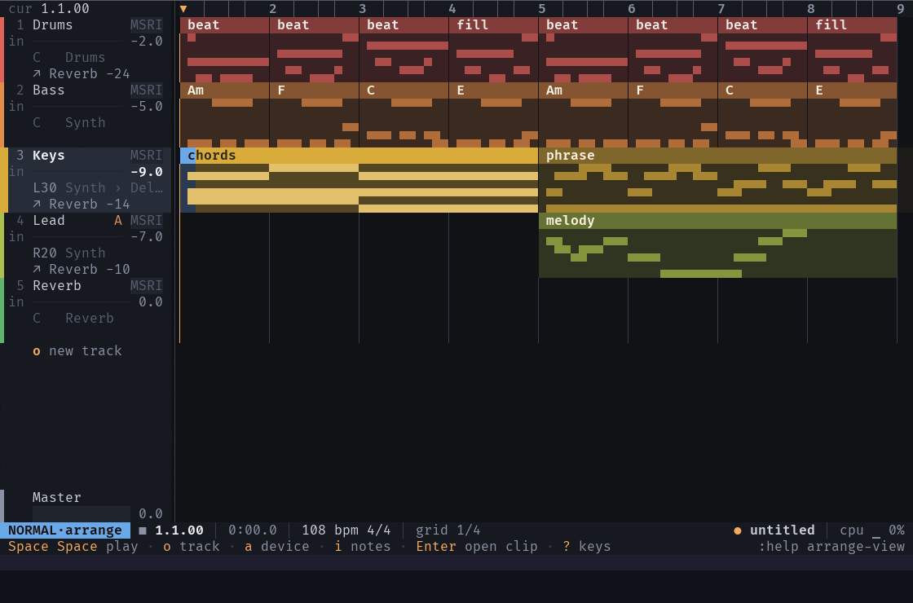
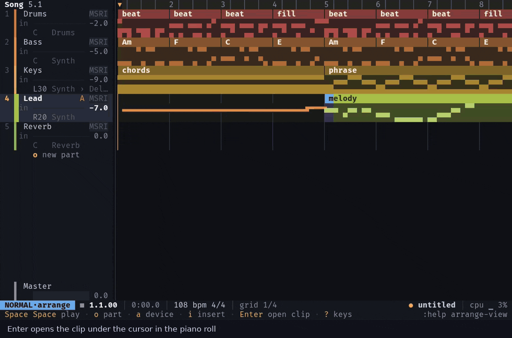
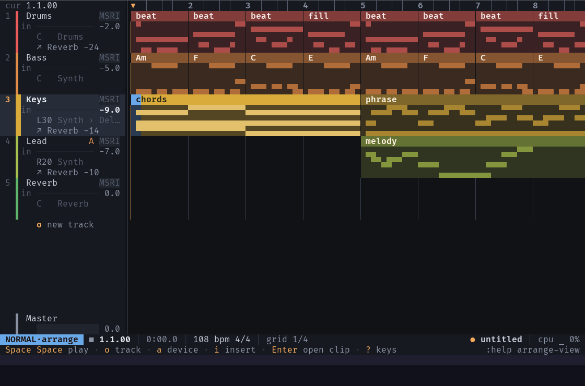
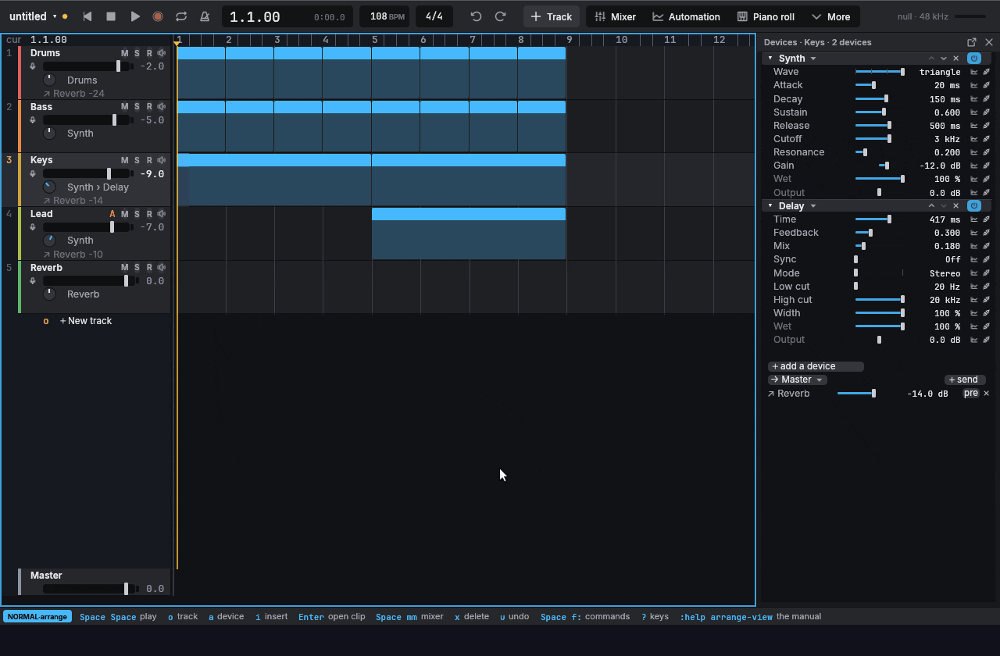
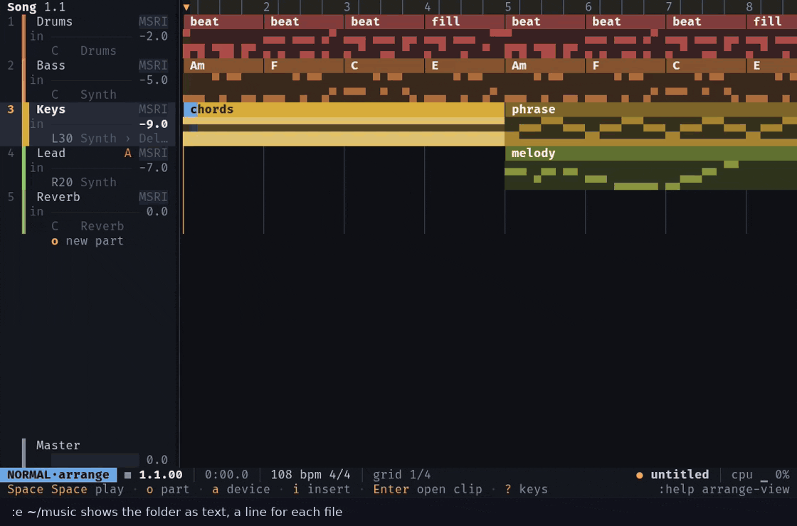
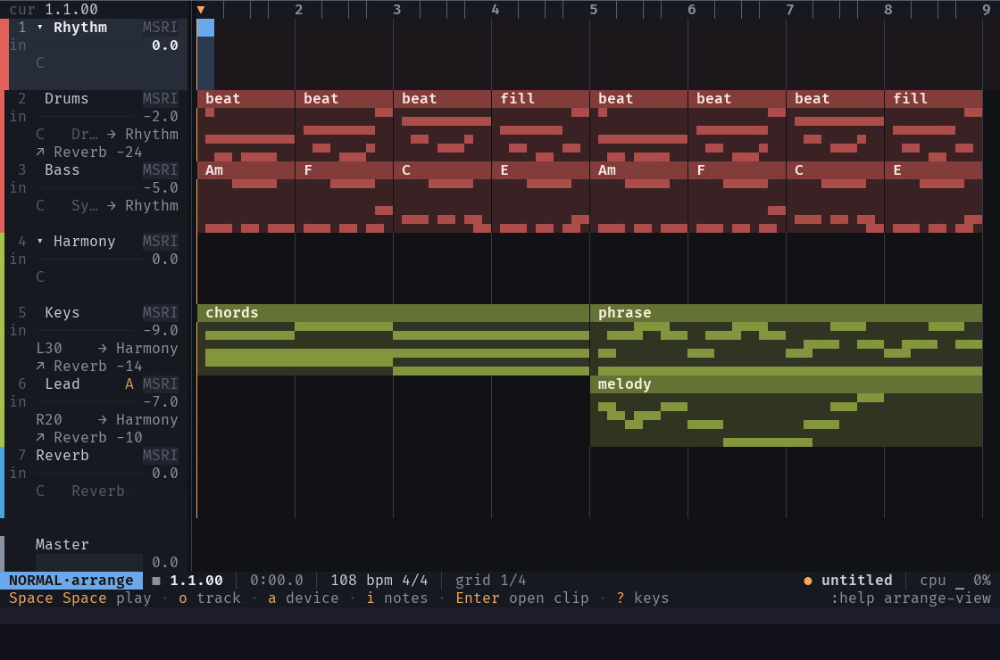
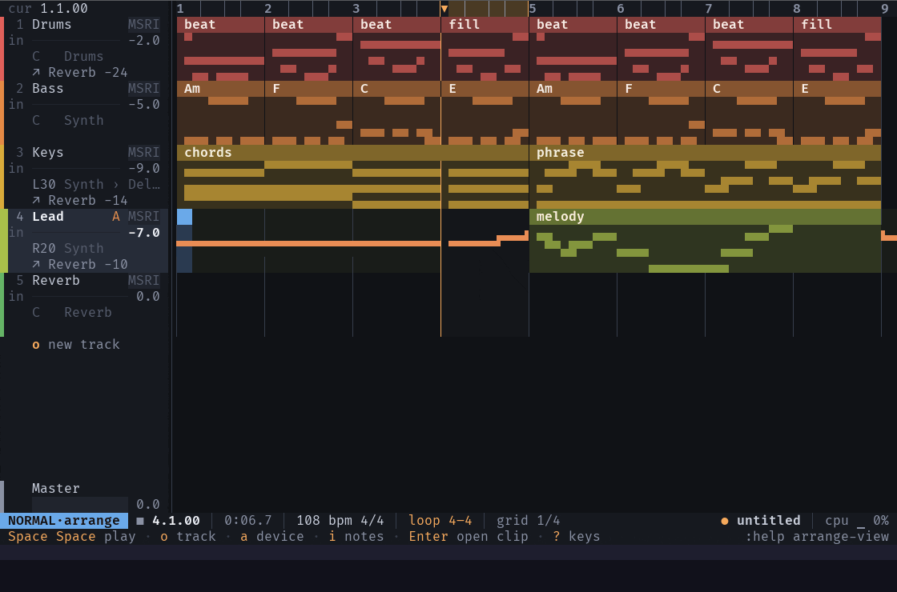
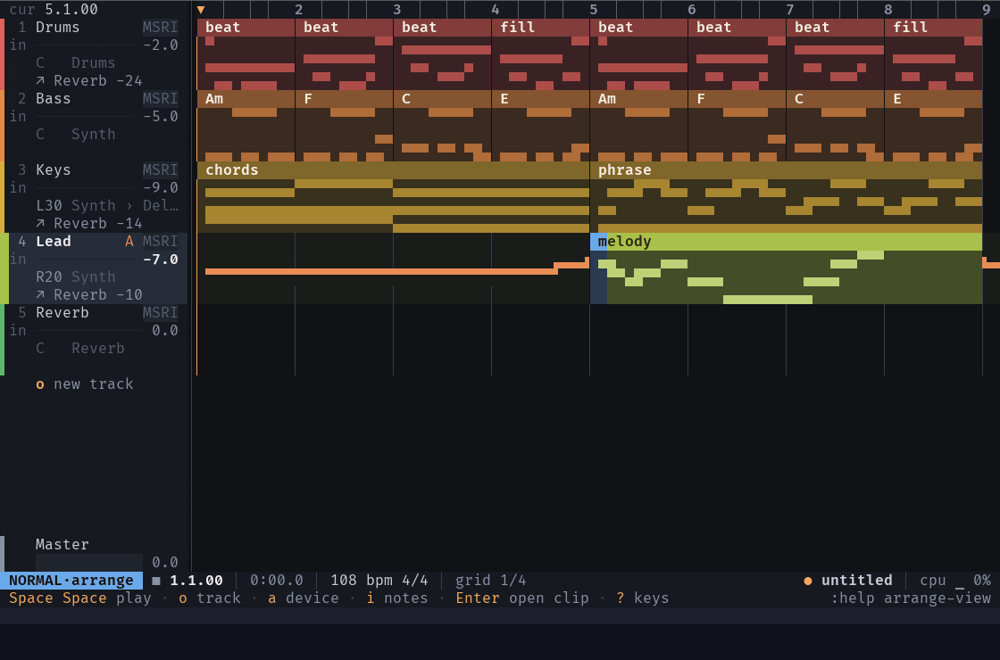
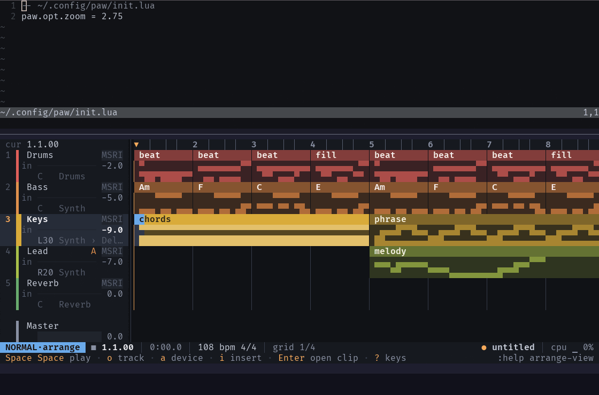

# paw

**A music workstation for Linux that you play from the keyboard, as Vim, and change in Lua.**

[](#license)




paw is a digital audio workstation (DAW) for terminal nerds, and for people
who spend more time in their config files than in the program. You
record, edit, mix and render songs in the terminal, with motions,
operators, counts, `.` and Ex commands. The same views also open in a
[graphical window](crates/paw-gui/README.md) for the mouse. Each view,
command and key is Lua, and your `init.lua` can change all of them while
the song plays.

```sh
git clone https://github.com/AlejandroGomezFrieiro/custom_daw paw && cd paw
nix run . -- -e 'dofile("examples/demo-song.lua")'
```

## Try it

You need Linux and [Nix](https://nixos.org/download/) with flakes enabled
(`experimental-features = nix-command flakes` in `nix.conf`). The first run
builds paw from source. This takes several minutes.

1. Run the two commands above. They get the source and start paw with the
   demo song. The arrange view shows the song, with one row for each track.
2. Press `Space`. The song plays and the playhead moves to the right.
3. Press `Space` again to stop the song.
4. Press `?`. A list shows each key of the current view. Press `Esc` to close it.
5. Type `:tutor` and press `Enter`. The first of seventeen short lessons starts.
6. Type `:q` and press `Enter` to quit.

Then [make your first song](docs/tutorials/make-music/README.md) in five
lessons. To install paw, see [How to install paw](docs/how-to/install-paw.md).
If you hear no sound, run `nix run . -- doctor`. The doctor examines your
sound devices, MIDI ports and plugins.

> [!NOTE]
> paw is a **personal project and it is not complete**. One person made it
> for their own music. It runs on Linux (PipeWire, ALSA or JACK) and hosts
> CLAP, LV2 and VST3 plugins. paw has more than 1,600 end-to-end tests in
> Lua and 700 tests in Rust. Most of them use stand-ins, not real hardware.
> paw can change without notice. See
> [what paw does not do](docs/reference/limits.md).

## Is paw for you?

paw is for musicians who keep their tools in a configuration that they
write.

| If you want | Look at |
| --- | --- |
| A modal DAW in the terminal for the keyboard, which you can script and change | **paw** |
| A mature DAW on each platform, with many settings | [REAPER](https://www.reaper.fm) |
| A mature open-source DAW to record and mix on Linux | [Ardour](https://ardour.org) |
| Sound design, modulation and performance | [Bitwig Studio](https://www.bitwig.com), [Ableton Live](https://www.ableton.com) |
| A tracker for composition from the keyboard | [Renoise](https://www.renoise.com) |
| Scores to print first, playback second | [MuseScore](https://musescore.org), [Dorico](https://www.steinberg.net/dorico/) |

paw is newer and smaller than all of them. Select it for the way it works,
not for the length of its list of features.

## What you can do

- **Write and edit.** MIDI and audio clips, a piano roll, take lanes and
  comps, time stretch, a tempo map, and an undo tree that keeps each
  branch. Each note can have an articulation. See
  [Edit notes](docs/how-to/edit-notes.md).
- **Record.** Audio and MIDI, loop recording into takes, punch in and out,
  and a count-in. See [Record a guitar or a bass](docs/how-to/record-a-guitar-or-a-bass.md).
- **Mix.** Groups, sends, side-chains, automation and controller learn. A
  synth, a drum kit, effects, a sample player, and your plugins, each in a
  process of its own. See [Set levels and pan](docs/how-to/set-levels-and-pan.md).
- **Render and share.** WAV, FLAC, MP3 (through ffmpeg) and stems, in the
  background. MIDI files, and with extensions REAPER projects and
  DAWproject files. See
  [Export a song](docs/how-to/export-a-song.md).
- **Find.** Pickers with previews that you can hear, `:vimgrep` into the
  quickfix list, and queries (`:select clip[name~=pizz] > note[pitch>=C5]`).
  See [Search the project](docs/how-to/search-the-project.md).
- **Keep your work as text.** A project is a folder of text files that you
  can read: a file for each track and for each clip. `:Pdiff` and the git
  drivers compare and merge projects. See
  [Save and open projects](docs/how-to/save-and-open-projects.md).

## A tour

The keys work as in Vim, but on a timeline and not on a text. One rule
applies in each view: `h` `j` `k` `l` only move, `+` and `-` change the
value under the cursor, and `Esc` cancels.
[All the keys](docs/reference/keys.md) are on one page.



A line of the command line is a bar, and a range can be a range of tracks
(`:5,8d`, `:t2,t4 mute`, `:%s/c4/d4/gc`). paw shows a preview while you
type:


The mixer and the device picker are views like the other views. A picker
plays each item before you select it:



The same views open in the graphical window, for the mouse:



<details>
<summary>More: lists as text, find, files, large projects, record, help, configuration</summary>


![The clips picker shows the melody beside the list. Then the notes picker. Then :vimgrep puts four clips in the quickfix list, and ]q moves through them](docs/images/tui-pickers.gif)











</details>

## Make it yours

Your configuration is Lua in `~/.config/paw/init.lua`. `:reload` applies
it, and the sound does not stop:

```lua
paw.ui.hl("Playhead", { bg = "#f38ba8" })
paw.keymap.set("<leader>T", "track.add Strings device=synth", { desc = "A strings track" })
```

[config/init.lua](config/init.lua) is an example to start from. See
[How to configure paw](docs/how-to/configure-paw.md).

An extension is a folder of Lua that adds commands, keys, views, devices and
kinds of track, and `:ext.unload` removes all of it. A view that an
extension writes works in the terminal and in the graphical window. The
extensions that come with paw write scores and tablature, and program
drums. They play SFZ libraries with an articulation for each note, make
vocal tracks sing and launch clips live. They also open and write REAPER
and DAWproject files, and check your sound card. [Extensions](docs/reference/extensions.md) lists all
of them, and [How to load an extension](docs/how-to/load-an-extension.md)
tells how to turn one on. Scripts, the socket
(`paw ctl`) and AI agents also control paw, through the same Lua. See
[How to drive paw from an agent](docs/how-to/drive-paw-from-an-agent.md).

## Documentation

[The manual](docs/README.md) starts with a short list of pages for a new
user. It has tutorials, how-to guides, reference pages and explanations.
In paw, `:help` shows the same pages.

## Contribute

paw is a personal project for the taste of one person, and it changes at
its own speed. Send bug reports, questions and ideas as GitHub issues.
Before a pull request that is larger than a small fix, open an issue.

- [AGENTS.md](AGENTS.md) gives the rules for code and for documentation.
- [The source tree](docs/reference/source-tree.md) tells what each folder
  and crate holds.
- [How to run the tests](docs/how-to/run-the-tests.md) gives the commands.
  The tests use a null audio backend and a private X display.

paw takes ideas from [Neovim](https://neovim.io),
[oil.nvim](https://github.com/stevearc/oil.nvim), [pi](https://pi.dev) and
[REAPER](https://www.reaper.fm). The Vim modes for REAPER showed that keys
can control a DAW: [reaper-keys](https://github.com/gwatcha/reaper-keys),
[vimper](https://github.com/ggVGc/vimper),
[reavim-ext](https://github.com/AntoineBalaine/reavim-ext) and
[ReaLeader](https://github.com/SV3A/ReaLeader). Music in the terminal is
older than paw. [Ecasound](https://ecasound.seul.org) and
[Nama](https://metacpan.org/pod/Nama) record, edit and mix from a command
line. [Orca-c](https://github.com/hundredrabbits/Orca-c) is a grid that you program
live in the terminal. The trackers and sequencers
[terminal-tracker](https://github.com/2bt/terminal-tracker),
[PLEBTracker](https://github.com/danfrz/PLEBTracker),
[teqqer](https://github.com/fps/teqqer) and
[cquencer](https://github.com/dnewcome/cquencer) run in ncurses. Other
DAWs also run in a terminal: [Phosphor](https://github.com/joshjetson/phosphor),
[SHR-DAW](https://github.com/PaolaShultz/shr-daw) for a Raspberry Pi, and
the terminal interface of [daw-ai](https://github.com/hrubiian/daw-ai). Other ideas come from
[Ardour](https://ardour.org), [Bitwig Studio](https://www.bitwig.com),
[Renoise](https://www.renoise.com), [Dorico](https://www.steinberg.net/dorico/),
[MuseScore](https://musescore.org) and [TidalCycles](https://tidalcycles.org).

## License

You can use paw under the [MIT](LICENSE-MIT) license or under the
[Apache-2.0](LICENSE-APACHE) license. Unless you state a different license,
each contribution that you send for inclusion has the same two licenses,
with no other terms or conditions.
