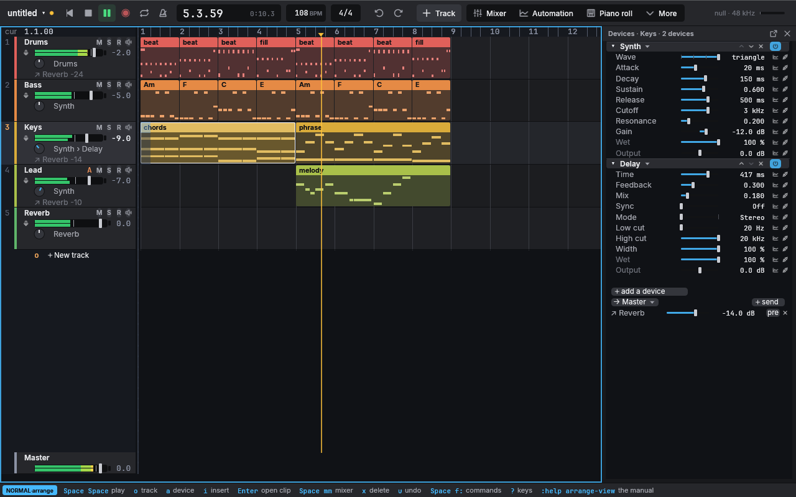
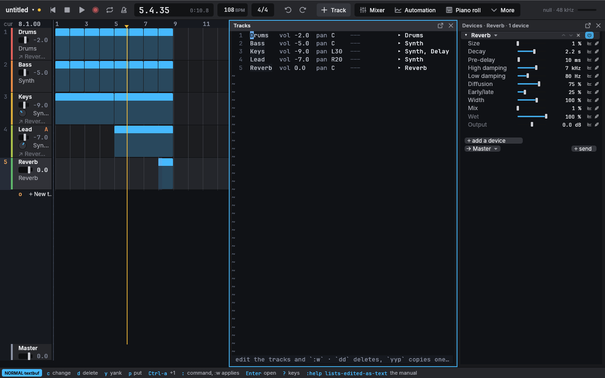
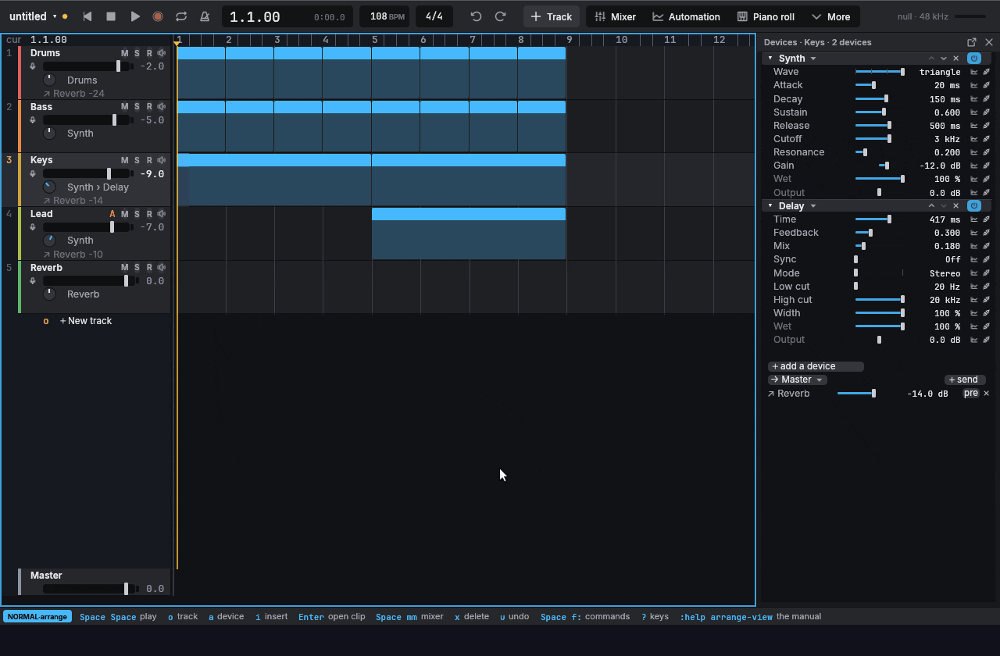
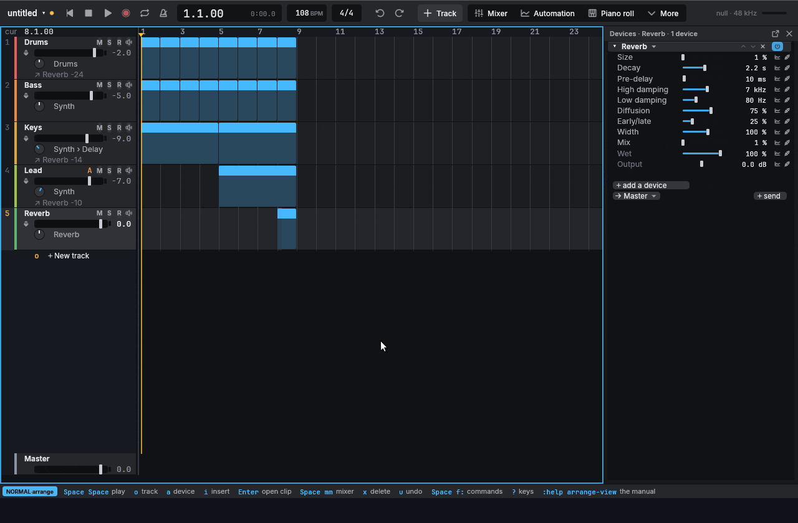
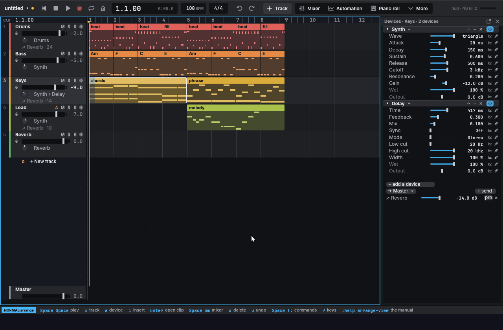

# paw-gui: the graphical window

`paw-gui` is the graphical window of paw, for work with the mouse. It shows
the views of the terminal as panes in a window, with faders to drag, clips
to move and notes to draw. It is written in Rust with
[egui](https://github.com/emilk/egui) (eframe, OpenGL through glow). paw
puts the terminal first, so the window is a second frontend for the same
project, and everything in it also works from the keyboard.



## Try it

```sh
nix run .#paw-gui -- -e 'dofile("examples/demo-song.lua")'
```

The window starts a kernel of its own with the demo song. Press `Space` two
times to play the song, and then drag a clip on the timeline and press `u`
to undo the move.









## How to

- [How to run the graphical window against a kernel on another machine](../../docs/how-to/run-the-window-against-a-remote-kernel.md)
- [How to run the graphical window without a graphics card](../../docs/how-to/run-the-window-without-a-graphics-card.md)
- [How to give an extension an editor in the graphical window](../../docs/how-to/add-an-editor-to-the-window.md)

## Reference

- [The graphical window](../../docs/reference/window.md): the command line, each gesture, the panes, views in windows of their own, the renderer, the fonts, the layout file.
- [The graphical window in Lua](../../docs/reference/window-lua.md): `paw.frontend.act`, menus, bands, panes, views that paint.
- [The control protocol](../../docs/reference/protocol.md): the messages between the window and the kernel, scenes included.

## Tests and licenses

`cargo test --release -p paw-gui` runs the egui tests in the process
(`egui_kittest`), and it controls the running window on a private X display.

egui, eframe, winit and the other crates have MIT or Apache-2.0 licenses.
The fonts in the program have the SIL Open Font License, and the Phosphor
icons have the MIT license (see `fonts/`).

## About

- [About scenes: one view, two frontends](../../docs/explanation/about-scenes.md): why the window has no views of its own, and how the kernel sends it what to draw.
