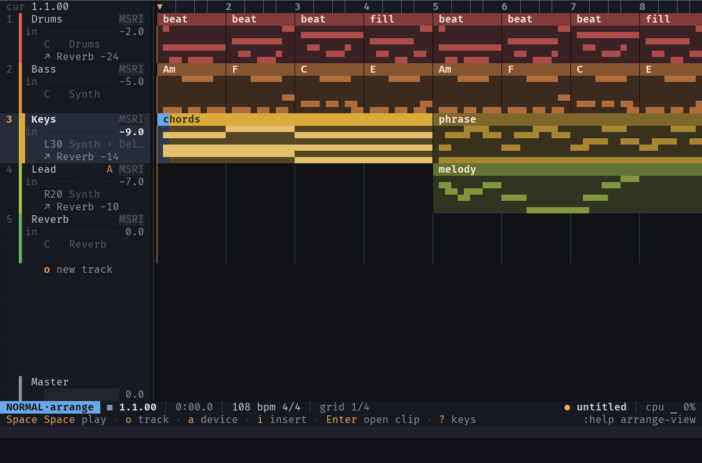

# doctor: a guided check of the real hardware

The doctor checks the real hardware, which means the audio device, MIDI
input, recording and plugins. It runs a list of checks, and for each check
you start it, watch or listen, and answer ("heard it", "did not", skip), or
the check measures by itself. At the end, the doctor writes a report in
Markdown, with the facts of the machine at the top, and when an earlier
report exists, the report also shows what changed.

```lua
paw.ext.load("/path/to/paw/extensions/doctor")   -- config/init.lua has this line
```



## Try it

1. Type `:ext.load doctor`, then `:doctor`. A page with the list of checks
   opens.
2. Press `k` until the cursor is on the first check, "The sound system".
3. Press Enter. The check runs, and its result shows beside its name.
4. Press `o`. The message gives the path of the report.
5. Press `q`. The page closes.

## How to

### How to check all the hardware

1. Connect the audio interface, the MIDI controller and the speakers or
   headphones.
2. Type `:doctor all`.
3. Answer each question with the key shown under it. To skip a check,
   press `s`.
4. At the end, the doctor writes the report. Type `:doctor report` to see
   its path.

Warning: turn the volume down before check 4, Round trip latency, because
its clicks are loud through a microphone and speakers.

### How to run the checks from the shell

1. Type `paw doctor` in a shell. It runs the checks that need no person and
   prints the report.
2. To run some checks only, add `--only system,plugins`.

`paw doctor` does not need the extension loaded, because it finds the
extension in the source tree beside the binary, or in `$PAW_HOME`.

### How to keep the latency that the doctor measured

1. Run check 4, Round trip latency, and accept the offset.
2. Copy the line that the report gives into your `init.lua`.

The doctor sets the offset only for the session.

### How to check a plugin

1. Set `paw.opt.doctor_plugins` to a part of the name of the plugin, for
   example `{ "MT-PowerDrumKit" }`. Or give `--plugin MT-PowerDrumKit` to
   `paw doctor`.
2. Run check 8, Plugins.
3. If the plugin is silent, accept the offer to open its editor. Some
   instruments need to be opened once before they make sound.

### How to add a check

1. After the doctor loads, add a table to `require("doctor").checks`, in
   your `init.lua` or in an extension:

   ```lua
   table.insert(require("doctor").checks, {
     name = "Footswitch",                       -- shown in the list and the report
     help = "Press the footswitch once.",       -- what it needs from the person
     unattended = false,                        -- true if it can run with nobody there
     limit = 60,                                -- seconds before it is stopped (120 by default)
     run = function(ctx)
       local pressed = false
       local handler = paw.on("midi.in", function(e) if e.type == "cc" and e.number == 64 then pressed = true end end)
       ctx:cleanup(function() paw.off(handler) end)
       ctx:ask("Press the footswitch.", { { "s", "skip" } }, { timeout = 15, done = function() return pressed end, default = "timeout" })
       if not pressed then return "fail", "no pedal message arrived" end
       ctx:fact("pedal", "sustain")
       return "ok", "the footswitch sends sustain"
     end,
   })
   ```

2. In `run`, wait only with the functions of `ctx`. Do not write a loop
   that does not yield.
3. Type `:doctor` and run the new check.

## Reference

### Commands

| Command | Effect |
| --- | --- |
| `:doctor` | opens the page: the checks, the result of each, the current question |
| `:doctor all` | runs every check |
| `:doctor input` | runs one check, by name or number |
| `:doctor unattended` | runs the checks that need no person |
| `:doctor stop` | stops a run, removes what it made, writes the report |
| `:doctor report` | the path of the last report |
| `:doctor.close` | closes the page, and stops a run |
| `paw doctor` | from the shell: the checks that need no person. The report goes to standard output |

<!-- tags: :doctor -->

The page floats over the terminal. In the graphical window, paw draws the
same page in pixels, with buttons for the keys and a button for each
answer.

### Keys

| Key on the page | Effect |
| --- | --- |
| `j` `k` | moves the cursor between the checks |
| `<CR>` | runs the check under the cursor |
| `A` | runs every check |
| `u` | runs the checks that need no person |
| `y` `n` `s` `w` `r` `l` `b` `a` `d` | answer the current question. The page lists the keys under it. `s` also skips the current check |
| `o` | shows the path of the report |
| `<Esc>` | stops the run. The page stays |
| `q` | closes the page |

### Checks

| Check | What you do | With no person |
| --- | --- | --- |
| 1. The sound system | nothing | runs |
| 2. Output | listen to a soft tone (-18 dB), one second on the left, on the right and on both. Tell if and where you heard it, or play it again | does not run |
| 3. Input levels | play or speak into each input. The page shows the level of each channel, and keeps the highest level. Press `d` at the end. The page names a channel that stayed silent | listens for three seconds |
| 4. Round trip latency | connect an output to an input with a cable, or let a microphone hear the speakers. Answer yes. The doctor plays and records three clicks, measures the median delay, and offers the recording offset (`paw.transport.record_offset`) | does not run |
| 5. Dropouts | nothing. A song of many synth voices plays for twenty seconds (`paw.opt.doctor_seconds`). Then it plays again while paw reads a long sound file from the disk. The report gives xruns, late plugin blocks, the CPU load and the time of a block for both | runs |
| 6. MIDI input | press a key, then move a knob or a fader, within twenty seconds each. The doctor records the port, the channel, the note and the controller | lists the ports |
| 7. Recording | play or speak for four seconds while a part records from the first input (the first pair, if there are two). The doctor plays the take back and shows its peak. Tell if you heard it | records, and tells if the take is silent |
| 8. Plugins | nothing, unless a plugin that you named is silent. Then the doctor offers to open its editor | runs |
| 9. The environment | nothing | runs |

- Each wait has a limit, and each question has a timeout. A question with
  no answer is a skip.
- A check that raises an error fails, with the error. The run continues.

### What each check reads

1. The sound system reads the backend, the output and the input, all the
   devices found (`paw.audio.devices()`), the sample rate, the block, and the
   latencies (`paw.api.engine_get()`). It warns about the following problems:
   - a Bluetooth output (high latency, and headphones that are the
     default of the system get all the sound)
   - an output latency over 80 ms
   - an interface that is connected but is not the output
   - a device with a sample rate that is not the rate of paw
   - a block over 25 ms
   - no open input
   - the null backend
2. Output plays a tone made for the check, from a part of its own.
3. Input levels reads `paw.audio.levels()`, sampled every few hundredths of a
   second. Below -60 dBFS is silent, and a channel that reached full scale
   gets a warning.
4. Round trip latency plays a click from a part, and a muted part armed
   on the first input records. The doctor finds the click in the take. It
   subtracts what paw already removes from a take (the latency that the
   audio system reports, plus the offset), and if you accept, it adds the
   rest to the offset. It tells a tone or a noise from before the click, and
   silence, from a loop-back.
5. Dropouts reads `xruns`, `late_blocks`, dropped MIDI events and the CPU
   load from `paw.api.engine_get()`, with `engine_reset_stats` before each
   run. The long file is a quiet tone, long enough that its decoded sound
   is past `paw.opt.media_stream`. `paw.media.list()` tells if paw read it
   from the disk. The decoded copy stays in `~/.cache/paw/media`, inside
   the limit of the cache.
6. MIDI input reads the ports from `paw.midi.inputs()`, and the `midi.in`
   events, which name their port.
7. Recording reads back the file of the take, for its peak on each
   channel, its length and its format.
8. Plugins counts the plugins of each format, and lists the files that
   the scan could not use (the log lines "plugin scan: …"). For each part
   of a name in `paw.opt.doctor_plugins` (`{ "MT-PowerDrumKit", "Ugritone"
   }`), the doctor loads a plugin with that name on a part and sends it
   five notes. A drum plugin plays kick, snare, hat and more. The meter of
   the part tells if sound came out.

   You name Windows plugins through yabridge in the same way. The report
   names a plugin that does not start, is not installed or is silent. Some
   plugins need their editor opened once (`ge` on the part).
9. The environment reads the following:
   - `DISPLAY`, `WAYLAND_DISPLAY` and `XAUTHORITY` as paw sees them, after
     it corrects an old display name
   - the sockets and the authority file
   - the free space for recordings
   - `ffmpeg` and `gdi2m` on the `PATH`
   - the version of the kernel, `paw.api.limit_async` and the threads of
     the engine

### Your project during a run

- When a check first needs parts, the doctor puts your project aside as a
  whole (`paw.api.project_shelve`). This includes its undo tree, its
  transport and its changed flag. An empty scratch project opens.
- When the run ends, the scratch project closes. Your project returns as
  it was, with the playhead at the same place.
- The checks that only read (1, 3, 6, 9, and 8 with no plugin named) do not
  put the project aside.
- While your project is aside, a copy is in `doctor/open-project.json` in
  the state directory. paw removes it when your project returns. If paw
  stops in that time, that file is your project: open it with `:edit`.
- Autosave is off during the run, and on again after it.
- Plugins on your parts stop while the project is aside, and start again
  when it returns.
- A check removes all that it added when it ends, also when you cancel it
  or when it fails: its parts, its files, its take.

### The report

The report is `<state directory>/doctor/<year-month-day-time>.md`, and
`paw.opt.doctor_dir` names another folder. A `.json` file beside it holds
the same data, for the next report.

- At the top are the facts of the machine: the program, the kernel, the
  system, the processor, the memory and the sound system. Then the
  devices, the rate, the block, the display and the configuration.
- Then a table of the checks, and a section for each check.
- Under "Changed since the report of …": the facts of the machine and the
  results of each check that are different from the last report. For
  example, a device that is gone, a different rate, a plugin that is now
  silent.
- Measurements that are never the same two times (peaks, CPU, latency) are
  in the report, but the doctor does not compare them.

### `paw doctor`

| Option | Effect |
| --- | --- |
| `--seconds 20` | the length of the dropout runs |
| `--plugin MT-PowerDrumKit` | a plugin to check. You can give it more than one time. Default: `paw.opt.doctor_plugins` |
| `--only system,plugins` | the checks to run |
| `--audio`, `--output`, `--input`, `--buffer`, `--rate` | the audio options of paw |

`paw doctor` opens the sound device, and makes sound while it runs. Other
scripts get the null backend. The exit status is 1 if a check failed.

### The context of a check

`run(ctx)` returns `"ok"`, `"warn"`, `"fail"` or `"skip"`, and a sentence.
It runs in a coroutine that a timer wakes.

| `ctx:` | Effect |
| --- | --- |
| `say(text)` | a line on the page while the check works |
| `log(text)`, `warn(text)` | a line for the report. A warning changes "ok" to "warn" |
| `fact(key, value)` | a result, compared with the last report |
| `measure(key, value)` | a result, not compared |
| `sleep(ms)` | waits |
| `wait_for(fn, ms)` | waits until `fn()` is true. Returns true or false |
| `ask(question, choices, opts)` | asks for a key: `{ { "y", "yes" }, ... }`. Returns the key, `"skip"` when there is no person, `opts.default` at the timeout, or `"done"` when `opts.done()` is true. paw calls `opts.each()` while it waits |
| `part(opts)` | a part in the scratch project. paw removes it when the check ends |
| `file(path)`, `dir()` | a file to delete, a directory of the run |
| `cleanup(fn)` | runs `fn` when the check ends, in all cases |
| `play(beat, seconds)`, `stop()` | plays the scratch project, stops it |
| `attended()` | true when a person is there |

An error in a check ends it as failed. A `pcall` in a check must raise
again an error that is a table. The doctor uses such an error to end a
check that you cancel or that times out.

### Events

| Event | Payload | When |
| --- | --- | --- |
| `doctor.done` | `{ report, problem }` | a run ended. `report` is the path of the report, `problem` what went wrong, or nil |

### Limits

The doctor ran on the null backend only. There, a test input gives two
channels of tone, and `paw.midi.inject` acts as a controller. The doctor
also has paths for real hardware (a Bluetooth output, a UR22mkII, the
latency of PipeWire, a loop-back cable, real plugin windows), and those paths
come from the reports of the program. They did not run against the devices.

## About

Most of paw was tried against substitutes: the null audio backend, MIDI
that a test sends, plugins in a test set. The doctor is for the real
hardware, where a person must listen.

A check needs parts, clips and recordings of its own. The doctor does not
add them to your project and remove them after, because that would leave
steps in the undo history and move things. Instead, it puts your project
aside as a whole. Autosave is off for the run, because a safety copy of the
scratch project would replace the copy of your project.
