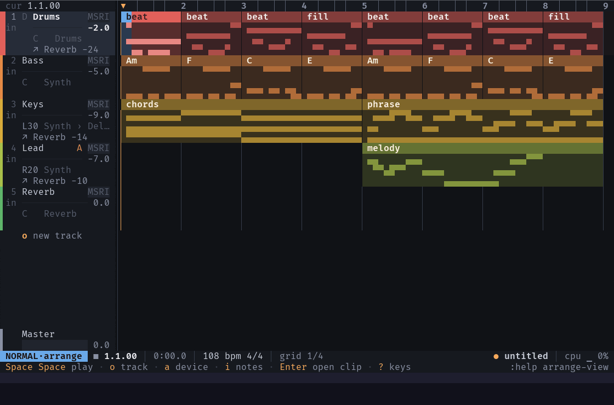

# drums

A drum track in one step, and a grid to program it. The rows of the grid
are the pieces of the kit, by name. The grid is one view, in the terminal
and in the graphical window.

```lua
paw.ext.load("/path/to/paw/extensions/drums")
```



## Try it

1. Type `:ext.load drums`.
2. Press `\kn`. A new drum track appears below the cursor track, and its
   clip opens in the grid.
3. Type `/snare` and press Enter. The cursor goes to the row of the snare.
4. Press `l` four times, then Enter. A hit appears on the second beat, and
   you hear the snare.
5. Press `&`. The bar repeats to the end of the clip.

`extensions/drums/demo.lua` is a song for more practice:
`paw -e 'dofile("extensions/drums/demo.lua")'`.

## How to

### How to make a drum track

- Press `\kn`, or type `:drums.track Drums bars=2`. The new track has the
  built-in `drums` kit and the General MIDI map.
- To play a folder of samples, type `:drums.track Drums kit=~/samples/808`.

### How to use a drum plugin

1. Put the plugin on a track.
2. Type the map of the plugin:
   - For MT-PowerDrumKit 2, type `:drums.map mt-powerdrumkit`.
   - For a kit with the General MIDI map, type `:drums.map gm-kit` (with
     toms and two crashes), or `:drums.map gm`.

The clips of the track now open in the grid.

### How to play a folder of samples

1. Put the cursor on the drum track.
2. Type `:drums.kit ~/samples/808`.

The grid names its rows after the files. To change one sample, put the
cursor on its row and type `:drums.pad level=-3 pan=0.2`.

### How to start from a beat

1. Open the clip in the grid.
2. Press `gb` and choose a beat. The beat replaces the notes of the clip.

### How to add a map of your own

1. Add the map to `require("drums").maps` in your `init.lua`:

   ```lua
   local maps = require("drums").maps
   maps.mykit = { label = "My kit", rows = { { note = 36, name = "Kick" }, { note = "E2", name = "Snare" } } }
   maps.gm.rows[2].name = "Snare (top)"
   paw.opt.drums_map = "mykit"          -- the map of new drum tracks
   ```

2. Type `:drums.map mykit` on a track.

### In the graphical window

- Right-click the timeline and choose **New drum track**.
- In the menu of a track header, choose **Drum map…**.
- In the menu of a clip, choose **Open in the drum grid** or **Drum beat to
  start from…**.
- Double-click a clip of a drum track to open it in the grid.

## Reference

### Commands

| Command | Keys | Effect |
| --- | --- | --- |
| `drums.track [name] [map=] [kit=] [bars=]` | `\kn` | makes a track below the cursor track, with the built-in `drums` kit, the General MIDI map, a name, a color and a bar to program, and opens it in the grid. `kit=<folder>` plays samples |
| `drums.map [name]` | `\km` | makes the track under the cursor a drum track with a map, with any instrument. Without a name, you choose. `drums.map off` makes it an ordinary track |
| `drums.edit` | `Enter` | opens the clip under the cursor in the grid. `Enter` (`clip.edit`) does this on the clips of a drum track, and opens the piano roll on other clips |
| `drums.kit <folder>` | | plays the drum track (or a new track) from a folder of sound files, by their names |
| `drums.pad level= pan= tune= group= file=` | | changes the sample of the row of the grid |
| `drums.beat [name]` | `gb` in the grid | fills the clip with a beat to start from, in place of its notes |
| `drums.rename <name>` | | renames the row of the grid under the cursor |

### Maps

| Map | Rows |
| --- | --- |
| `gm` | the pieces for a beat: kick, snare, rim, clap, closed, pedal and open hat, high, mid and low tom, crash, ride, ride bell, cowbell, tambourine |
| `gm-kit` | a drum kit as a drummer puts it together: two snares, five toms, two crashes, splash, china, ride and bell |
| `gm-full` | every General MIDI percussion note, 35 to 81 |
| `mt-powerdrumkit` | the notes of MT-PowerDrumKit 2, from the note names of its vendor: closed, half-open, open and pedal hat (42, 44, 46, 65), three toms, two crashes and a choked crash, splash, china, ride, bell, and a key that stops all cymbals (83) |

- Maps are plain tables in `require("drums").maps`.
- A track keeps a copy of its rows. So a project opens the same on each
  machine.
- A note that the map does not name gets a row at the bottom, named after
  General MIDI and dimmer. So the grid shows all the notes of a clip.

### The grid

Each piece has a row with its name. Each step has a column. A hit is as
tall as its velocity (`▁` to `█`), in the color of the track. Beats have
shades in turn, and bars have marks. The title gives the piece, the place
and the step under the cursor, and the velocity of the hit there.

| Keys | Effect |
| --- | --- |
| `h` `l`, `j` `k` | a step, a row. Counts work |
| `w` `b` | the next and the previous hit on the row |
| `W` `B`, `0` `$` `^` | bars. The start and the end of the clip, the first hit of the row |
| `gg` `G`, `5G` | the first and the last row, row 5 |
| `/snare` | goes to a piece by name |
| `Enter` | adds a hit, or removes it. You hear a new hit |
| `+` `-` (or `]` `[`) | harder and softer, by 16. A count multiplies |
| `]g` `[g` | larger and smaller steps |
| `\3` | triplets, or straight again (as in the score) |
| `&`, `3&` | repeats the bar of the cursor to the end of the clip, or three times |
| `dd`, `x` | clears the row. Removes the hit |
| `d` `y` `>` `<` | operators: delete, yank, move a step later or earlier |
| `gs` | swing: moves every second step later by `drums_swing` of a step (`50gs` half a step). Hits that have swing do not move again |
| `p` `P` | pastes after the cursor or at the cursor. A block goes on the rows under the cursor |
| `gh` | plays the piece |
| `gp` | moves the playhead to the cursor |
| `gb` | a beat to start from |
| `Esc` | cancels. The grid stays |
| `Ctrl-w p` | returns to the window before |

- Text objects: `ih` `ah` the cell, `ir` `ar` the row, `ib` the bar on every row,
  `ic` every hit.
- Visual mode: `v` a time on every row, `Ctrl-v` a block, `V` full rows.
  Then `x`, `+` `-`, `gs`, `y`, `p`.
- Registers, counts, `.` and macros work as in all views.

### The grid with the pointer

The pointer does the same in the terminal and in the graphical window.
The graphical window shows the grid in a pane, in its own font, with the
buttons of the toolbar as buttons. A double click opens the clip of a
drum track in the grid. It does not open the clips of other tracks.

| Gesture | Effect |
| --- | --- |
| click an empty cell | adds a hit |
| click a hit, right click | removes the hit |
| drag along a row from an empty cell | paints hits on that row only. The stroke is one undo step |
| drag along a row from a hit | erases hits on that row only |
| click or drag on the velocity lane | sets the velocity of the hits of the cursor row. The lane is under the rows, when there is space. Each hit is a bar two rows tall |
| click the name of a row | plays the piece |
| the toolbar | plays the clip in a loop, sets the step (1/4 to 1/32, triplets of 1/8 and 1/16), sets the length of the clip in bars |
| the ruler | moves the playhead |
| the wheel | scrolls the rows |

The steps and hits are roles (`step`, `hit`), and each part is a hit
region (see "Roles" in [Views and buffers in
Lua](../../docs/reference/lua-views.md#roles)). So one drawing works in both
frontends.

### Kits

- The built-in `drums` device plays the fifteen pieces of `gm`. It also
  plays the rest of `gm-kit`: a second snare, floor toms, a second crash,
  china, splash, a second ride. All are synthesized. The closed hat and the pedal
  hat stop the open hat.
- The built-in `sampler` device plays one sound file for each note, each
  with a level, a pan, a tune value and a group. Pads of the same group stop
  each other.
- `:drums.kit` reads the names of the files: `kick`, `BD`, `snare`, `hh
  closed`, `OpenHat`, `pedal hat`, `tom lo`, `ride bell`, `cowbell`,
  `tamb`, and other. The hats share a group. Files with other names go on
  notes from 60 up.
- The kit is the state of the device. The project saves it, undo applies
  to it, and renders play it. paw reads the files when the project opens.
  `paw.api.device_call(id, "status")` tells which files it found.

```lua
local kit = require("drums.kit")
kit.build(track, "~/samples/808")
kit.set_pad(kit.device(track), 38, { level = -3, pan = 0.2, tune = -1 })
kit.pads(kit.device(track))       -- { { note, file, level, pan, tune, group }, ... }
```

### Options

| Option | Default | Effect |
| --- | --- | --- |
| `drums_map` | `"gm"` | the map of new drum tracks |
| `drums_step` | `0.25` | the beats of one column of the grid |
| `drums_velocity` | `100` | the velocity of a new hit |
| `drums_swing` | `0.33` | how far `gs` moves every second step, as a part of a step |

## About

A drum track is an ordinary track with ordinary MIDI clips. So playback,
renders, the piano roll, undo and the `pattern` extension work on it as on
all tracks. A **drum map**, kept with the track in the project
(`track.meta.drums`), makes it a drum track. The map tells which notes are
which pieces, in which order, with which names. The grid shows a clip
through that map, with any instrument: the built-in kit, a kit of your own
samples, or a plugin.
