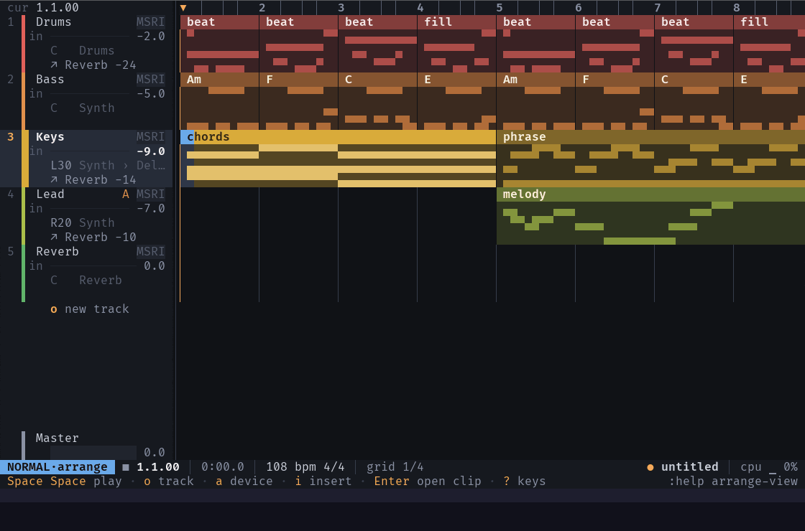

# interop: the projects of other programs

The interop extension opens the projects of other programs in paw, and writes the
projects of paw for them, so a song can move in both directions. It handles
two formats:

- REAPER projects (`.rpp`).
- DAWproject files (`.dawproject`), the open format of Bitwig Studio,
  PreSonus Studio One and Steinberg Cubase.

The extension is also the example of how to add a format. Each format is a
module that the core's `:import`, `:open`, `:export` and `:write` use through
one call, `paw.formats.register`, and [How a format is
made](#how-a-format-is-made) describes it.

```lua
paw.ext.load("/path/to/paw/extensions/interop")   -- or link it into ~/.config/paw/extensions
```



## Try it

1. Type `:ext.load interop`.
2. Type `:e song.rpp` with the path of a REAPER project, or
   `:e song.dawproject` with a file that another DAW wrote. The parts of
   the song appear in the arrange view.
3. Read the page that opens over them. It lists what paw could not bring
   across, by kind. If paw brought all of it, there is no page.
4. Type `:w copy.rpp` or `:w copy.dawproject`. The message tells what paw
   wrote.
5. Open the copy in REAPER or in the other DAW. The parts and the clips
   are there.

## How to

### How to open a project of another program

Type `:e song.rpp` or `:e song.dawproject`. The page that opens lists what
paw could not bring across, grouped by kind. paw puts the audio files of
a DAWproject file in a folder beside the file, `song media`.

If the MIDI parts of a REAPER project are silent because their
instrument stayed in REAPER, type `:e song.rpp instrument=synth`. Each
such part gets a `synth`.

### How to add the parts of another project to this project

Type `:import song.rpp` or `:import song.dawproject`, and the project keeps
its own tempo map and its own master.

### How to write a project for another program

Type `:w song.rpp` or `:w song.dawproject`. The page that opens lists what
paw could not write. A DAWproject file holds the audio files and the
states of the plugins. To keep the audio files outside the file, type
`:export song.dawproject embed=false`, and the file then refers to the audio
files where they are.

### How to edit a `.rpp` file from a script

```lua
local rpp = require("interop.rpp")
local doc = rpp.read("song.rpp")
doc.project:set("TEMPO", 96, 4, 4, 0)
rpp.save(doc, "song.rpp")
```

Lines that you do not change keep their bytes.

## How a format is made

A format is a table that `paw.formats.register` takes, from any
extension or from your `init.lua`:

| Field | What it is |
| --- | --- |
| `name` | the name of the format: `rpp` |
| `desc` | what the files are, for the list of `:help formats` |
| `extensions` | the endings of its files: `{ "rpp" }` |
| `project` | true when a file holds a whole project: then `:w song.rpp` writes one too |
| `detect(path)` | optional: true when the file is of this format, whatever its ending |
| `import(path, opts)` | optional: reads the file. `opts.merge` is true for `:import` (add to the project) and false for `:open` and `:e` (in place of the project). `opts.args` holds the `key=value` words after the path |
| `export(path, opts)` | optional: writes the project to the file. `opts.args` as above |

`import` and `export` return what to say, as text or as `{ said, lost }`,
where `lost` is the lines of what did not carry over, and paw shows them on a
page. paw says an error that they raise as the error. A format with no
`export` only reads, and a format with no `import` only writes.

The extension registers its two formats in `init.lua`, through
`interop.register`, which makes the two functions from a module that has
`import(path, opts)` and `export(path, opts)`:

```lua
local interop = require("interop")
interop.register({ name = "rpp", desc = "REAPER projects", extensions = { "rpp" }, project = true, module = "interop.rpp" })
```

The two modules are the worked examples. They are written in Teal, so the
types of what they read and write are checked:

- `interop.rpp` (`lua/interop/rpp/`): `format.tl` reads and writes the
  text of a `.rpp` file as a tree, `import.tl` makes the parts, clips,
  lanes and devices of paw from it, `export.tl` writes them back, `fx.tl`
  maps the plugins, `midi.tl` the MIDI.
- `interop.dawproject` (`lua/interop/dawproject/`): the archive with
  `paw.zip`, the XML with `paw.xml`, `import.tl` and `export.tl` as
  above, `vst3.tl` the `.vstpreset` files of VST3 plugins.

What both use is in `interop` (`lua/interop/init.tl`), for a new format
too:

| Function | Effect |
| --- | --- |
| `interop.report.new(title)` | a list of what did not carry over, by group: `add(group, item)`, `count(group, what, n)`, `empty()`, `lines(n)`, `data()` |
| `interop.register(spec)` | registers a format from a module (`spec.module`). The message of an import tells how many parts, clips and plugins came in |
| `interop.said(result, text)` | what an import or export says, with the lines of `result.report` |
| `interop.installed(kind)` | the kind of device installed here, or nil |
| `interop.find_plugin(query)` | the plugin installed here that a file names, by its own id, else by name and vendor (`paw.api.device_find`) |
| `interop.device_types()` | the kinds of device by kind, looked up as they are met |
| `interop.tempo_from_seconds(tempos, signatures)` | a tempo map from points in seconds, in beats (`paw.api.tempo_from_seconds`) |
| `interop.db(gain)` | a gain as decibels from -120 to 24 |
| `interop.amp(db)` | decibels as a gain, 0 at -120 dB and below |
| `interop.markers()`, `interop.add_markers(list)` | the markers and regions of the project, and new ones added after them |
| `interop.sections()` | the song sections of the sections extension, or none when it is not loaded |
| `interop.vst3_split(state)`, `interop.vst3_join(component, controller)` | the parts of the state of a VST3 plugin |

A format written in Teal can name the types of what its `import` and
`export` take and give, `interop.Options` and `interop.Result`.

[Write an importer or exporter](../../docs/how-to/write-an-importer-or-exporter.md)
makes a small format step by step.

## Reference

### Commands

The extension has no commands and no keys of its own, and the commands of
paw take its files:

| Command | Effect |
| --- | --- |
| `:import song.rpp`, `:import song.dawproject` | adds the parts of the file to the project |
| `:open song.rpp`, `:edit song.rpp`, `:e song.rpp` | replaces the project with the one of the file. `instrument=synth` gives a device of that kind to the MIDI parts of a REAPER project whose instrument stayed behind, so you can hear them |
| `:export song.rpp`, `:export song.dawproject` | writes the project to the file. `embed=false` refers to the audio files of a DAWproject file and does not copy them into it |
| `:write song.rpp`, `:w song.dawproject` | the same as `:export`. Other files save as before |

After an import or an export, a page lists what paw could not bring
across, grouped by kind (plugins, takes, envelopes, and other). The
message line tells how much came across, and paw lists every item that it
drops.

```lua
local rpp = require("interop.rpp")
local result = rpp.import("song.rpp", { instrument = "synth" })
print(result.report:text())            -- or result.report:data() as tables
rpp.export("out.rpp").report:empty()   -- true when paw wrote all of it
local dp = require("interop.dawproject")
dp.import("song.dawproject", { merge = true, media_dir = "/path/for/the/audio" })
dp.export("out.dawproject", { embed = false })
```

### REAPER projects

#### The format

`rpp.parse(text)` gives a tree, and `rpp.write(tree)` gives the text back.

- A tree with no changes writes the same bytes that it came from:
  indentation, quotes, number format, CRLF or LF.
- A changed or added line is written as REAPER writes it.
- The parser never fails. It keeps what does not fit (a `>` alone, a block
  that does not close) as it is.

```lua
local doc = rpp.read("song.rpp")
local project = doc.project                         -- the <REAPER_PROJECT block
project:getn("TEMPO")                               -- 120: the first argument as a number
project:set("TEMPO", 96, 4, 4, 0)                   -- replaces a line (or adds it)
for _, part in ipairs(project:blocks("TRACK")) do
  print(part:get("NAME"), part:child("VOLPAN"):argn(1))
  part:add(rpp.line("MUTESOLO", 1, 0, 0))
end
local fx = project:child("TRACK"):child("FXCHAIN"):child("VST")
fx:data_groups()                                    -- the base64 parts of the state of a plugin
rpp.save(doc, "song.rpp")
```

A node is `{ tokens = { name, args... }, children = {...} }`. Blocks have
children, and lines do not.

| Method | Effect |
| --- | --- |
| `name`, `arg(i)`, `argn(i)`, `set_args` | the tokens |
| `child(name)`, `all(name)`, `blocks(name)` | the children |
| `get(key, i)`, `getn(key, i)`, `set(key, ...)` | a line by its key |
| `add(node, index)`, `add_before(name, node)`, `remove`, `remove_all(name)` | add and remove nodes |
| `data()`, `data_groups()`, `set_data(groups, width)` | the base64 data of a block |
| `quoted(i...)` | always quotes these arguments, as REAPER does for paths |
| `walk(fn)` | calls `fn` on each node |

`rpp.format.quote` and `rpp.format.number` are the quotes and the number
format of REAPER. A token has no quotes, unless it is empty, holds a blank
or starts with a quote, and then it takes the first of `"`, `'` and `` ` ``
that it does not contain. The format has no escapes.

#### What comes across

A REAPER project gives times in seconds. paw changes them to beats with the
tempo map of the project, and back.

| | REAPER → paw | paw → REAPER |
| --- | --- | --- |
| Tempo, time signature | The full tempo map: `TEMPO` and the `TEMPOENVEX` points. Square points become steps. Linear points become ramps (linear in time, as REAPER plays them), with their time signatures (packed as numerator + denominator × 65536). Other point shapes become ramps and are reported. When merged into an open project, the project keeps its own map | `TEMPO`, and `TEMPOENVEX` when the tempo or the signature changes along the song |
| Loop | Loop points (`SELECTION`) and the repeat switch (`LOOP`) | The same |
| Markers and regions | The markers and regions of paw (`paw.markers`), with their colors | The same. Song sections (`project.meta.sections`) become regions, each to the start of the next |
| Parts | Name, color (`PEAKCOL`), volume, pan, mute, solo, record arm, audio input and monitoring | The same |
| Folders | The children of a folder go into the folder part | A part that goes into the part above it (or into its folder) becomes a child of the folder. paw writes other routes into a part as a send from a part with its parent send off, and reports them |
| Sends | Receives (`AUXRECV`) become sends from the source part, at their level. Pre-fader receives become pre-fader sends | Sends become receives, post-fader or pre-fader |
| Master | Volume, pan, mute, FX chain, volume and pan envelopes | The same |
| Audio items | A clip with the file (relative to the project folder, as REAPER finds it, also in the recording folder), position, length, start in the source (`SOFFS`, also the start of a section), item volume times take volume as the clip gain, fade lengths, play rate and pitch shift, mute. A looped item becomes a looped clip. At a play rate other than 1, it becomes one clip for each pass | Items with a `WAVE`, `FLAC`, `MP3` or `VORBIS` source, with the same fields. A looped clip becomes a looped item that plays a section of the file. Paths under the folder of the project are relative to it |
| MIDI items | Notes from inline events and from `.mid` files, with velocity and channel (in `meta.channel` of the note), through the ticks per quarter note of the source. Controllers, pitch bend, channel and key pressure, and program changes (with the bank before them) become the controller moves of the clip. A source that ignores the project tempo runs at its own. A looped item becomes a looped clip. Notes held over the item start begin at it, as REAPER plays them. Muted items stay muted | Inline events at 960 ticks per quarter note, channels from `meta.channel`, and the controller moves. A looped clip becomes a looped item |
| Automation | Volume and pan envelopes of parts and the master, and the parameter envelopes (`PARMENV`) of plugins that came across, as lanes, on or off as in REAPER. Square points hold. Slow start and end points become smooth | The same |
| CLAP plugins | When installed here: the same plugin with the state that REAPER saved, which is the own state of the plugin | With their state |
| VST3 plugins | When installed here (found by the class id in the line of REAPER, else by name and vendor): the same plugin with its state, from the chunk of REAPER (paw checks the sizes first) | Only plugins that came from a REAPER project: paw keeps the header of REAPER for them, and puts the current state into it |
| LV2 plugins | When installed here: the same plugin with its control ports (`P` lines. The symbols of the ports are the parameter keys of paw) | With their control ports |
| Bypass | For each plugin, and a bypassed FX chain | For each plugin |
| Other plugins | VST2, JSFX, AU, DX, containers, and plugins that are not installed: a placeholder in `meta.rpp_placeholders` of the part (`name`, `format`, `position`, `reason`, and the text of REAPER for it), reported | Placeholders return into the chain at their places, as paw read them |

REAPER counts the parameters of a plugin from 0, in the order of the
plugin. paw lists them in the same order. For a CLAP or VST3 plugin, REAPER
writes the id of the plugin for the parameter after the place, as a signed
32-bit number: `<PARMENV 5:-1611133501`. paw writes and reads the same
form, and it finds the parameter by the id first, so an envelope stays on
its parameter in a version of the plugin with a different order.

A parameter envelope gives values from its minimum to its maximum, and
paw scales them to the range of the parameter. See
[Device parameters](../../docs/reference/device-parameters.md).

#### What does not come across

After each import or export, paw lists the following items.

- REAPER to paw:
  - tempo envelope points with shapes other than square and linear
  - inactive takes, fade shapes (paw fades on a quarter sine), the play
    rate and pitch shift of MIDI items
  - take pan, polarity and channel modes, take envelopes and stretch
    markers
  - sysex and text events, muted MIDI notes and muted controller events,
    controllers on MIDI channels other than 1 (they play on channel 1)
  - envelopes other than volume, pan and plugin parameters (width, mute,
    send envelopes), and envelopes of plugins that did not come across
  - the curve shapes 3, 4 and 5 of REAPER (fast start, fast end and a
    curve with handles: they become straight lines or smooth)
  - pre-FX sends (they become pre-fader), send pan, send channel mapping,
    muted sends and MIDI-only sends
  - parts whose master or parent send is off (in paw they play through
    their output), hardware outputs, frozen parts
  - empty items, video, subprojects, other sources, media files that paw cannot find
  - LV2 state other than control ports, offline plugins, the volume of
    MIDI items
- paw to REAPER:
  - built-in devices (`synth`, `drums`, `gain`, `delay`) and other devices
    that are not plugins, and their automation
  - VST3 plugins added in paw (paw does not know the id of REAPER for them)
  - LV2 state other than control ports
  - the tension of smooth curves, stretch modes and warp markers, the loop
    of a stretched audio clip
  - registered and assignable controllers and per-note controllers (MIDI
    1.0 has no event for them)
  - note attributes (MIDI 2.0 articulations: a REAPER project keeps MIDI
    1.0)
  - note times finer than 1/960 beat are rounded
  - clips in the slots of the clip launcher
- paw does not read the settings of a REAPER project that it has no place
  for (render settings, grid, view, metronome, project notes). It writes
  the defaults of REAPER for them.


### DAWproject files

#### The format

A DAWproject file is a ZIP archive. It holds `project.xml` (the song),
`metadata.xml` (the title and the artist), the states of the plugins and
the audio files. The official XML schemas are in `schema/`, with their
license (MIT, Bitwig).

The core reads and writes the archive (`paw.zip`) and the XML
(`paw.xml`):

- `paw.zip.read(bytes)` gives the files of an archive. It reads files that
  are stored and files that are compressed (deflate).
- `paw.zip.write(entries)` makes an archive of stored files.
- `paw.xml.decode(text)` gives a tree of elements, `paw.xml.encode(root)`
  the text. `dp.xml` says how a DAWproject file writes it.

#### What comes across

paw writes times on the arrangement in beats, and audio clips play their
files in seconds.

| | DAWproject → paw | paw → DAWproject |
| --- | --- | --- |
| Tempo, time signature | The tempo and time signature of the transport, and the tempo and time signature automation (tempo points in beats or in seconds). A linear tempo point becomes a ramp. When merged into an open project, the project keeps its own map | The same |
| Parts | Name, color, volume, pan, mute, solo. A part in a part goes into it (a folder). A channel with a destination plays into that part | The same. A part that goes into the part above it (or into a folder that it is in) is written inside that part |
| Sends | Level, before or after the fader | The same |
| Master | Volume, pan, mute, devices, automation | The same |
| MIDI clips | Notes with their velocity and MIDI channel (in `meta.channel` of the note). Controllers, pitch bend, channel and key pressure and program changes in the clip become the controller moves of the clip. Play start, loops, mute (a clip that is not enabled) and the name | The same |
| Audio clips | The file, the play start as the offset into the file, the fades, mute and the name. Two warp points give the speed. Audio in a clip of clips (as Bitwig Studio writes it) becomes one clip. Audio from the archive goes into a folder beside the file | The same. paw copies each audio file into the archive once |
| Automation | Volume and pan of the parts and the master, and the parameters of the devices that came across. Points that hold (the default) and linear points | The same |
| Markers | Markers with their colors. A marker that paw wrote for a region becomes the region again | Markers. A region becomes a marker at its start, with its length in the comment |
| CLAP plugins | When installed here: the same plugin with its state | With their state (`plugins/*.clap-preset`) |
| VST3 plugins | When installed here (found by the class id, else by name and vendor): the same plugin with the state of its `.vstpreset` | With their state as a `.vstpreset` |
| LV2 plugins and the devices of paw | Only from a file that paw wrote: the same device with its parameters | As a device (an LV2 plugin) or a built-in device (`synth`, `gain` and the others) that only paw reads, with its parameters. paw lists them |
| Bypass | The `Enabled` switch of each device | The same |
| Other devices | VST2 and Audio Unit plugins, the built-in devices of other programs, and plugins that are not installed: a placeholder in `meta.dawproject_placeholders` of the part (`name`, `format`, `position`, `reason`, the XML and the state), reported | Placeholders return into the chain at their places, with their states |

#### What does not come across

After each import or export, paw lists the following items.

- DAWproject to paw:
  - note-off velocities, per-note expressions, and expressions other than
    MIDI controllers (gain, pan, transpose, timbre, formant)
  - warp points between the first and the last (paw stretches the clip
    evenly), loops of stretched audio, loops of clips that hold clips
  - crossfades, fades on MIDI clips, video
  - automation of mute and of send levels, automation points that are not
    real values
  - send pan, sends that are off
  - the clip launcher (scenes and their clips)
  - the master of the file, when merged
- paw to DAWproject:
  - the class id of a VST3 plugin that is not installed here and did not
    come from a DAWproject file (a DAW finds the plugin by its name)
  - the pitch of audio clips, warp markers, the tension of smooth curves
    (they become straight lines), automation lanes that are off (they are
    written as on)
  - registered, assignable and per-note controllers, the bank of program
    changes, note attributes (MIDI 2.0 articulations)
  - the loop of the transport, record arm, inputs and monitoring
  - clips in the slots of the clip launcher

For a parameter of a CLAP or VST3 plugin, `parameterID` holds the id that
the plugin itself gives the parameter, and the `deviceID` of a VST3 plugin
holds its class id. Ids of 2^31 and more become negative numbers, because
the schema has a signed 32-bit number there.

For a device of paw or an LV2 plugin, `parameterID` holds the place of
the parameter in the device (the first is 0).

When paw reads a file, it finds a parameter by the id of the plugin
first, then by its name. See
[Device parameters](../../docs/reference/device-parameters.md).

### Tests

The suite runs `tests_rpp.lua`, with fixtures written by hand in
`fixtures/rpp/`. The tests cover the following:

- parse and rewrite
- an import, checked part by part and clip by clip
- MIDI times at three tempos, envelopes, the report
- an export, then an import, of a project made with the API
- plugins in all three formats
- a render of an imported project with audio and MIDI
- REAPER itself opens an exported project
- REAPER itself makes and saves a project, and paw imports it

The parser was checked on 24 project files saved by REAPER, up to 2.9 MB,
and it gave the same bytes, and the same tokens after it wrote every line
again.

The first REAPER test opens an exported project in REAPER, and then it
compares what REAPER read with the project of paw. It compares the parts,
folders, colors and sends, the items with their fades, play rates and loops,
and the notes, the controller events, the envelope shapes, the markers and
regions. The REAPER tests run when `PAW_REAPER` names the `reaper` program,
and otherwise the suite skips them:

```sh
PAW_REAPER=/path/to/reaper nix develop -c tests/tools/suite.sh only "REAPER"
```

`tools/reaper-open.sh song.rpp dump.txt` does the same for any project.
REAPER runs in a sandbox (`bwrap`) on a private X display, with no audio
device and its own new configuration, so it does not touch the configuration
of a REAPER that you have. The startup script `tools/reaper-dump.lua`
writes what REAPER read, and then REAPER stops. Inside another sandbox,
such as the sandbox of a coding agent, `bwrap` can't start, and the suite
skips the REAPER tests with a message that says so.

The second REAPER test gives a third argument, `tools/reaper-build.lua`.
REAPER runs that script in a new project, and the script makes a song with
the API of REAPER. REAPER saves the song as `song.rpp`, and paw imports it
and compares it with what REAPER wrote about it.

Some rules come from projects saved by REAPER 7.84, and from REAPER 7.84
itself, not from documentation:

- Volume envelope points are amplitudes in the file, also with
  `VOLTYPE 1`.
- Pan envelope points go from +1 (left) to -1 (right).
- A color in the file is red + green × 256 + blue × 65536, plus 0x1000000
  when the color is in use.

The suite runs `tests_dawproject.lua`. The fixture
`fixtures/dawproject/studio.dawproject` is a song written by hand in the
shape that Bitwig Studio writes, made with the `zip` program (so its files
are compressed), and `fixtures/dawproject/studio/` holds its files. The
tests cover the following:

- an import of the fixture, checked part by part and clip by clip
- an export, then an import, of a project made with the API
- the XML of each export, checked against the official schemas with
  `xmllint` (in the dev shell)
- plugins (CLAP and VST3) with their states and automation, when the test
  plugins are installed
- `:import`, `:e`, `:export` and `:w` on `.rpp` and `.dawproject` files
  (in `tests_rpp.lua`)

Nobody opened the exported files in Bitwig Studio, Studio One or Cubase,
because none of them runs on this computer. The schemas say that the files
have the correct form.
