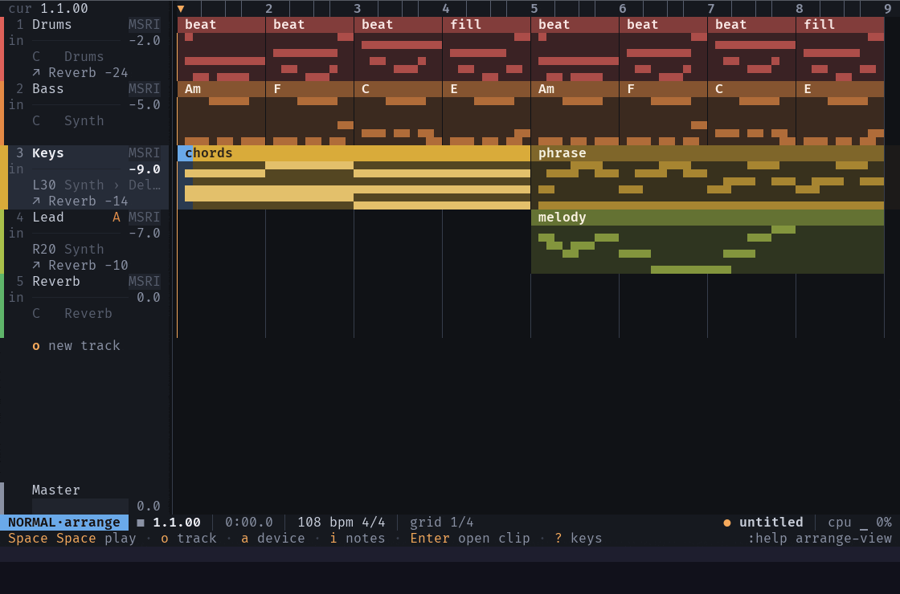

# mixdiag

Mix diagnostics. paw measures the mix and reports the problems as a list
of findings, in the same way that a language server reports problems in
code. Each finding has a severity, a message with the number that caused
it, a fix, and a place (a track and a beat) that `]d` and `[d` go to.

```lua
paw.ext.load("extensions/mixdiag")      -- or put it in ~/.config/paw/extensions
```



## Try it

1. Type `:ext.load mixdiag`, and open a song.
2. Press `<Space>ma`. The status line shows `measuring` and a percentage. At the
   end, a message gives the summary: LUFS, true peak, LRA.
3. Look above the arrange view. A row has a letter (`E`, `W`, `I` or `H`)
   at the beat of each finding.
4. Press `]d`. The cursor goes to the first finding, and the message gives
   it.
5. Press `<Space>mx`. The list of the findings opens.

## How to

### How to check a mix before delivery

1. Choose the target: press `<Space>mt` until the message names it, or type
   `:mix.target ebu`.
2. Press `<Space>ma` to measure the song.
3. Press `<Space>mr` to open the report. Press `j` and `k` to choose a finding.
   Press Enter to go to it.
4. Correct the mix, then press `<Space>ma` again. The marks show `(old)` until you
   measure again.

### How to find the track that clips

1. Press `<Space>ma`. If a track output is over full scale, the finding
   `track_over` names it.
2. To measure what one track adds to the mix, put the cursor on the track
   and press `<Space>mk`.

### How to measure a file

Type `:mix.file path`.

### How to add a rule or a target

Add them to the module in your `init.lua`:

```lua
local mixdiag = require("mixdiag")
mixdiag.rules.too_wide = {
  desc = "Side louder than mid",
  check = function(ctx, add, rule)
    if ctx.result.side > 0 then
      add({ severity = "info", message = string.format("side %.1f dB over mid", ctx.result.side),
            fix = "narrow the widest parts", beat = ctx.range.start, track = 0 })
    end
  end,
}
mixdiag.targets.album = { name = "my album", kind = "deliver", integrated = -16, tolerance = 1, true_peak = -1 }
```

### In the graphical window

- Choose More ▸ Mix report, or type `:view.window mixdiag_paint`.
- Point at a finding to see it in full, with its advice. Press Enter or
  click it again to go to it.
- Click a flag in the band under the ruler to go to its finding.

## Reference

### Keys and commands

| Keys | Command | Effect |
| --- | --- | --- |
| `<leader>ma` | `mix.analyze` | measures the song. In visual mode, the selection |
| `<leader>ml` | `mix.analyze loop` | measures the loop |
| `<leader>mk` | `mix.analyze track` | measures what the cursor track adds: the song with that track as if it is soloed |
| `<leader>mx` | `mix.list` | the findings, in `paw.pick`, or in the report |
| `<leader>mr` | `mix.report` | the report: what paw measured (or the progress), the numbers, the findings by severity, the target. `j` `k` choose a finding, Enter goes to it, `a` measures the song, `l` the loop, `t` the cursor track, `T` selects the next target, `q` closes |
| `<leader>mp` | `view.open mixdiag_paint` | the painted report, in pixels where the terminal shows them (`paw.opt.graphics`). Otherwise, the report in cells |
| `<leader>ms` | `mix.summary` | LUFS, true peak, LRA, short-term maximum and mono loss of the last measurement |
| `<leader>mt` | `mix.target [name]` | the next delivery target, or the target with that name |
| `<leader>mc` | `mix.clear` | removes the findings |
| `<leader>mq` | `mix.cancel` | stops a measurement |
| `]d` `[d` | | the next and the previous diagnostic, as in every view: the findings are diagnostics, with the other diagnostics of the project. A finding about the master leaves the cursor on its track |
| | `mix.next` `mix.prev` | the next and the previous finding only, with its message. A count goes further. They wrap. `<C-o>` returns |
| | `mix.file path` | measures an audio file |

- When a measurement ends, its summary shows as a message.
- A row above the arrange view marks each finding with `E`, `W`, `I` or `H`
  at its beat. It shows `measuring 40%` during a measurement, and `(old)`
  when the project changed after the measurement.
- The painted report in the graphical window has the following parts:
  - the loudness, true peak, sample peak and RMS of the mix, as bars with
    the target
  - the peak of each track, as a meter
  - the spectrum by octave band, on a log axis
  - the findings, each with a dot in the color of its severity
  `:view.window mixdiag` opens the list of the terminal in cells.
- The findings with a place are flags in a band under the ruler, in the
  color of their severity.

### Options

| Option | Default | Effect |
| --- | --- | --- |
| `mixdiag_target` | `"streaming"` | `streaming` (-14 LUFS, -1 dBTP, from the page of Spotify), `ebu` (-23 ± 1 LUFS, -1 dBTP, EBU R 128 v5), `none`, or a target of your own |
| `mixdiag_tail` | `1` | the seconds measured after the end, for releases and echoes |
| `mixdiag_ignore` | `""` | the rules to skip, by name: `"silence,forgotten"` |
| `mixdiag_strip` | `true` | shows the row of marks above the arrange view |

### Findings

The severities are `error`, `warn`, `info` and `hint`. Each rule is a table
in `require("mixdiag").rules`. Its thresholds are fields that you can
change.

| Rule | Finds | Threshold | Severity |
| --- | --- | --- | --- |
| `silent` | the measured part never goes above -60 dBFS | | error |
| `clip` | the master over full scale: where, how many runs and samples, and how much to lower it | a run (see below). Runs within `merge` = 4 beats are one finding. At most `max` = 20 | error |
| `true_peak` | the true peak is over the ceiling of the target (Spotify: -1, or -2 when louder than -14 LUFS. EBU: -1). With no target: over 0 dBTP when no sample clips | | error for a delivery target, else warn |
| `loudness` | EBU R 128: the integrated loudness is more than `tolerance` (1 LU) from -23 LUFS. Streaming: louder than -14 by more than `slack` (0.5 LU), with how much the service turns it down. Or quieter, when the true peak stops the service from a full increase, with how much quieter it plays | | error (EBU, full song), info (streaming, or a part) |
| `track_over` | the post-fader output of a track is over full scale, and where it first went over | 0 dBFS | warn when the master clips too, else info |
| `phase` | a passage with a correlation under `floor` for at least `seconds`, while louder than `audible` | -0.2, 2 s, -50 LUFS | warn |
| `mono` | the measured part loses more than `limit` in mono, or cancels fully | 4 dB (unrelated sides lose 3.0) | warn. error when it cancels |
| `dc` | a DC offset over the full render, or in a passage of `seconds` whole seconds whose means are over `limit` on one side of zero | 0.01 (-40 dBFS), 2 s | warn |
| `silence` | silence at the start of the render, or before its end (not the tail added for releases) | `start` 1 s, `ending` 2 s | info |
| `infrasonic` | the energy below the 31.5 Hz octave band (22 Hz) is over `limit` of the total | -20 dB (1 %) | info |
| `forgotten` | a soloed track (the measurement heard only solos), a muted track with clips in the part, muted clips, bypassed devices, automation lanes with points that are off | | warn for solo, else hint |
| `no_sound` | an unmuted track with clips in the part whose output never went above `floor` (no instrument, or a bypassed one) | -100 dBFS | hint |

The rules about delivery (`loudness`, `true_peak`) apply only for the
chosen target. With the target `none`, the report gives the loudness as
numbers and not as findings, and when paw measures what one track adds, it
does not apply these rules.

### Measurements

The measurement is in Rust, in the crate `crates/paw-measure`, which the
MCP server uses too. The kernel's part is in `crates/paw-core/src/measure/`,
and scripts call it as `paw.api.measure*` (see below). A private engine renders the
project, as `paw.render` does, but into memory, on a worker thread, and paw
measures the audio during the render.

| Measurement | Method | Standard |
| --- | --- | --- |
| Integrated loudness (LUFS) | K-weighting. 400 ms blocks every 100 ms. Absolute gate -70 LUFS, relative gate -10 LU | ITU-R BS.1770-4, EBU R 128 |
| Momentary and short-term maximum | 400 ms and 3 s windows every 100 ms | EBU Tech 3341 |
| Loudness range (LRA) | 3 s windows, gates -70 LUFS and -20 LU, 95th minus 10th percentile | EBU Tech 3342 |
| True peak (dBTP) | 4x oversampling below 96 kHz, 2x above, with a Kaiser-windowed sinc interpolator of 24 taps for each phase | BS.1770-4 annex 2 (the method. The filter is our own) |
| Sample peak, clipped runs | runs of 3 or more samples at full scale (the default of Audacity), or any sample over it. Runs closer than 3 samples join | convention |
| DC offset | the median of the 1 s means of each channel, and the 1 s means over time | none (the convention of MIDI LSP) |
| Crest factor, peak-to-loudness ratio | sample peak over RMS. True peak minus integrated loudness | arithmetic |
| Correlation, width, side level | Pearson correlation of left and right. Side energy over mid plus side | arithmetic |
| Mono-sum loss | K-weighted loudness of (L+R)/2 on both sides, over the blocks that the stereo measurement kept | arithmetic on BS.1770 |
| Spectral balance | Hann-windowed FFT of the mid signal, frames of about 1/6 s. The share of energy in each octave band, IEC 61260-1 base-ten mid frequencies 31.5 Hz to 16 kHz, with `sub` below and `air` above | the bands of IEC. No target curve |
| Spectral centroid | the mean frequency of the same spectrum, weighted by power | arithmetic |
| Peaks of each track | the post-fader meter of each track, read every engine block (1024 samples) | |
| Series every 100 ms | momentary and short-term loudness, correlation (400 ms and for each 100 ms), mono loss, sample and true peak. DC for each second | |

#### Accuracy

Rust tests (`cargo test -p paw-measure`) make the following
signals:

| Signal | Expected | Read |
| --- | --- | --- |
| K-weighting at 48 kHz | the coefficients printed in BS.1770-4 | equal to 1e-8 |
| 997 Hz stereo sine at -20 dBFS, 44.1, 48 and 96 kHz | -20.0 LUFS | -20.00 ± 0.02 |
| Tech 3341 case 1: 1 kHz stereo sine at -23 dBFS | -23.0 ± 0.1 (M, S, I) | -22.99 |
| case 2: the same at -33 dBFS | -33.0 | -32.99 |
| case 3: -36 / -23 / -36 dBFS for 10 / 60 / 10 s | -23.0 | -23.01 |
| case 4: -72 / -36 / -23 / -36 / -72 dBFS | -23.0 | -23.01 |
| case 5: -26 / -20 / -26 dBFS for 20 / 20.1 / 20 s | -23.0 | -22.98 |
| case 9: 1.34 s at -20 and 1.66 s at -30 dBFS, 20 times | short-term -23.0 at all points | -23.0 ± 0.1 at every point |
| a tone at -75 dBFS alone | gated out: no value | none |
| Tech 3342 cases 1 to 4 (20 s steps of -20/-30, -20/-15, -40/-20, -50/-35/-20/-35/-50) | LRA 10, 5, 20, 15 ± 1 | 10.0, 5.0, 20.0, 15.0 |
| sine at fs/4, 45° phase, peak -6.02 dBFS | true peak -6.02, samples 3.01 dB lower | -6.02 dBTP, -9.03 dBFS |
| sine at fs/6, samples 30° from the crest | true peak -6.02, samples 1.25 dB lower | -6.02, -7.27 |
| fs/4 at 1.2 (an inter-sample over) | +1.58 dBTP with every sample under 0 dBFS | +1.58 dBTP, -1.43 dBFS |
| 5, 10, 15, 19 kHz at three phases, 44.1 and 48 kHz | within +0.2 / -0.4 dB of Tech 3341 | worst error 0.003 dB |
| a 100 Hz sine cut flat at full scale for 1 s | 200 clipped runs | 200 |
| left side offset by 0.01 | DC 0.0100 | 0.0100 |
| identical, opposite and unrelated sides | correlation 1, -1, 0. Mono loss 0, total, 3.01 dB | as expected |
| 1 kHz tone. 100 Hz and 4 kHz tones of equal level | all in the 1k band. -3.01 dB in each | as expected |

The tests of the extension read a 16-bit WAV of a 1 kHz sine at -23 dBFS
through `paw.api.measure`, as -23 LUFS.

#### Speed

Take a song of 5 minutes, with 9 tracks of built-in synths, drums and delays.
Its diagnostics take about 3 s in a debug build (the dev profile of the
workspace), and `paw.render` of the same song takes most of that time.

- The render and the analysis run on two worker threads, a few pieces
  apart.
- The interface stops for about 1 ms to prepare the engine. Plugins add
  more time, because paw makes them again, as for a render.
- Each check of the progress takes a tenth of a millisecond.
- The result (about 20 000 numbers) takes 2 ms to come into Lua and go
  through the rules.
- The analysis alone runs at about 140 times real time.

### The Lua module

```lua
local mixdiag = require("mixdiag")

mixdiag.analyze("song")                     -- or "loop", "selection", "track",
                                            -- { start = 0, ["end"] = 32, track = id }, { file = "x.wav" }
mixdiag.analyze("loop", { done = function(findings) end })
local findings = mixdiag.analyze("song", { wait = true })   -- waits for the measurement
mixdiag.findings      -- { severity, message, fix, beat, track, seconds, rule }
mixdiag.result        -- the measurement (below)
mixdiag.summary()     -- "LUFS -14.2  TP -1.3 dBTP  LRA 6.1 LU  …"
mixdiag.marks()       -- { beat, severity, text, track } for a ruler
mixdiag.step(1)       -- what :mix.next does
mixdiag.list()  mixdiag.clear()  mixdiag.cancel()  mixdiag.stale()
```

- The `ctx` of a rule has `result`, `range` (`start`, `end`, `label`,
  `track`), `kind` (`mix`, `track` or `file`), `whole` (the full song or
  file) and `target`, and the helpers `beat(seconds)` (through the tempo
  map), `where(beat, seconds)` and `track_name(id)`.
- paw sends `mixdiag.done` when the findings are ready.

### `paw.api.measure`

```lua
paw.api.measure({ start = 0, ["end"] = 64, tail = 1, sample_rate = 48000, track = id })  -- waits
paw.api.measure({ file = "master.wav" })
local id = paw.api.measure_start(opts)          -- on a worker thread
paw.api.measure_poll(id)    -- { done = false, progress = 0.4, elapsed } or { done = true, result | error }
paw.api.measure_cancel(id)
```

The fields of the result:

| Fields | Value |
| --- | --- |
| `integrated`, `momentary_max`, `short_term_max`, `lra`, `lra_low`, `lra_high`, `mono_integrated` | LUFS. nil when nothing goes through the gates |
| `true_peak`, `true_peak_at`, `sample_peak`, `sample_peak_at` | dB, seconds |
| `plr`, `crest`, `rms` | ratios and levels |
| `clipped_samples`, `over_samples`, `clip_runs`, `runs` | `runs` is `{ at, frames, peak }`, the first 2000 |
| `dc`, `dc_mean` | `{ left, right }`, linear |
| `correlation`, `width`, `side`, `mono_loss` | the stereo image |
| `sound_start`, `sound_end` | where sound starts and stops |
| `bands` | `{ name, low, high, share }` |
| `centroid` | Hz, the spectral centroid. 0 for silence |
| `tracks` | `{ id, peak, peak_at, over_at }` |
| `series` | `hop`, `momentary`, `short_term`, `correlation`, `correlation_hop`, `mono_loss`, `sample_peak`, `true_peak`, `dc_left`, `dc_right`. Point `i` is the window that ends at `(i + 1) * hop` seconds. `-150` is silence |
| `sample_rate`, `frames`, `seconds`, `elapsed` | the measurement |
| `start` (beat), `end`, `tail`, `tempo`, `track`, `edits` | for a project |

Times are seconds from the start of the measurement.

### Limits

- Tracks give only their peak, not their loudness, correlation or
  spectrum. To get the numbers of one track, measure what it adds
  (`<Space>mk`), which costs one render for each track.
- paw measures the mix, so a DC offset, a phase problem or infrasonic
  energy points at a time, not at a track.
- What a track adds includes its solo path to the master. It does not
  include effect returns that its sends feed.
- paw does not compare the spectrum with reference tracks. It has no
  target curves, on purpose.
- paw measures the mix as floating point numbers, before dither. It does not
  apply the settings of an integer render.
- paw reads mono files as two identical channels, so they measure 3 dB
  louder than on a meter that knows mono.
- Fixes are advice only. Nothing in the project changes.
- paw does not measure again after edits. `(old)` and `mix.summary` tell
  when the project changed after the measurement.
- Plugins on the worker thread are tested with the stereo limiter of LSP in
  the three formats. Its peak is the same as in a render. Other plugins
  that need one audio thread are not tested.
