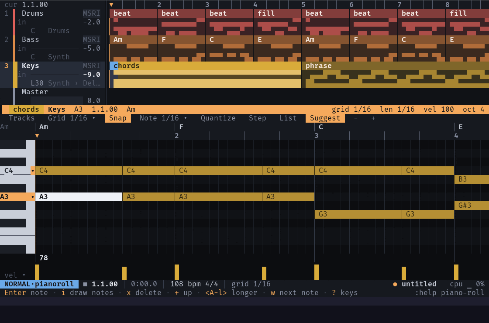

# musicops: musical operators

The extension turns the edits that a musician makes to notes each day into
operators, for example humanize, strum, arpeggiate, quantize with swing,
crescendo and transpose in the key. Motions, text objects, visual
selections, counts, `.` and macros all work with them. The extension also
adds text objects for phrases and chords, and motions for phrases. It keeps
the key of the project, and it has a scale lock for the entry and the
movement of notes.

```lua
paw.ext.load("/path/to/paw/extensions/musicops")   -- or link it into ~/.config/paw/extensions
```

In the picture, `gzpie` arpeggiates every chord and `u` undoes it, and then
`gzsie` strums the chords and `gzhie` humanizes them:



All keys start with `gz`.

## Try it

1. Type `:ext.load musicops`.
2. Open a clip with chords in the piano roll. Put the cursor on a chord.
3. Type `gzsic`. The notes of the chord now start one after the other,
   which is a strum.
4. Press `u`. The chord is as before.
5. Type `gzpic`. The chord becomes an arpeggio, for its full length.

## How to

### How to humanize a phrase

1. Put the cursor in the phrase, in the piano roll.
2. Type `gzhip`. The message gives the seed, for example `humanized, seed
   1234`.
3. To get the same result again later, set `paw.opt.musicops_seed = 1234`.

### How to set the key and keep notes in it

1. Type `:key D minor`.
2. To move a phrase one step up the scale, type `gzkip`.
3. To move notes that are outside the key into it, type `gznic`.
4. To keep the entry of notes in the key, press `gzL`. The scale lock is
   on.

### How to give an amount to an operator

1. Select the notes in visual mode, for example with `vip`.
2. Type the amount, then the operator: `50gzq` quantizes half way, `2gzk`
   moves two scale steps.

In normal mode, the count goes to the motion or the text object, not to
the amount.

### How to edit every clip of a track

In the arrange view, type the operator two times. For example, `gzkk` moves
every clip of the track one scale step up, and `3gzkk` does it on three
tracks.

### How to apply a function to a full clip

Type `:musicops.apply` with the name of a function of the module and its
options. For example, type `:musicops.apply humanize timing=0.05 seed=3`, or
`:musicops.apply transpose_scale 2`.

## Reference

### Operators

An operator acts on what a motion, a text object or a selection covers:

- In the piano roll (`pianoroll`) and the vocal editor (`utau`), an operator
  acts on the notes of the region, as `d` and `>` do. `gzkip` moves the
  phrase under the cursor a step up the scale, `gzs2w` strums the next two
  notes, and `vjjgzq` quantizes a selection.
- In the arrange view, an operator acts on the notes of the MIDI clips in the
  region. For a time, these are the notes that start in it: `gzkic` the clip
  under the cursor, `gzh2W` two bars. paw edits each clip separately.

Typed two times, an operator takes the full row. In the piano roll, that
is all the notes of the pitch under the cursor (`gzhh`), and in the arrange
view, it is the full track. `.` repeats each operator, and macros record
them.

With a motion or a text object, the count belongs to the motion or the text
object, as for each operator (`gzk3w`, `gzk2ip`). In visual mode, a count
before the operator sets its amount: `vip2gzk` is two scale steps, and
`vip50gzq` quantizes half way.

| Keys | Effect | Count in visual mode | Views | Example |
| --- | --- | --- | --- | --- |
| `gzh` | humanize: moves starts and velocities at random, with a seed | timing in 1/100 beat, and velocity range | all | `gzhip` loosens the phrase |
| `gzs` `gzS` | strum each chord up, down: notes start `musicops_strum` beats apart and end together | step in 1/100 beat | roll, arrange | `gzsic` strums the chord at the cursor |
| `gzp` `gzP` | arpeggiate each chord up, down, for its full length | steps for each beat (4: sixteenths) | roll, arrange | `gzpic`, `vac4gzP` |
| `gzb` `gzB` | arpeggiate up and down. In the order that the notes were played | steps for each beat | roll, arrange | `gzBic` the full clip |
| `gzl` | legato: hold each note to the next | | all | `gzlip` |
| `gzt` | staccato: shorten each note to `musicops_staccato` of its length | percent of the length that stays | all | `vip25gzt` a quarter |
| `gzq` | quantize to the grid, with `musicops_strength` and `musicops_swing` | strength in percent | all | `gzqip`, `vip50gzq` |
| `gzw` | quantize with swing (`musicops_swing_amount`, triplet swing by default) | swing in percent of a step | all | `gzw2W` |
| `gz>` `gz<` | crescendo, diminuendo: up to `musicops_ramp` more (less) velocity at the last note | the velocity added or removed | roll, arrange | `gz>ip`, `vip20gz<` |
| `gzc` | compress velocities half way to their average (`musicops_compress`) | ratio in percent (above 100 expands) | roll, arrange | `gzcip` |
| `gzv` | make all velocities their average | the velocity to set | roll, arrange | `vip90gzv` |
| `gze` | accent: louder notes on the beat (`musicops_accent`) | velocity added | roll, arrange | `gzeic` |
| `gzr` | reverse the passage in time (retrograde) | | all | `gzrip` |
| `gzd` `gzD` | double time, half time, from the first note | | all | `gzdip` |
| `gzu` `gzU` | invert each chord up (the lowest note goes an octave up), down | the number of inversions | roll, arrange | `gzuic`, `vac2gzU` |
| `gzk` `gzj` | up, down a step of the scale of the project | scale steps | all | `gzkip`, `vip3gzj` |
| `gzn` | snap notes outside the key into it (`musicops_snap`) | | all | `gznic` |
| `gzm` | mirror the melody around its first note, in scale steps | | all | `gzmip` |
| `gzo` `gzO` | double each note an octave up, down | octaves | roll, arrange | `gzoip` |
| `gzx` | remove overlapped notes of one pitch | | all | `gzxic` |

- "All" is the piano roll, the vocal editor and the arrange view.
- The vocal editor has no strum, arpeggio, inversion, velocity edit or
  added octave. It sings one voice, and new notes would repeat lyrics.
  In the vocal editor, notes keep their lyrics and pitch curves through
  each edit.
- `gzh` uses a new seed each time and gives it (`humanized, seed 1234`).
  `paw.opt.musicops_seed` set to a number makes each humanize the same.
- Notes that go past the end of their clip (half time, an arpeggio) make
  the clip longer, to the next grid step. In the arrange view, the clip
  can then overlap the next clip.

### Text objects and motions

The operators take paw's text objects of the piano roll: `ic` the chord,
`ip` the phrase, `iv` the voice, and the others that
[Motions, operators and modes](../../docs/reference/grammar.md#objects-of-the-piano-roll)
lists. `gzsic` strums the chord at the cursor, `gzkip` moves the phrase a
step up the scale.

In the vocal editor, musicops adds the following:

| Keys | What it selects |
| --- | --- |
| `ip` | the phrase at the cursor: notes with no rest longer than `paw.opt.phrase_rest` beats (half a beat) between them. From a rest, the next phrase. `2ip` two phrases |
| `ap` | the phrase and the rest after it, to the next phrase |
| `)` `(` | motions: the start of the next phrase. The start of this phrase, or of the previous phrase. With a count, that many |

### Key and scale

| Command | Effect |
| --- | --- |
| `:key D minor`, `:musicops.key F# dorian` | sets the key. The default scale is major |
| `:key D minor at 17` | writes a key change at bar 17, a marker named `key D minor`, in one undo step |
| `:key` | shows the key |
| `:key off` | clears the key |
| `:musicops.scales` | lists the scales |
| `:musicops.lock`, `:musicops.lock on`, `gzL` | the scale lock, on or off |
| `:musicops.apply <function> name=value ...` | applies a function of the module to the full clip that you edit (the clip of the piano roll or the vocal editor, or the clip under the arrange cursor) |

- The key of the project is the key of the core (`paw.harmony.key`, see
  [Harmony](../../docs/reference/harmony.md)). The project keeps it as
  `key` (`"D minor"`), so the project saves it, and undo applies to it.
- With no key, the operators use C major. They do not use the key that the
  core reads from the notes.
- Scales: `major` (`ionian`), `minor` (`aeolian`), `harmonic_minor`,
  `melodic_minor`, `dorian`, `phrygian`, `lydian`, `mixolydian`,
  `locrian`, `pentatonic`, `minor_pentatonic`, `blues`, `whole_tone`,
  `chromatic`, and any other scale in `paw.music.scales`.

The scale lock (`musicops_scale_lock`, `gzL`) works as follows while it is
on:

- Insert mode in the piano roll moves the note being drawn by steps of
  the scale (`+` `-` and `<C-a>` `<C-x>`, `2+` from C is E in C major).
- `<C-a>` and `<C-x>` move notes by steps of the scale, not by semitones
  (`3<C-a>`: three steps). They move the note under the cursor in the
  piano roll, and the selected notes in the piano roll and the vocal
  editor.

### The module

`require("musicops")` is a set of functions on lists of notes
`{ pitch, start, length, velocity, meta }`, for any script. The functions
have no side effects.

- Each function returns a new list in time order, and does not change its
  input.
- Notes keep their `meta`. New notes copy the `meta` of the note that they
  come from.
- Results can play: pitches 0 to 127, whole velocities 1 to 127, no start
  before 0, lengths of at least 1/64 beat.

```lua
local mo = require("musicops")
local clip = paw.tracks()[1]:clips()[1]
clip:set_notes(mo.humanize(clip:notes(), { timing = 0.02, velocity = 8, seed = 7 }))
clip:set_notes(mo.arpeggiate(clip:notes(), { mode = "updown", step = 0.25 }))
clip:set_notes(mo.transpose_scale(clip:notes(), 2, "D minor"))
```

| Function | Options (defaults) |
| --- | --- |
| `humanize(notes, opts)` | `timing` 0.02 beats in each direction, `velocity` 8, `length` 0 (a fraction), `seed` 1 |
| `quantize(notes, opts)` | `grid` 0.25, `strength` 1, `swing` 0 (the fraction of a step that every second grid line moves later. 1/3 is triplet swing at eighths), `lengths` false |
| `legato(notes, opts)` | `gap` 0: each note continues until the next note starts. Chords go to the next chord. The last notes stay |
| `staccato(notes, opts)` | `factor` 0.5 |
| `set_length(notes, opts)` | `length` 0.25 |
| `reverse(notes)` | mirrors in time between the first start and the last end |
| `stretch(notes, opts)` | `factor` 1, `anchor` the first start |
| `double_time(notes, opts)`, `half_time(notes, opts)` | `anchor` |
| `strum(notes, opts)` | `step` 0.05, `dir` "up" or "down", `tolerance` |
| `arpeggiate(notes, opts)` | `mode` `"up"`, `"down"`, `"updown"` or `"played"`, `step` 0.25, `gate` 1, `tolerance`. A note alone stays |
| `invert(notes, opts)` | `dir` 1 or -1, `times` 1, `tolerance` |
| `add_octave(notes, opts)` | `by` 12 |
| `transpose(notes, semitones)` | |
| `transpose_scale(notes, degrees, key)` | key: a name or a key. The key of the project when nil. Notes outside the key keep their distance from the scale note below them |
| `snap_scale(notes, key, opts)` | `dir` "nearest" (half way goes up), "up", "down" |
| `mirror(notes, opts)` | `axis` (a pitch or a name. Default: the first note), `key` (mirrors in scale steps. Without it, in semitones) |
| `ramp(notes, opts)` | `from` 40, `to` 110: velocities on a straight line from the first start to the last start |
| `crescendo(notes, opts)`, `diminuendo(notes, opts)` | `amount` 30: added (removed) fully at the last start, none at the first start. Accents stay |
| `compress(notes, opts)` | `ratio` 0.5, `center` their average |
| `set_velocity(notes, opts)` | `velocity` (their average when nil) |
| `accent(notes, opts)` | `grid` 1, `offset` 0, `amount` 20 |
| `remove_overlaps(notes)` | cuts a note where a later note of its pitch starts. Of the notes that start together on a pitch, the longest stays |

Helpers:

| Function | Returns |
| --- | --- |
| `chords(notes, tolerance)` | groups of notes that start within `tolerance` beats (1/16) of each other |
| `phrases(notes, rest)` | `{ start, finish, notes }` for each phrase |
| `sounding(notes, beat)` | the notes that sound at a beat |
| `span(notes)` | the first start and the last end |
| `random(seed)` | the generator of `humanize` (Park and Miller, the same numbers on each machine) |

`require("musicops").scale` (also `musicops.scale`) is the theory:

| Function | Returns |
| --- | --- |
| `parse("D minor")` | `{ root = 2, scale = "minor", steps = {...} }` |
| `name(key)`, `contains(key, pitch)`, `snap(key, pitch, dir)`, `step(key, pitch, n)` | facts about a key |
| `degree(key, pitch)`, `pitch(key, degree)` | absolute scale degrees |
| `names()`, `scales` | the scales |
| `project()` | the key of the project, or nil |
| `current()` | the key to use |
| `set(spec)` | sets the key (nil clears it) and sends `musicops.key` |

`require("musicops.keys")` has what the keys use: `apply(view, region,
fn)`, `apply_arrange(region, fn)`, `apply_to_clip(clip, pick, fn)`,
`phrase_region`, `chord_region`, `phrase_motion`. `operator(lhs, desc,
views, fn)` adds an operator of your own in the same way.

### Options

| Option | Default | Effect |
| --- | --- | --- |
| `musicops_seed` | nil | a fixed seed for `gzh`. nil for a new seed each time |
| `musicops_humanize_timing` `musicops_humanize_velocity` `musicops_humanize_length` | 0.02, 8, 0 | how far `gzh` goes |
| `musicops_strum` | 0.05 | the beats between the notes of a strum |
| `musicops_arp_step` `musicops_arp_gate` | nil (the grid of the piano roll), 1 | the step of an arpeggio, and the note length in steps |
| `musicops_legato_gap` | 0 | the beats that `gzl` leaves between notes |
| `musicops_staccato` | 0.5 | what `gzt` keeps |
| `musicops_strength` `musicops_swing` | 1, 0 | `gzq` (the grid is `note_grid`) |
| `musicops_swing_amount` | 1/3 | `gzw` |
| `musicops_ramp` | 30 | `gz>` `gz<` |
| `musicops_compress` | 0.5 | `gzc` |
| `musicops_accent` | 20 | `gze` |
| `musicops_together` | 1/16 | notes that start this close are one chord |
| `musicops_snap` | "nearest" | where `gzn` sends notes outside the key: "nearest", "up", "down" |
| `musicops_mirror_chromatic` | false | `gzm` mirrors in semitones |
| `musicops_scale_lock` | false | the entry and `<C-a>` `<C-x>` stay in the key |

### Tests

The suite runs `tests.lua` (`paw --clean --no-plugins -l tests/suite.lua
musicops`), and the tests cover the following:

- each function on known notes, with exact results
- the operators through typed keys in the piano roll, the arrange view and
  the vocal editor, with `.`, counts and counts in visual mode
- the text objects and the motions
- the key through undo, redo, save and load
- the scale lock

### Limits

- Counts in normal mode go to the motion or the text object, and never to
  the amount. `3gzkip` moves three phrases a step up, not one phrase three
  steps, so use visual mode for an amount.
- Typed two times is the full row. `gzhh`, `gzjj`, `gzkk`, `gzll`, `gzww`,
  `gzbb` and `gzee` take full pitches (full tracks), as `>>` does, so the
  motions `h` `j` `k` `l` `w` `b` `e` cannot come directly after the
  operator with the same last key. No operator ends in `i` or `a`, because
  it would take the text objects.
- The piano roll does not shade rows outside the key. It shows the key
  beside the row of chords, because its layers paint over notes and not under
  the rows.
- The scale lock applies to insert mode and to `<C-a>` `<C-x>` only. The
  `j` `k` of the cursor, `Enter` (a note at the cursor), the pointer and
  pasted notes stay chromatic. It does not apply in the arrange view, where
  `<C-a>` transposes a full clip in semitones, and it does not apply in the
  normal mode of the vocal editor, which has no `<C-a>` of its own.
- Operators in the arrange view edit each clip separately. A phrase across
  two clips is reversed, stretched or ramped clip by clip, and notes of a
  clip that start before the region do not change, also when they sound in
  it.
- The extension has no motions of the form `]p` and `[p`, so `]` and `[`
  (velocity in the piano roll) do not wait for a second key.
- Nobody tried the extension by hand in a terminal. The suite checked all
  of it through `paw.keymap.feed`.

## About

An edit that a musician makes each day should be an operator, because then
the grammar of Vim gives it all the regions that it can need, with no more
code. Examples are a phrase, a chord, two bars, a selection and a full
track.

The scale lock puts mappings over the mappings of the runtime for its
keys. While the lock is off, those mappings give the key back to the
runtime, so nothing in the runtime changes.
