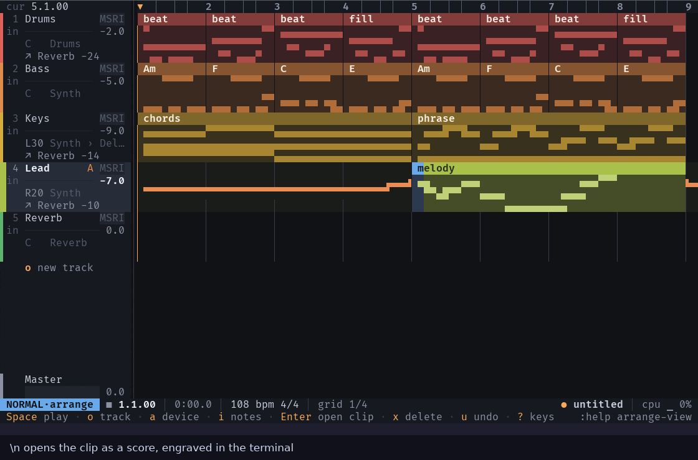
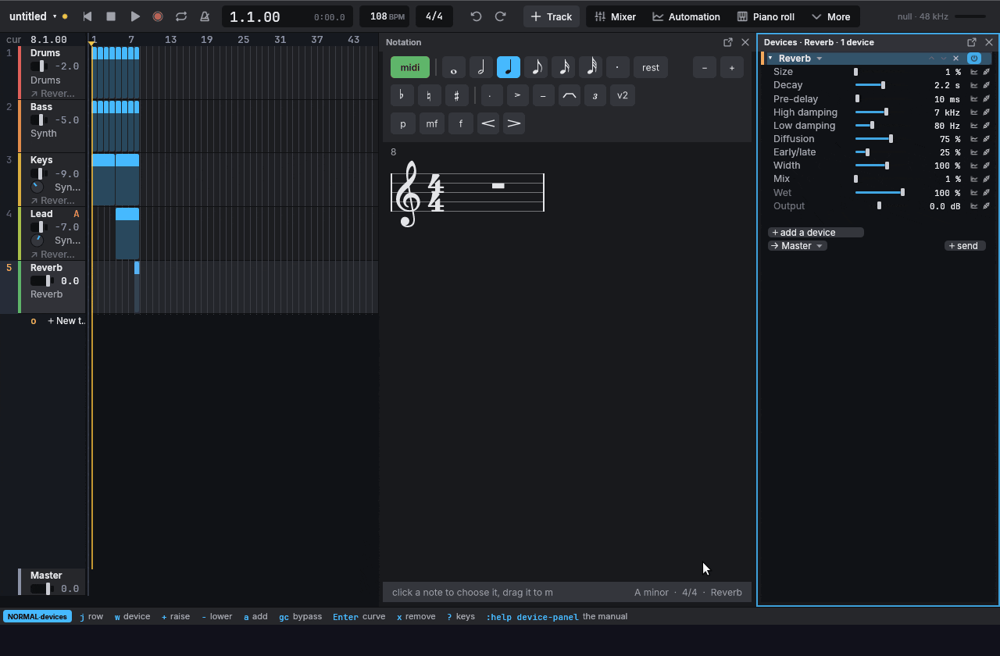
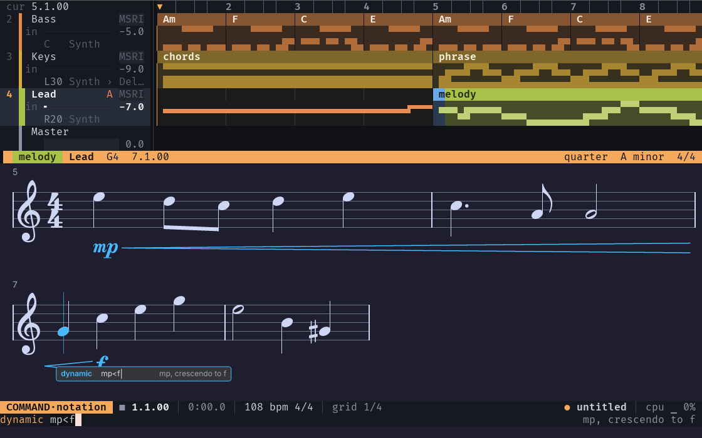

# notation

Staff notation for a clip, to read and to write. In the terminal, paw
draws it in text cells. Where there are pixels, which means in a window of
the graphical frontend and in a terminal that shows images, paw engraves it
with a music font (Leland).

Notation is a view of the MIDI of the clip, in the same way that the
notation editor of REAPER is. The notes are the truth, because they play and
every other view edits them. An edit in notation is an edit of the MIDI and
one undo step, and it changes only the notes that it writes. See
[About](#about).

```lua
paw.ext.load("extensions/notation")   -- or put it in ~/.config/paw/extensions
```







## Try it

1. Type `:ext.load notation`. Put the arrange cursor on a MIDI clip with a
   melody.
2. Type `:notation`. The clip opens as a score at the bottom of the
   terminal.
3. Press `W` until the cursor is on an empty bar. Press `i`, then type
   `cdeg`. Four notes appear, and the cursor moves after each one. Press
   `Esc`.
4. Press `v`, then `B` to select back to the start of the bar. Press `\d`,
   type `p<f` and press Enter. A hairpin from `p` to `f` appears under the
   notes.
5. Press Space two times. The notes play louder along the hairpin.

## How to

### How to open a clip as notation

- In the arrange view or the piano roll, press `\n`, or type `:notation`.
- In the graphical window, choose "Open as notation" in the menu of a MIDI
  clip.

To return to the arrange view, press `\n` again. To close the view, type
`:q`.

### How to enter notes

1. Choose the value: `g5` for a quarter, `g4` for an eighth.
2. Press `i`. Type the letters of the notes, `c` to `b`. Capitals stay at
   the cursor, to make a chord (`CEg`).
3. Press `Esc` to stop.

See [Keys](doc/reference.md#keys) for the keys of insert mode.

### How to write a dynamic, a hairpin or a tempo

1. Put the cursor on the note, or select the notes.
2. Press `\d` for a dynamic or a hairpin, `\t` for a tempo. Type it, and
   press Enter.

Each popover is an Ex command, so `:5,8notation.dyn p` does the same. See
[Popovers](doc/reference.md#popovers).

### How to make the notes play as written again

After you edit velocities or lengths in the piano roll, press `g@` in
notation. Dynamics and hairpins set the velocities again. Staccato and
tenuto set the lengths again.

### How to correct what the transcription wrote

- To change a setting of the transcription for the clip, type
  `:notation.set` and the setting, for example `:notation.set swing off`.
- To see every note as played, press `gR`.
- To forget the decisions of notation and write again from the notes,
  press `g=`.

### How to edit a score of several tracks

Type `:score`. Each staff is a track. `[[` and `]]` move between
instruments. See [Scores](doc/reference.md#scores).

### How to print a part or the score

- For the part of the track, type `:part.export flute.pdf`.
- For every part, type `:part.export parts.pdf all`.
- For the full score, type `:part.export score.pdf score`.

### How to exchange MusicXML

- To open a MusicXML file as a new project, type `:open song.musicxml`.
- To add its parts to this project, type `:import song.mxl`.
- To write the clip as MusicXML, type `:notation.export song.musicxml`.

See [Import and export](doc/reference.md#import-and-export).

### How to move a score between MuseScore and paw

1. In MuseScore, export MusicXML (File, Export, MusicXML, compressed or
   not).
2. Type `:open song.mxl`. The parts become tracks with MIDI clips. Edit
   them with the keys of the notation view or in the piano roll, and play
   them.
3. To return the score, type `:notation.export song.mxl all`. Open that
   file in MuseScore.

Dorico, Sibelius and Finale work the same way.

## Reference

[The reference page](doc/reference.md) describes every key, command,
option and Lua function of notation. `:help notation-reference` opens it.

- [The view](doc/reference.md#the-view)
- [MIDI is the truth](doc/reference.md#midi-is-the-truth)
- [The piano roll beside it](doc/reference.md#the-piano-roll-beside-it)
- [What is written of a MIDI clip](doc/reference.md#what-is-written-of-a-midi-clip)
- [Keys](doc/reference.md#keys)
- [The grammar](doc/reference.md#the-grammar)
- [Popovers](doc/reference.md#popovers)
- [The staff in cells](doc/reference.md#the-staff-in-cells)
- [The engraved page](doc/reference.md#the-engraved-page)
- [Scores](doc/reference.md#scores)
- [Import and export](doc/reference.md#import-and-export)
- [Parts](doc/reference.md#parts)
- [From Lua](doc/reference.md#from-lua)
- [Limits](doc/reference.md#limits)

## About

Notation is a view of the MIDI of the clip. The score is the notes of the
clip, written as a musician writes them, and the decisions that you make in
notation (a spelling, a voice, a staccato, a dynamic) stay beside them. A
note that you enter is a MIDI note at the written place, with the written
length, and a note that you raise, move, lengthen or delete is that MIDI
note, changed. [About MIDI as the
truth](../../docs/explanation/about-midi-as-the-truth.md) gives the reasons.

### Works without the extension

Nothing in the core knows about notation. Without this extension, a clip
written in notation is a MIDI clip like all other clips, so its notes play,
and the piano roll, Ex, the language servers, MIDI export and every other
view edit them as they are.

The data that notation keeps goes with the notes. It stays on a note that
you copy or paste, on a clip that you move or duplicate, and in the saved
project. When you load the extension again, notation shows the notes as
they are now, and it keeps its data on the notes that are still there. An
edit in notation changes only the notes that it writes.

### Compared with REAPER

The model is the model of REAPER. The MIDI belongs to the item, and
notation shows it. The data that notation cannot keep in MIDI stays as
notation data on the notes (the "notation events" of REAPER, which are
spelling, voice, articulation and text), and other data stays with the item
(dynamics, clefs, key signatures).

Note entry in notation writes MIDI. When you write a dynamic, it sets the
velocities of the notes after it, as the dynamic of REAPER does when you set
it to, and the piano roll edits the same notes.

One thing is different. The transcription here reads played music itself
(strums, swing, drift, voices, hands, grace notes, tuplets), and it does not
quantize only for display. Its settings belong to the clip
(`:notation.set`).

### Compared with Dorico and MuseScore

The popovers are the popovers of Dorico, with Shift and a letter there, and
the local leader and a letter here. They use the same words: `mp<f`,
`p subito`, `niente<`, `Allegro q=132`, `rit.`, `a tempo`, `3+3+2/8`,
`f#m`, `|:`, `1.`, `5:4`. paw has no Write and Play mode, because the piano
roll on the same clip is Play mode, and both views edit the MIDI of the
clip. A popover with a selection works on all of it, and its line is an Ex
command that you can type, repeat and record.

The popovers take the place of the palettes of MuseScore and its
`Ctrl-E`/`Ctrl-T`/`Ctrl-K`/`Ctrl-L` text entries. Lyrics and chord symbols
continue with `Space` as in MuseScore, and `-` adds a hyphen.

Note input follows the note input of MuseScore in how it works, and the keys
are the keys of paw. Insert mode (`i`, `a`, or a double click) is the note
input of MuseScore. A letter enters that note in the nearest octave and
steps on, and a capital adds it to the chord. `Alt-2` to `Alt-8` add an
interval above, `t` enters triplets, `~` ties, and `R` repeats the chord.
The note to enter shows where it would go.

You choose durations by number as in MuseScore (`5` a quarter, `4` an
eighth), but paw has no 1 or 9, because its values go from a 32nd to a
whole note. The keys of the piano roll move pitches (`Ctrl-a` `Ctrl-x` a
semitone, `Alt-k` `Alt-j` a step of the key, `}` `{` an octave). The arrows
do not move pitches, and they move the cursor as in all views. In normal
mode the letters are motions and operators, so you enter notes by letter
only in insert mode. A click chooses and does not enter, as in MuseScore
outside note input.
