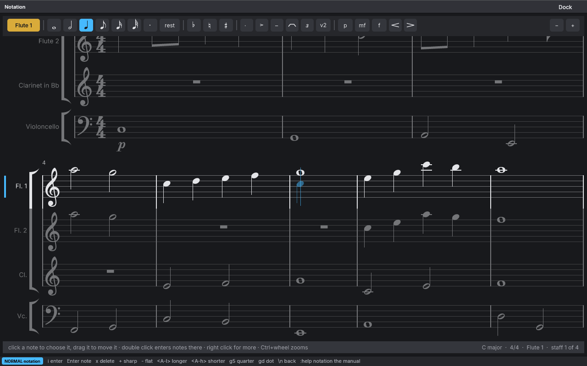
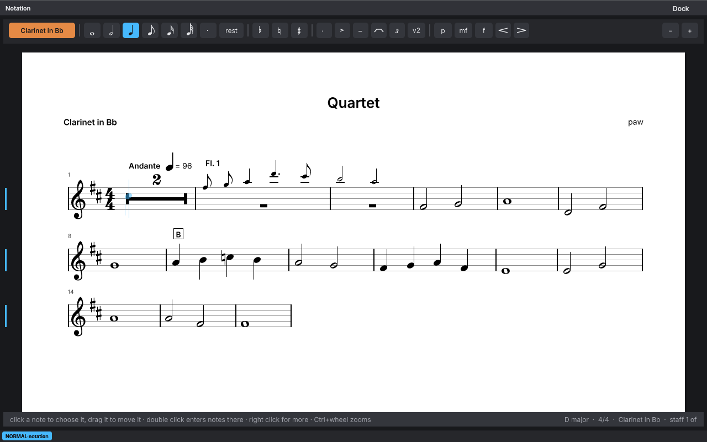

# notation: reference

<!-- tags: notation-reference -->

This page describes the view, the keys, the commands, the options and the
Lua functions of the [notation](../README.md) extension. The README of the
extension has the steps to try it and the how-to guides.

## The view

<!-- tags: notation-view -->

<!-- tags: notation-opening-it -->

| | |
| --- | --- |
| `:notation` | the clip under the arrange cursor, or the piano roll's clip |
| `\n` | the same, in the arrange view and in the piano roll |
| Open as notation | in the window's right-click menu of a MIDI clip |

The view opens at the bottom of the terminal and takes two thirds of the
height. In the graphical frontend, it opens in a window of its own. `\n`
returns to the arrange view as it was before. `:q`, `ZZ` and `Ctrl-w c`
close the view. When you close its window, the view closes too.

`Esc` in normal mode stays in the view, as it does in Vim. It drops a
count, an operator or a selection, and if you press it again soon, it
tells you how to leave.

## MIDI is the truth

<!-- tags: notation-midi-is-the-truth -->

Every MIDI clip opens as notation, and you do not convert it first. Each
time the notes of a clip change, notation makes the score from them again,
with the data that notation keeps (below). It writes and lays out again
only the bars that changed.

| Kept | Where | What |
| --- | --- | --- |
| on each note | `note.meta.notation` | its spelling (`letter`, `alter`, and the `pitch` it was spelled for: a note given another pitch in the roll gets its spelling from the key again), `voice`, `staff` of a grand staff, `grace` (`acciaccatura`, `appoggiatura`), `strum`, `chord`, `beam`, the articulations of its chord (`art`), `orn`ament and `stem`, `lyrics` of verses after the first (the first is `note.meta.lyric`, where the `utau` extension keeps its own), and `len` with `sounding`: how long it is written while it is as long as notation made it (a staccato) |
| with the clip | `clip.meta.notation`, in beats of the clip | `version`, how all this is laid out (1; a clip without one keeps it as before versions were written); the transcription's `settings`; `tuplets` written (or a stretch said to be plain); `marks` (dynamics, hairpins, slurs, text, tempo marks, chord symbols, playing techniques); `bars` (barlines, repeats, endings, rehearsal marks, key and clef changes, the beats' grouping); `layout` (system breaks, bars to a system); `staves`, the clefs it was written on where its notes would now choose others |
| with the track | `track.meta.notation` | its clef, its tablature |
| with the song | the tempo map, the signatures | what tempo marks and time signatures say |

Notation names the written notes after their MIDI notes. `n41` writes note
41, and the note keeps its id wherever it moves. MusicXML that paw writes
carries these names as the `id` of each `<note>`.

The data that notation keeps is on the note, so it goes where the note
goes. A note that you move,
copy, paste or undo in the piano roll keeps its spelling and its voice. A
note that you delete takes its data away with it. Marks along the clip
keep their beats.

**What an edit in notation writes.** Each edit is an ordinary edit of the
notes of the clip (`paw.api.clip_notes_edit`). It is one undo step, and it
includes the data that notation keeps:

| In notation | The MIDI |
| --- | --- |
| a note entered | a note where it is written, as long as its written value (a tied note one note; a tuplet's on exact thirds or fifths; a grace note a 32nd before its note), as loud as the dynamic in force or as the piano roll enters notes |
| a pitch, a respelling, a step of the key | the note's pitch; its spelling kept on it |
| a chord moved, lengthened, dotted | its notes moved or made longer by the written amount, whatever their played lengths |
| a note or chord deleted, a bar taken out | the notes gone; the notes after a bar taken out moved earlier |
| a voice, a staff, a beam, an arpeggio sign, an ornament, a lyric | nothing in the MIDI: kept on the notes |
| a dynamic, a hairpin | the velocities of the notes it reaches (to the next dynamic), a hairpin ramps them (to its end, or to a dynamic written inside it, where it is drawn to end), `sfz` `fp` and other marks of that kind at their place |
| an accent, a marcato | 20, 30 louder |
| a staccato, staccatissimo, tenuto, fermata | half, a quarter of its written length, all of it |
| a tempo mark, a time signature | the song's tempo map, its signature from that bar |

That is all a mark does. It writes the MIDI when you write the mark, and
after that the MIDI is free. In the piano roll, you can give a note marked
`f` another velocity, or a staccato note another length. The mark stays,
as a label.

When you remove a mark, it puts back what it wrote on each note that is
still as the mark left it. It does not change a note that changed after
the mark. When you remove a dynamic, its notes get the loudness of the
dynamic before it again. A slur, text, a repeat sign or a playing
technique writes nothing.

| | |
| --- | --- |
| `:notation.quantize`, `=` | quantize to the notation: each note starts where it is written and lasts as long as written (or as marked) |
| `:notation.apply-marks`, `g@` | make the notes play as the marks say again, after the piano roll changed them: dynamics and hairpins set the velocity, staccato and tenuto the length |
| `:notation.retranscribe`, `g=` | forget what notation decided about the notes (spellings, voices, hands, tuplets): written again from how they play |

**Projects from before.** An older version of this extension kept the
score of a clip written in notation in `clip.meta.score`, and rendered the
notes from it. Without this extension, the notes of such a clip play and
edit as they are. With it, the clip shows as that score said. The first
edit in notation moves what the score said onto the notes and the clip.
The undo step of that edit takes it back.

## The piano roll beside it

<!-- tags: notation-piano-roll-beside-it -->

The roll edits the same notes. Nothing asks for permission and nothing
refuses an edit: the roll is a plain MIDI editor. The roll and the
notation view can be on screen together, on one clip and both with
`:setlocal timebind`. Then the note under the cursor of one view has an
outline in the other: `⟦ ⟧` in the roll, a `◉` head in the staff. The views
find the note by its id.

## What is written of a MIDI clip

<!-- tags: notation-what-is-written-of-a-midi-clip -->

A transcription (`notation.score`) is between the notes of a clip and the
page. It transcribes the notes into written chords, and each chord knows
which played notes it stands for. These chords, with the data that notation
keeps, are the score (`notation.midi`). The data that the score does not
show stays in the notes as played. That data is the offset of each note
from its written place, its real length and its velocity.

- **Chords and strums**: onsets within 35 ms are one chord, in any order.
  A strum or a roll is one chord too, written where it starts. In a strum,
  each string starts up to 70 ms after the last, low to high or high to
  low, while the earlier ones still sound. A strum lasts at most 450 ms. A
  roll slower than 160 ms gets an arpeggio sign with its direction.
- **Onsets** go on the plainest grid that explains each beat. That grid is
  the beat, its halves, quarters or eighths, triplets or sixths, or fifths
  and sevenths. In 6/8 it is the eighths of the beat, or two or four in its
  time. The transcription chooses the grid for each beat by how well it
  fits against how complex it is. A tuplet must fit better than the
  straight grid by a large amount, and its notes must not be shorter than
  the `finest` value. A tuplet alone among plain duple beats needs a better
  fit again, so a straight part played loosely does not get tuplets.
- **Drift**: the transcription follows the distance of the player from the
  grid. First it follows it beat by beat, then by a line fitted through the
  onsets around each beat. So a part played ahead of the beat, or a part
  that slows down (a ritardando against the grid), is still written on the
  beat.
- **Swing**: the transcription recognizes eighths played long-short and
  writes them straight.
- **Lengths**: a chord lasts to the next onset in its voice when the
  silence before that onset is short. That silence is articulation, not a
  rest. A note much shorter than that, within a beat, is a staccato. A note
  held into the next note is legato, not a tie. Other notes get the value
  nearest to what was played, by proportion. So a long note released early
  is still a long note.
- **Grace notes**: a grace note is a note shorter than 100 ms (and a sixth
  of a beat) immediately before a longer note of another pitch. It ends
  before the longer note sounds, and it is not a step of an even run (the
  last note of a fast tuplet).
- **Voices**: a note held well past the next onset, under (or over) notes
  that move, is a second voice. It has stems down (or up) and its own rests.
- **Hands**: on a grand staff, the transcription divides the notes of each
  chord between the hands by the recent positions of each hand. So a melody
  that goes below middle C stays in the right hand.
- **Tuplets** have a bracket with their number. `3` is for triplets, and
  quarter-note triplets over two beats are one bracket. `6` is for a beat
  of sixteenths in sixes. `5` and `7` are for quintuplets and septuplets of
  sixteenths (in the time of four). In 6/8, `2` is a duplet and `4` is four
  eighths in the time of three. A tuplet that you set in notation (`\3`)
  has priority over what the notes suggest. A beat that you set as
  plain has priority too.
- **Rests** merge as the meter divides the bar.
- **Notes drawn exactly on the grid** (in the piano roll) are written as
  they are, because the interpretation is for played music. A played note
  can land on the grid by chance, because the ticks of a MIDI file allow it
  now and then. The transcription reads such a note as played. But if the
  notes next to it are also drawn, or notation wrote it, it is written as
  it is.

Each of these has a setting. The clip keeps the settings in
`clip.meta.notation.settings`:

| `:notation.set` | default | |
| --- | --- | --- |
| `chord` | 35 | ms: onsets this close are one chord |
| `strum`, `strum_span` | 70, 450 | ms between strings of a strum (0 off); its longest |
| `arpeggio` | 160 | ms: a strum this long gets an arpeggio sign (0 never) |
| `triplets` | on | beats may be written in triplets (duplets and quadruplets in 6/8) |
| `tuplets` | on | beats may be written as quintuplets and septuplets |
| `finest` | 0.25 | the shortest duple subdivision, in beats |
| `simplicity` | 1 | how strongly the transcription prefers plain grids (0 to 2) |
| `gap` | 0.3 | a silence shorter than this share of the time to the next onset is articulation |
| `staccato` | on | short detached notes written with a staccato mark |
| `grace` | 100 | ms: the longest grace note (0 off) |
| `swing` | auto | `auto`, `off`, or the long eighth's share of the beat (0.66) |
| `voices` | on | held notes as a second voice |
| `split` | auto | or a pitch: the hands split there |
| `follow` | on | follow the player's drift from the grid |
| `mode` | score | `raw`: every note as played, rounded to `paw.opt.notation_grid` |

`:notation.set` alone lists the settings on a page, with the default of
each setting that the clip changed. `:notation.set swing off` sets one
setting. `:notation.set swing default` forgets it, and `:notation.reset`
forgets all of them. `:notation.raw` (`gR`) shows or hides the raw view,
for a check. The raw view shows every note as it is, rounded to the grid.
It has one chord for each start, and middle C splits the hands.

**What you decide** stays, also after changes in other views (see
[MIDI is the truth](#midi-is-the-truth)). For a note, that is its voice,
hand, spelling and articulations, and if it is a grace note. It is also the
arpeggio sign of a strum, notes that are one chord, and a broken beam. For
the clip, it is the tuplets, marks and bars.

Notes that you enter in notation are drawn exactly on the grid, and are
written as they are. A note marked staccato keeps its written length while
it is as short as the mark made it. Notation does not keep a tie. A tied
note is one note, and notation writes it again as the meter divides it.

Other parts of the page:

- **Measures** follow the bars of the song. Where the kernel keeps time
  signatures along the song (`paw.time.signature_at`), each bar takes its
  own signature. The page shows the new signature where it changes.
- **Clef**: treble when the notes stay above A3, bass when they stay below
  E4, and a grand staff when they need both. `:notation.clef bass` sets the
  clef for the track (`treble`, `treble8` for guitar, `bass`, `bass8`,
  `alto`, `tenor`, `grand`, `auto`), and `track.meta.notation` keeps it. A
  clip written in notation keeps the clefs it was written on, where its
  notes would now choose others. For example, a melody taken a little under
  the treble staff stays on it. A clip also keeps a clef change at a bar
  (`\C`, see [Popovers](#popovers)).
- **Key**: the key of the project (`paw.harmony.project_key`). Modes and minor keys take the signature of their
  relative major. `:notation.key Eb major` sets the key, and
  `:notation.key off` clears it. With a clip open in the view, the command
  writes a key signature from the bar of the cursor (`\k`, see
  [Popovers](#popovers)). The key of the first bar is also the key of the
  project.

  With no key set, the title names the minor key that the music reads in
  (`A minor`, not `C major`). In a song of more than 2000 notes, this
  step is slow. So it occurs when the edits pause, and the title changes
  a moment later.
- **Spelling**: notes of the key take its letters. The other notes lean the
  way the key does. An accidental stays in force to the end of the bar. A
  tied note keeps its accidental across the barline without a sign. A note
  altered in one bar gets a reminder sign in the next bar.
- **Stems** go by the note furthest from the middle line, or by the voice.
  **Beams** join eighths and shorter notes within a beat (four eighths in
  half a 4/4 bar, three in 6/8), and within a tuplet, with part beams.
- **Tablature**: `:notation.tab guitar` puts a tab staff under the notation
  of the track. The other choices are `bass`, `dropd`, `dadgad`, `7string`
  and `bass5`, or the notes of the strings from the lowest
  (`E2 A2 D3 G3 B3 E4`). `track.meta.notation.tab` keeps the choice. The
  command also writes a guitar in its treble clef an octave up. The notes
  of each chord go on different strings within the reach of a hand, and the
  hand moves as little as possible. `meta.notation.string` on a note sets
  its string.
- **Lyrics**: the page writes the `meta.lyric` of a note under it. The vocal
  clips of the `utau` extension keep their lyrics there.
- **Several tracks**: `:notation.tracks` (`zS`) shows a score of every track
  with MIDI over the stretch of the open clip, a staff for each. You edit
  the staff of the open clip. The same command again returns to the clip
  alone. [The score](#scores) shows every track, the tracks of a group or
  the tracks of a selection. [Parts](#parts) shows the parts.

## Keys

<!-- tags: notation-keys -->

In the notation view, counts, registers, `.`, macros and marks work as
they do in all views. The operators and text objects work on the written
score (see [The grammar](#the-grammar)). The rows of the view are pitches.
So a visual selection, and the single keys of the roll on it, work as in
the piano roll. Every key that edits writes the MIDI of the clip (see
[MIDI is the truth](#midi-is-the-truth)), as one undo step.

<!-- tags: g3 g4 g5 g6 -->

| Keys | |
| --- | --- |
| `h` `l` | back, on by the chosen value |
| `j` `k`, `Ctrl-d` `Ctrl-u` | down, up a line or space; an octave |
| `w` `b` `e` | next, previous note or rest; end of the note |
| `W` `B`, `0` `^` `$`, `gg` `G` | next, previous bar; start of the clip, first note, end; the highest, lowest note's line |
| `Enter` | add a note of the chosen value at the cursor, or take away the one there |
| `x` | delete the note under the cursor |
| `+` `-`, `Ctrl-a` `Ctrl-x` | sharpen, flatten it (a semitone, spelled with a sharp or a flat); a count first is how many |
| `Alt-k` `Alt-j` | move it up, down a step of the key |
| `}` `{` | move it up, down an octave |
| `Alt-l` `Alt-h` | lengthen, shorten its chord by the chosen value, ties included |
| `g.` | dot its chord, or take the dot away |
| `g2` … `g7` | choose the value: 32nd, 16th, eighth, quarter, half, whole (the numbers MuseScore uses) |
| `gd` | dotted values on or off |
| `d` `y` `c` `>` `<` `=` `gl` | operators: delete, yank, change, move later or earlier by the chosen value, quantize the notes to the notation, loop; the others are in [The grammar](#the-grammar) |
| `v` `V` `Ctrl-v`, then `x` `Ctrl-a` `Ctrl-x` `Alt-k` `Alt-j` `}` `{` | on a selection, which takes in the note under the cursor, as Vim's takes the character |
| `:` on a selection | a command for it: the line starts `:'<,'>` (`:'<,'>notation.cresc`) |
| `p` `P` | paste after the note, at the cursor (a bar yanked with `yab`: after, before the cursor's bar) |
| `i`, `a`, `I`, `R` | enter notes at the cursor; after the note; and push later music along; as new pitches for the notes there |
| `gh`, `gp` | hear the cursor's pitch; playhead to the cursor |
| `zi` `zo` | spread the notes out, draw them closer; in the cell view zoomed in, a row for every line and space; on the engraved page, a larger, smaller staff |
| `zg` | the engraved page as one long system that scrolls sideways (the galley), or wrapped |
| `zp` | the engraved systems on pages of paper, under the title and composer (the page view), or without pages |
| `zs` | start a system at the cursor's bar; again, let the bar go where it fits |
| `zj` | keep the cursor's bar on the system before; again, let it go where it fits |
| `:notation.bars-per-system 4` | that many bars on every system; without a number, as they fit |
| `K` | what is under the cursor: the note as written (its value, voice, marks and the dynamic in force) and the MIDI note it is, then the clip and the track |
| `\n` | back to the window before |
| `:q` `ZZ` `Ctrl-w c` | close the view |
| `Esc` | stay: drop a count, an operator or a selection |

**Note entry** (`i`) works as in other notation programs. A letter `c` to
`b` enters that note at the cursor, with the chosen value, and steps on.
The note goes in the octave nearest the note before (within a fourth), and
the key alters it. A capital letter stays, to build a chord (`CEg`).

Notes go into a voice of the staff that the note is written on. That voice is
the voice of the note under the cursor when you press `i`. Else it is the
chosen voice: 1, unless `v` or `:notation.voice` sets another.

Notes replace what that voice had there. If a note cuts into a chord, the
chord keeps the part before, and the remainder becomes a rest. A note
longer than what is left of the bar gets a tie over the barline. Note entry
does not touch other voices or other staves.

On a single staff, a note more than three ledger lines under or over the
staff makes a grand staff. The note goes on the new staff, for example a
bass under a melody. This occurs only for the first note after `i`, from the
cursor line. The notes that follow it stay on the staff of the note before,
on ledger lines, and replace what the voice had there. For example, the
letters `g e a a` on a sketch of C4 D4 E4 F4 replace all four notes.

| Keys | |
| --- | --- |
| `a` … `g`, `A` … `G` | enter a note and step on; enter it and stay |
| `2` … `7` | choose the value |
| `.` | dotted values on or off |
| `+` `#`, `-` | sharpen, flatten the last note entered |
| `'` `,` | the last note entered an octave up, down |
| `Alt-2` … `Alt-8` | add a second … an octave above the last note entered, in the key, to its chord (`C` `Alt-3` `Alt-3` is a C major triad) |
| `~` | hold the last note entered on by the chosen value, tied where it crosses a beat or a barline, and step on |
| `t` | enter triplets of the chosen value (a triplet of rests is made where there is none, and filled), or plain values again |
| `v` | enter in the other voice (1 or 2); `:notation.voice 3` chooses any of four |
| `R` | enter the last chord (or note) again here, and step on |
| `r` `0` | a rest: clear the chosen value and step on |
| `Space` | step on, and leave what is there |
| `Backspace` | step back and remove what starts there |
| `Esc` | back to normal mode |

## The grammar

<!-- tags: notation-grammar -->

A Vim grammar for music: an operator, then a motion or a text object, with
counts, registers, `.` and undo as in all views. Text objects are parts of
the score (events, measures, voices), not groups of notes in time. Every
operator changes the written score, and so the notes that the score
writes. So `d3ab`, `gUip`, `y2iv` and `.` after any of them are exact, and
each is one undo step. A motion acts in the staff and voice of the cursor.
A visual selection acts in every staff and voice (a block, in its pitches).

<!-- tags: i. a. iv av -->

| Object | `i…` | `a…` |
| --- | --- | --- |
| note `n` | the note under the cursor | with the notes its ties join |
| chord `c` | the chord (`3ic` three) | with its grace notes and ties |
| beat `.` | the beat, in the cursor's voice (`2i.` two) | the beat in every staff and voice |
| bar `b` | what the bar holds, every staff and voice (`2ib`) | the bar itself: `dab` takes it out and the music closes up, `yab` then `p` or `P` puts it in after or before the cursor's bar |
| phrase `p` | the notes under the cursor's slur, else between the rests around it (`2ip`) | with the rests after it |
| voice `v` | the cursor's voice in the bar (`2iv`) | the voice through the score |
| staff `s` | every voice of the staff in the bar | the staff through the score |
| tuplet `t` | the tuplet's notes | the tuplet, rests and all |
| slur `l` | the notes under the slur | and the slur |
| clip `e` | the whole clip | the whole clip |

`ic` is the chord here. In the piano roll, `ic` is the clip. In notation,
the clip is `ie`, as it is in the piano roll too.

| Operator | |
| --- | --- |
| `d` `y` `c` | delete (chords become rests, notes leave their chords, bars go), yank (a fragment of the score, which pastes as written here and as played in the piano roll), change |
| `>` `<` | move later, earlier by the chosen value, as written: the notes move by as much, with their marks, and what is there gives way |
| `gU` `gu` | up, down a step of the key, and chromatic notes stay chromatic; a count is the steps (`3gUib` a fourth up) |
| `g+` `g-` | up, down a semitone, spelled as the key has it (an octave keeps the spelling); a count is the semitones |
| `g~` | respell each note: G sharp, A flat, G sharp again; E, F flat (`g~in` the note under the cursor) |
| `g(` | a slur over the notes (`g(ip`, `g(3w`; on a slur's start again, taken away; on a selection too). `s` is solo wherever there is a track |
| `g?` | retrograde: backwards, rhythm and pitches, grace notes with their chord; with a count (`2g?ib`) an inversion about the first note, in the key |
| `gq` | tidy: spelled as the key has it, beams as the meter has them, values and ties written again as the meter divides the bars |
| `!` | filter: asks for a filter, `reverse`, `transpose 12`, `rhythm 1/8`, or any shell command, which reads the music a line an event (`1/4 C4 E4`, `1/8 r`, lengths as parts of a whole note) and writes it back so: `!ib tac`, `!ip sed s/D4/G4/` |
| `=` `g=` `gl` | play as written, write again from the playing, loop |

| Motion | |
| --- | --- |
| `f` `F` + letter | to the next, previous note of that name in the voice (`2fe`); with an operator the note found is taken in, as Vim's `df` |
| `t` `T` + letter | to the note before (after) it |
| `;` `,` | the last `f` `F` `t` `T` again, the other way |
| `)` `(` | the next, previous phrase: a note after a rest |
| `]v` `[v` | the next, previous voice (then the next staff's); note entry goes into it |
| `Ctrl-j` `Ctrl-k` | the staff below, above |

**Entry modes.** `i` writes over what is there in its voice. MuseScore and
Dorico do the same by default. `I` pushes later music in the voice along by
what you enter, over barlines. This is the Insert of Dorico. During entry,
`Insert` toggles between the two modes.

`r` and a letter change the note under the cursor to the nearest pitch of
that name, and keep its rhythm. On a chord, they change the top note.
`3rc` changes three chords.

`R` is re-pitch mode. Each letter makes the next chord of the voice that
note, and keeps the rhythm. A capital adds a note to the chord. So you can
copy a rhythm, then press `R` and type the letters. In this view, `R` is
not record.

The badge of insert mode shows `INS`, `PUSH` or `REPITCH`, and
a tuplet or grace note that comes next.

| Keys in insert mode | |
| --- | --- |
| `/`, `//` then a letter | a grace note before the note at the cursor: an acciaccatura, an appoggiatura |
| `Ctrl-t` | a tuplet to enter: `3` (three in the time of two), `5` (in four), `5:4`, `2:3`, `off` |
| `Ctrl-o` | one command of normal mode, then back to note entry |
| `Ctrl-r` and a register | paste it at the cursor and step past it (`Ctrl-r "`) |
| `Tab` | take the suggestion `paw.complete` shows as ghost notes; in normal mode `3 Tab` takes three notes or chords of it (with none shown, `Tab` is the next view) |

**Ex.** `:s`, `:g` and `:d` over notes change the notes of the clip as they
do in the piano roll, and the score shows the change. `:%s/c4/db4/g` raises
the C4s a semitone, spelled as the key has it. `:g/e4/d` deletes the E4s.

**Edits of the score.** These keys work on the written chord under the
cursor. Its notes move and get longer by the written amount, whatever their
played lengths:

| Keys | |
| --- | --- |
| `L` `H` | move the chord later, earlier by the chosen value, with its grace notes and marks; what is there in its voice gives way |
| `Alt-l` `Alt-h` `g.` | its written length longer, shorter, dotted, ties included |
| `X` | delete the chord: a rest (`x` deletes the one note) |
| `=` | an operator: the notes quantized to the notation, start where they are written and as long, for example `=in`, `=ib`, or on a selection |
| `g=` | an operator: what notation decided about the notes forgotten, the bars written again from how they play |
| `gV` | the note (or the chord) into the other voice, and enter in that voice |
| `gH` | the chord onto the other staff of a grand staff, in a voice free there |
| `gs` | arpeggio sign up, down, none; on a selection, the chords one chord (a strum) |
| `gG` | the chord a grace note of the next (its time goes to the chord before), or the chord's grace notes become notes again |
| `gb` | break the beam before the chord, or join it |
| `g'` `g>` `g_` `g^` | staccato, accent, tenuto, marcato on the chord (or a selection), and played so |
| `g(` | on a selection: a slur, the notes played legato (it is the slur operator: `g(ip`) |
| `Alt-l` `Alt-h` | on a selection: each chord longer, shorter by the chosen value |
| `gR` `zS` | the raw view; several tracks |

`:notation.quantize` quantizes the whole clip to the notation.
`:notation.retranscribe` writes it again from how it plays.
`:notation.transpose 2` moves the chord under the cursor up two semitones,
spelled by the key (`-1 steps` moves it a step of the key down).

**Ranges.** Every `notation.*` command that works on notes or puts marks
takes a range in front, as in Vim. `:'<,'>` is the last selection (what
`:` types from visual mode), `:5,8` is bars 5 to 8, and `:5` is bar 5.
Examples are `:5,8notation.transpose 2`, `:'<,'>notation.slur`,
`:9notation.dyn p`, `:1,4notation.repeat` (both signs around bars 1 to 4)
and `:5,8notation.quantize`. These commands take a range: `art`, `dyn`,
`cresc`, `dim`, `slur`, `text`, `repeat`, `quantize`, `apply-marks`,
`retranscribe` and `transpose`. The commands that the popovers run take
one too: `tempo`, `meter`, `key`, `clef`, `bar`, `rehearsal`, `chord`,
`lyric`, `orn`, `tech`, `interval`, `tuplet` and `voice`.

| Command | |
| --- | --- |
| `:notation.open` | show the clip under the cursor as notation (as `:notation`) |
| `:notation.value eighth` | the value of the notes that you enter (`g2` … `g7`) |
| `:notation.art accent` | staccato, accent, tenuto or marcato on the chord or the range |
| `:notation.orn tr` | an ornament: `tr`, `mordent`, `prall`, `turn`, `fermata`, `trem`, `off` |
| `:notation.tech pizz.` | a playing technique, written: `pizz.`, `arco`, `con sord.`, `off` |
| `:notation.bar :\|` | a barline at the cursor or the range's end: `\|\|`, `\|.`, `\|:`, `:\|`, `:\|:`; endings `1.` `2.` over the range; `off` |
| `:notation.meter 6/8` | the time signature from the cursor's bar, the music written again in its bars (`3+3+2/8`, `C`) |
| `:notation.rehearsal` | a rehearsal mark at the cursor's bar (the next letter), and a song marker |
| `:notation.chord Cmaj7` | a chord symbol at the cursor (`G/B`, `N.C.`, `off`) |
| `:notation.lyric la-` | a syllable under the note at the cursor; `verse=2` for the second verse |
| `:notation.interval 3` | a note an interval above (`-6` below, `m3`) each chord of the range |
| `:notation.tuplet 3` | the beat or the range as a tuplet (`5:4`); on a tuplet, `off` gives plain values; in insert mode, enter in it (`off` plain) |
| `:part.bars-per-system 4` | in the part shown, that many bars to every system; without a number, as they fit |

**Marks that play.** `:notation.dyn mf` puts a dynamic at the cursor
(`ppp` to `fff`, `off`). It sets the velocities of the notes from there to
the next dynamic to its loudness. `:notation.cresc` and `:notation.dim` put
a hairpin over the selection or range, or to the end of the bar. The
hairpin ramps the velocities to the next dynamic.

`:notation.slur` puts a
slur over the selection. `:notation.text Allegro` writes text above the
staff, and `:notation.repeat start` (`end`, `off`) puts a repeat sign at
the bar of the cursor.

The slur, the text and the repeat sign are only written: the timeline of
the song plays as it is. A staccato makes a note half its written length,
and a tenuto all of it. An accent makes a note 20 louder, and a marcato 30.
Each mark writes the MIDI when you write the mark. After that, the notes
are free to change (see [MIDI is the truth](#midi-is-the-truth)).

**Marks follow notation edits.** A note that you enter, move or paste in
notation gets the loudness that the marks ask for where it lands. That is
the dynamic in force, the ramp of a hairpin there, or the push of an
accent. A note that stays under the same marks keeps its velocity. A note
that no edit touched never changes. So a notation edit at one place leaves
a piano roll edit at another place alone.

To make MIDI agree with the marks again, use `:notation.apply-marks`. With
a range (`:5,8notation.apply-marks`) or on the selection, it writes what
the marks ask for into the notes in that part, as one undo step. `g@` with
a motion or selection (`g@ib`, `vjg@`) does the same with a prompt. While
the prompt is open, you hear the change, and the page shows it in the
accent color. `Enter` writes it, and `Esc` leaves nothing.

A second run has no effect (an accent does not add twice). When you remove
a mark after that, the note gets back what it had before.

## Popovers

<!-- tags: notation-popovers -->

You write all that is not a note with a popover, as in Dorico, in the
shape of a Vim prompt. The local leader (`\`, option
`paw.opt.localleader`) and a letter open a prompt of one line at the
caret. In visual mode, the popover is for the selection. In insert mode,
`Ctrl-o` comes first (`Ctrl-o \d`), and note entry continues after it.

`Tab` completes, and shows the meaning of each choice. `Up` and `Down` go
through what you typed before in that popover. While you type, the page
shows what the popover would write, in the ink of the accent color. You
also hear it, as a trial (`paw.audition`). The line tells what the popover
would do, or why it cannot. `Enter` writes it as one undo step, and `Esc`
leaves no trace.

Each popover is an Ex command with what you typed after it. If there is a
selection, the command runs with its range: `\d` `mp<f` on a selection
runs `:'<,'>notation.dyn mp<f`. So `.` writes it again at the cursor, `@:`
runs the line again, and a macro records it. `:5,8notation.dyn p` and
`:9notation.tempo rit.` do the same without the popover. `\.` opens the
last popover again, with what you typed in it.

| Keys | Popover | Accepts | Writes |
| --- | --- | --- | --- |
| `\d` | dynamics | `mp`, `sfz`, `fp`, `p subito`, `mp<f`, `<`, `>`, `niente<`, `off` | a dynamic at the cursor (the start of the selection); a hairpin over the selection, or to the next dynamic when there is no selection, and the dynamic it reaches. `sfz` `sf` `fz` `rfz` accent the notes there, `fp` `sfp` are loud there and soft after |
| `\t` | tempo | `Allegro q=132`, `q.=60`, `Andante`, `rit.`, `accel.`, `a tempo`, `off` | a tempo mark, and a point of the song's tempo map: `rit.` and `accel.` ramp a fifth slower or faster to the end of the selection (or the bar), `a tempo` returns to the last tempo marked; a word alone has its tempo (Allegro 132) |
| `\m` | time signature | `6/8`, `3/4`, `3+3+2/8`, `C`, `¢` | the song's signature from the cursor's bar: every note stays where it is and is written in the new bars, tied over the new barlines; a grouping (`3+3+2/8`) and `C` `¢` kept with the clip |
| `\k` | key | `Eb`, `f#m` (a small letter is minor), `D dorian`, `off` | a key signature from the cursor's bar; in the first bar, the project's key too |
| `\C` | clef | `treble`, `bass`, `alto`, `tenor`, `treble8`, `bass8` | a clef change at the cursor's bar on its staff; in the first bar, the track's clef |
| `\b` | barlines, repeats, endings | `\|\|`, `\|.`, `\|:`, `:\|`, `:\|:`, `1.`, `2.`, `off` | at the cursor's barline (the one before the bar when the cursor is at its start, else after it); an ending over the bars of the selection |
| `\X` | text | `dolce`, `Solo` | text over the staff |
| `\r` | rehearsal mark | `A`, `Intro`; Enter alone writes the next letter | a boxed mark at the bar, and a marker of the same name in the song |
| `\q` | chord symbols | `Cmaj7`, `G/B`, `F#m7b5`, `N.C.` | over the staff; `Space` writes it and goes to the next beat, the prompt still open; `Tab` offers first what the notes there sound (`paw.harmony`) |
| `\l` | lyrics | a syllable; `Space` the next note, `-` a hyphen, `_` an extender; `verse=2 ` first for verse 2 | under the note at the caret, and on to the next of its voice |
| `\i` | intervals | `3`, `-6`, `8`, `m3`, `M6`, `P5` | a note that far above the top (below the lowest) note of each chord of the selection, in the key |
| `\3` | tuplets | `3`, `5`, `5:4`, `7:8`, `off` | the beat at the cursor (or the selection) as that tuplet; on a tuplet, `off` gives plain values again; in insert mode, the notes entered next |
| `\v` | voice | `1` to `4` | the voice of the notes that you enter; with a selection, its chords moved into it |
| `\o` | ornaments | `tr`, `mordent`, `prall`, `turn`, `fermata`, `trem`, `off` | on the chord, or each chord of the selection; a fermata holds its note's whole value |
| `\p` | playing techniques | `pizz.`, `arco`, `con sord.`, `sul pont.` | text at the cursor (written only) |
| `\.` | the last popover again | | with what was typed in it |

The letters are the letters of Dorico, where the letter of Dorico is not a
note name. They are on the local leader (`\`), not on the leader (`<Space>`), so
the leader keeps its meaning in the notation view. There, as in all views,
`<Space>d` is the device panel, `<Space>m` the mixer, `<Space>l` the session view and `<Space>p`
the piano roll. `<Space>c` and `<Space>x` start `<Space>ca` (fixes and actions) and the mix
measurements, as in all views. The clef is `\C` and text is `\X`. `\.`
repeats the last popover.

`paw.opt.localleader` changes the local leader. A key of a view of your
own that would be on a leader key of the whole program belongs on
`<localleader>` too. The check of the key rule tells you so.

The prompt shows under the system of the caret: in the terminal, in a
window, and on the pixel surface of a terminal. So what it previews stays
in sight. It shows only there, and the status line
of the window does not repeat it. Before you type, it shows dim examples of
what to type. `Tab` offers the choices.

## The staff in cells

<!-- tags: notation-staff-in-cells -->

Where the terminal cannot show pictures (tmux, a plain terminal, a remote
shell), paw draws the staff in text cells. It uses characters that every
common monospace font has (DejaVu Sans Mono, JetBrains Mono, Fira Code,
Noto Sans Mono). The staff lines are unbroken from the clef to the end of
the system, and the barlines join them (`┬ ┼ ┴`). A grand staff has a
brace. Heads are two cells wide, filled (`██`) or open (`()`). Stems go up
from the right side and down from the left side, with flags (`╲ ╱`) or
beams (`━`) at the tips.

Dots come after the heads, accidentals come before them, and ledger lines
go through or under them. Rests look like rests. The whole rest is under
the fourth line and the half rest sits on the third (`▄▄` `▀▀`). The
quarter rest is a zigzag (`╲ ╱ ╲`), an eighth rest is a `7`, and a
sixteenth rest is two.

Ties and slurs are arcs (`╰──╯`, `╭──╮`), and tuplets are a bracket with
their number. Dynamics and hairpins are under the staff (between the two
staves of a grand staff). A hairpin continues over barlines to its end.
Notes low under the last staff, with their stems down, get rows of their
own under it, so nothing goes into the next system. The prompt of a
popover opens under the row of dynamics, so a dynamic that it previews
stays in sight.

At the usual zoom, the staff is dense. Each line has a row and each space
is between two rows. So a staff takes five rows, and a grand staff takes
eighteen, with room for two ledger lines and the stems. A head in a space
covers the rows on each side (`▄▄` over `▀▀`, an open one `╭╮` over `╰╯`).
`zi` spreads the staff to a row for every line and space, nine for each
staff. This is easier to read, and the pointer can reach the spaces.

`zo` returns to the dense staff. A panel too low for both staves of a grand
staff shows the staff of the cursor. With `paw.opt.ascii`, the staff is
open and in plain ASCII (`-` `|` `+`, heads `@@` and `()`, `#` `b` `n`, the
treble clef `&`, the bass clef `?:`, a C clef `B`). A clef or key that
changes inside a system shows at the bar, and the clef is smaller.
Naturals cancel the old signs of a key.

The accidentals `♯ ♭ ♮` are the one exception to the common set. Fira Code
and JetBrains Mono do not have all of them. Terminals then take them from
a font that has them (DejaVu Sans Mono or Noto Sans Mono, which nearly
every system has). They stay one cell wide.

## The engraved page

<!-- tags: notation-engraved-page -->

In a window, and on the pixel surface of a terminal that shows images, paw
engraves the staff with the SMuFL font Leland. It uses the note heads,
clefs, accidentals, flags, rests and marks of the font. The engraving
defaults of the font set the thickness of staff lines, stems, beams, ties
and slurs. Stems attach where the font says.

Each line is on whole pixels. The staff space is a whole number of pixels
(`zi` `zo` step through 6 to 24). On a terminal it is a third of the height
of a cell (9 px in a 27 px cell). So the staff of one hand fits in five or
six rows, as in the cell view.

On a terminal, each measure is a whole number of columns wide and each
system is a whole number of rows high. The drawing tells where the
barlines are. So paw sends the page to the terminal as images cut at
barlines, and an edit sends again only the measure that it changed.

Behind Bars (Gould) is the reference for the details. Beams slope by not
more than a staff space. They sit on, straddle or hang from a staff line,
and they stand apart by the beam spacing of the font, on whole pixels. Ties
are flat and near the heads, on the side away from the stem.

The upper
notes of a chord tie up, and its lower notes tie down. A longer tie rises a
little more, to a maximum of 0.6 of a space. Slurs are rounder.

Ties and slurs are thicker in the middle. The accidentals of a chord stand
in columns. Accidentals (also in parentheses), grace notes and arpeggios
get more room only where the spacing of the notes leaves too little. They
then stand half a space clear of the note before. A tuplet under a beam of its
own has only its number, past the beam. All other tuplets have a bracket
from the first head to the last, clear of the stems and what is on them.

With two voices on a staff, a rest moves out of the way of the notes of the
other voice. A lyric gets the room that it needs: paw spaces its note so
that syllables do not touch.

**A placer puts the items outside the staff.** Each staff of a system has
a skyline (`notation.skyline`). The skyline is the outline of its notes,
stems, beams, flags, accidentals, ledger lines, articulations, ties and
tuplets, seen from above and from below. The placer puts items against it,
nearest first. These items are slurs, the bar number, lyrics, dynamics and
hairpins, text, and the kinds that other features add (chord symbols,
rehearsal marks, tempo text). Each item is clear of all the items before
it, and then becomes part of the outline.

The dynamics and hairpins of a system stand on one line along it (the
magnetic layout of Sibelius). The line is under the staff, or over it on a
staff with lyrics (Gould). A hairpin continues over barlines and systems.
It stops short of a dynamic at each end, and at the next dynamic inside it.
The space between the staves of a system, and the height of each system,
is what their skylines need, so nothing overlaps. For example, a grand
staff with dynamics between its hands gets more space only there.

**Slurs bend round the notes.** A slur goes under the heads when every stem
under it points up, else over them. In two voices, the slur of the upper
voice is over, and the slur of the lower voice is under. The ends of a slur
are half a space from the end notes, at the heads or past the stems.

A slur is as round as its length asks, and rounder where the notes under
it need it. Where a slur cannot be rounder and still look correct, its ends
rise, each for what is near it. When one slur is inside another, the placer
places the inner slur first. A slur over a system break has two parts, and
the second part starts after the clef and key.

**Systems break balanced.** The breaker divides measures into systems over
the whole clip at once (`notation.breaks`). It does not fill one system at
a time, but finds a total fit, as Knuth and Plass describe.

The cost of a system grows with the
square of how far its bars stretch, so all systems share the stretch. No
system stretches past twice the own width of its bars while another way
exists. A bar stands alone on the last system only when all other ways are
worse. Every system but the last fills the width, and the last does too
when it is three quarters full.

`zs` starts a system at the bar of the cursor, `zj` keeps that bar on the
system before, and `:notation.bars-per-system 4` sets the count. The clip
keeps these (`clip.meta.notation.layout`, each break at the beat of its
bar), and undo works on them as on any edit. The cell view of the terminal
breaks the same way, in whole cells. A tie into a new system starts after
the clef and key, and has the length of a tie.

The ink is the foreground color of the terminal (the text color of the
window). Staff lines are lighter. The selection, the cursor, suggestions
and diagnostics take the accent colors of the theme. Light ink on a dark
page is a little thinner, because it looks heavier.

The page is systems wrapped down the screen. With `zg`, it is one long
system that scrolls sideways (the galley). The galley keeps the start of
the system at the left. While the song plays, it keeps the playhead a third
of the way across. With `zp` (the page view), the systems are on sheets of
paper. The paper is A4, or US letter with the option `notation_sheet`, at
1.75 mm to the staff space (a staff 7 mm high).

Pages have margins. The first page has the title of the project
(`meta.title`, else its name) and the composer (`meta.composer`) at the
head. The other pages have page numbers. A system that does not fit starts
the next page, and the systems of a full page spread over it. The paper is
white with black ink, unless the option `notation_paper` is `"theme"`: then
the page keeps the colors of the theme. The staff space is the largest
whose page fits the width, unless you zoom.

Over the page, separate from it, paw draws these items:

- the selection: a faint band, and its notes in the accent color
- the suggestions from `paw.complete`: the notes laid out as notation would
  write them, faint
- the diagnostics from `paw.diagnostic`: a wavy line under the staff, the
  notes tinted, a mark in the margin, and the message on the info line when
  the cursor is on it
- the cursor: a hairline at its beat, and the note that `Enter` or a click
  would put there, half transparent. On a note, the cursor shows that note
  in the accent color.
- the playhead.

In the window, the toolbar has these controls:

- the value (whole to 32nd), the dot, rests, and the accidental of the
  notes that you enter (flat, natural, sharp, or none for the accidental of
  the key)
- marks on the chord under the cursor (staccato, accent, tenuto, slur,
  triplet, second voice)
- marks at the cursor (p, mf, f, crescendo, diminuendo)
- the zoom.

The line at the bottom shows what is under the cursor. At the right, it
shows the key, the time signature and the track. On a terminal, the
toolbar and that line are not there, because the bars of the terminal show
the same data.

| Pointer | |
| --- | --- |
| click | the cursor to that note (and hear it), or to that line or space and time: on the chosen value within the beat (an eighth chosen, on an eighth; in triplets, on a third of the beat), so notes typed next fall on the beat |
| Alt-click | the same, on the sixteenths' grid (`notation_grid`) |
| Shift-click | a selection from the cursor to there |
| drag on the paper | select a box (a block) |
| drag a note | move it in time (on the grid) and up or down the staff; it keeps its distance from the key (a sharp stays a sharp) |
| double click | enter notes from there (insert mode) |
| click in insert mode | put a note of the chosen value there, at that line or space and time (snapped as a click is; Alt on the grid), and hear it; with Rest on, clear that stretch. The note to enter follows the pointer |
| right click | a menu of what can be done there: delete, sharpen, flatten, respell, marks, voice, triplets; on the paper, a note or a rest of the chosen value, paste; the galley |
| wheel | scroll the systems (the galley sideways); with Ctrl, zoom |

Every key of the terminal view works in the window too. The pointer works
the same in the cell view of the terminal, one cell at a time. A click on a
head chooses that note, and a click on a line or space chooses that place
and time. On the dense staff a row is a line, so to reach a space, use
`zi` or the keys. The drag, Shift, the double click, the click in insert
mode and the menu of the right click are as above. The wheel scrolls by
measures.

In the cell view, the cursor off a note shows as the note that you would
enter (a shadow note). In insert mode, this note follows the pointer. The
status line shows the note and time under the pointer.

## Scores

<!-- tags: notation-scores -->

You edit a score of several tracks where you read it, as Dorico and
MuseScore edit theirs. Each staff is a line, and the staff of the cursor is
the track that every key writes. No other state is necessary. A move
between staves is a move of the cursor. An edit is an ordinary edit of the
clip of that track (see [MIDI is the truth](#midi-is-the-truth)).

![The quartet's score in the terminal: `[[` and `]]` go from instrument to instrument, the clarinet's staff marked and the others dimmed; a block over three staves, then gU on each](../images/tui-score.gif)




| | |
| --- | --- |
| `:score` | the score of the tracks the tab is narrowed to (`:narrow`, `zn`; it follows the scope), else of every track |
| `:score all`, `:part.score`, `\Ps` | every track with MIDI |
| `:score Strings` | a group's tracks (by its name, or part of it) |
| `:score selection`, `:'<,'>score` | the tracks of the arrange view's selection |
| `:notation.tracks`, `zS` | the tracks with MIDI over the open clip's stretch |
| `:score off`, `:part off`, `\Po` | the clip alone |
| `:score.check`, `zp` | the score's pages as they will be exported, to read: the one view where nothing is edited, and it says so; again to edit |

The instruments are in score order (see [Parts](#parts)). A staff is every
MIDI clip of its track on the timeline of the song (with `zS`, the clips
over the stretch of the clip). Clips pasted one after another read as one
line. A bar that no clip plays is a bar of rest. Where clips overlap, the
staff shows the clip that starts later.

The open clip is the clip under the cursor. A move past its end (`l`, `w`,
`W`) continues into the next clip, which becomes the clip that you edit. A
move back past its start goes into the clip before. A note that you enter
in a gap goes into the clip before the gap, and that clip grows to hold
it. A clip also grows when you enter notes past its end. Before the first
clip of a track, you cannot enter notes.

Clips of one track whose notes would choose different clefs share one
grand staff. The staff of the cursor has full ink and a mark at its start.
The title (in the window, the line at the bottom) names its track and
tells which staff it is: `the full score, staff 4 of 6`. With
`:set score_dim`, the other staves are dimmer. With `:set score_colors`,
they have the colors of their tracks. Both options work in the cells of the
terminal, on its pixels and in the window.

**Moves between staves.** `j` and `k` move the pitch of the cursor, as in
all of the view, and note entry follows them. The structural keys of Vim
reach the staves, as they reach the nodes of Tree-sitter:

| Keys | |
| --- | --- |
| `Ctrl-j` `Ctrl-k` | a staff down, up: a grand staff's two, then on into the next instrument |
| `]]` `[[` | the next, previous instrument (a grand staff is one) |
| `]s` `[s` | the next, previous instrument in the same group |
| `[{` `]}` | the first, last instrument of the group (Woodwinds, Strings); there already, of the group before or after |
| a click | on another staff, makes it the cursor's, on its note or its line |

Each key takes a count (`3]]`) and is a motion. `d]]` deletes this staff
and the next, whole. `Ctrl-v` stretches a block over the staves that it
reaches, and `V` over staves takes them whole.

The group is the group of the track (`paw.groups`), else the family that
its name tells. The brackets of the score show it. On a grand staff,
`Ctrl-j` goes to the lower hand first. `]v` `[v` reach the voices of the
hands.

**Every edit goes to the staff of the cursor.** That is true for note entry
by letter, the operators and text objects, the popovers, `:art`, the marks,
`x`, `p` and undo. A passage yanked on one staff pastes into another
(`yib`, `]]`, `P`), written as it was.

**A selection over staves** (`Ctrl-v` then `Ctrl-j`, or `V`) is bars by
staves. `x`, `d`, `y`, `gU`, `g+`, `>`, `<`, `g@`, `g'` and the other keys
act on the clip of each staff over those bars. They act on every pitch of
each staff, but within one staff a block keeps its pitches. A popover or
`:` on the selection runs on each staff in turn (`\d` `p` writes a `p` on
each). All of it is one undo step, for any number of tracks.

**Ex over staves.** In a score, a staff is a clip to Ex. `s4` is the fourth
staff, `s2,s5` the second to the fifth, `s.` the staff of the cursor and
`s$` the last. The name of a group or a family (`Strings`, `Woodwinds`) is
its instruments. These go before or after the bars:

| | |
| --- | --- |
| `:5,8 s4 d` | bars 5 to 8 of the fourth staff, emptied |
| `:s2,s3 5,8>` | moved later, on the second and third staves |
| `:5,8 Strings notation.dyn p` | a `p` at bar 5 on each string instrument |
| `:5,8 Woodwinds art stc` | staccato on the woodwinds' notes (with the articulations extension) |
| `:s1,s4 g/c4/d` | the C4s of the first four staves deleted |

The commands of Ex itself (`d`, `y`, `>`, `<`, `s`, `g`, `transpose`) work
on the notes of the staves. A command of the view runs on the clip of each
staff in turn, as if the cursor were there.

**You edit a transposed part as written.** In a part (`:part Clarinet`),
the letters that you type are the written notes. In a part in B flat, `c`
writes a C, and the MIDI of the clip keeps the B flat that it sounds. The
cursor, a click and the motions follow the written staff. The layout of
the part (`zs` and `zj` there, `:part.break`, `:part.join`) stays with the
part.

**A condensed staff is two players** (`:part.condense`). Voice 1 is the
clip of the first player, and voice 2 is the clip of the second player.
`]v` `[v`, and `v` in insert mode, go from one to the other.

An edit in
bars written `a2` applies to both players. `:score.split` writes the two
players apart there, as two voices, so that an edit is for one player. It
works on the bar of the cursor, a range or a selection. Again, it joins
them.

From Lua, `require("notation.staves")` has `show(tracks, label)`,
`split(frame, region)` (a region of the score as each clip has it),
`operate(fn, region, ctx)`, `within(clip_id, fn)` (run with another clip
open), and the motions `staff`, `unit`, `sibling` and `edge`.
`view:frame()` tells what the view shows and where the open clip is in it.
`view:activate(clip_id)` makes a staff the staff of the cursor.

## Import and export

<!-- tags: notation-import-and-export -->

| | |
| --- | --- |
| `:open song.musicxml` | a new project of the score: a track for each part, each with a MIDI clip of what it plays and what its score says kept as notation data |
| `:import song.mxl` | the parts on new tracks below the cursor's, the first bar at the cursor; `tempo=yes` brings the tempo marks and time signatures too |
| `:notation.import song.xml` | the same as `:import` |
| `:notation.export song.musicxml` | the clip's score as MusicXML; `.mxl` zipped, `.ly` LilyPond |
| `:notation.export score.mxl all` | every track's first MIDI clip with notes as a part of one score |

**MusicXML in.** paw reads `.musicxml`, `.xml` and `.mxl` (compressed)
files, as MuseScore, Dorico, Sibelius and Finale write them, partwise or
timewise (`notation.musicxml`, with its own small XML reader, and `paw.zip`). A
part becomes a track with one MIDI clip, and the track keeps the clef or
grand staff of the part. paw reads the file into a score, and writes the
score into the clip as notation writes it (see
[MIDI is the truth](#midi-is-the-truth)). Its notes become MIDI notes, and
what MIDI cannot hold becomes notation data.

paw reads these items into the score:

- the staves and their clefs
- the voices of each staff (the voices 5 to 8 of MuseScore on a second
  staff are its voices 1 to 4)
- chords and rests with their written values from `<type>`, dots, and
  tuplets (`<time-modification>`, split where the file starts or stops a
  tuplet)
- the length from `<duration>` where a note has no type
- ties, grace notes (slashed or not) and spellings
- key, clef and time signature changes (a clef at the end of a bar is the
  clef of the next bar, as MuseScore writes it)
- a pickup (the origin of the score), and a bar of another length (it gets
  a time signature of its own)
- barlines, repeats and endings, rehearsal marks, and tempo marks (the
  text, the metronome mark and `<sound tempo>`)
- dynamics (`p` with `subito`, `n` as niente), hairpins (niente too),
  slurs, text and playing techniques
- chord symbols (the `text` of `<kind>`, else its kind and degrees, the
  bass, N.C.)
- articulations, fermatas, ornaments, arpeggios, and lyrics in verses with
  hyphens and extenders
- system breaks, and beams where the file breaks a beam that the meter
  would join.

paw writes a transposing part at concert pitch. It counts by element what
the score cannot hold, and tells you:
`opened song.mxl: 412 notes on 3 tracks; left out: 12 <fingering>, 2 <pedal>`.

`:open` names the project after the file and gives it no file of its own
(`:w` asks where to save it). It also takes these items:

- the title and composer, for the page view
- the key
- the tempo map of the song, from the tempo marks, and its time
  signatures, from the bars
- a marker at each rehearsal mark
- the drum kit, for a part on channel 10 or in a percussion clef
- the MIDI program of each part, as a program change in its clip.

**Out.** paw writes MusicXML and LilyPond from the score of the clip, so
all that the score holds goes out. When paw reads a written file, it gets
the same score, bar for bar and mark for mark (the tests check each
feature). A score brought into a clip and written out again is the
transcription of the clip. So what the transcription writes its own way (a
tie that the meter does not need) returns as the transcription writes it.

MusicXML also carries the decisions of the page (accidentals, stems,
beams), and the channel and program of each part. LilyPond has the staves,
voices, `\partial`, `\tuplet`, grace notes, `\key`, `\clef`, `\time` and
barlines. It also has `\repeat` endings as volta brackets, `\mark`,
`\tempo`, dynamics and hairpins, and slurs. It has text and chord symbols
as markup, articulations, ornaments, and `\noBeam` for a beam broken by
hand. The lyrics are under their voice (`--`, `__`).

`:notation.export lead.ly track` writes every MIDI clip of the track on one
timeline, as the views draw them. Without a path, the file has the name of
the clip and goes to the working directory. The clip is the clip of the
notation view when that view has the keyboard. Else it is the clip under
the arrange cursor on the track of the cursor. The message names it:
`wrote 'melody' (Lead) to lead.pdf, 2 pages`.

`:notation.export pdf` (or a path that ends in `.pdf`) writes the engraved
pages as the page view lays them out, on white paper. The PDF has all the
pages, and the last page ends under its last system. `svg` writes each page
as an SVG file (numbered after the first), and `png` writes the first page
as an image. These files come from the same drawing operations as the
screen (`paw.api.canvas_export`, in `crates/paw-raster`). The glyphs of the
music font and the text are outlines, so the files need no fonts.

## Parts

<!-- tags: notation-parts -->

A song of several instruments is a score, and each instrument has a part
to play from. Every track with MIDI is an instrument, made of every MIDI
clip of the track on the timeline of the song (see [The score](#scores)).
Nothing is copied. The score and the parts come from the MIDI of the clips
each time it changes, with the data that notation keeps on the notes. So a
part is always current.




| | |
| --- | --- |
| `:part.score`, `\Ps` | the full score in the notation view, to edit ([The score](#scores)) |
| `:part.condense`, `\Pc` | two players of an instrument on one staff, or each on their own |
| `:part`, `\Pp` | the part of the open clip's track, to edit as it is written; `:part Flute 1` an instrument's (by name, its start, or its place in the score) |
| `:part.next` `:part.prev`, `\Pn` `\PN` | the next, previous part, in score order |
| `:part off`, `\Po` | the clip alone again |
| `:part.transpose Bb` | how the track's part is written (below) |
| `:5,8part.cue Oboe` | the oboe's notes as a cue in this part's rests of bars 5 to 8 (or a selection); `:part.cue off` |
| `:part.break`, `\Pb`; `:part.join`, `\Pj` | in the part: a system starts at the cursor's bar; the bar stays on the system before; again, as it fits |
| `:part.bars-per-system 4` | in the part: that many bars to a system |
| `:part.name Flute 1 \| Fl. 1` | the names the score and the part give the instrument, in full and short |
| `:part.export flute.pdf`, `\Pe` | the part shown (or the score) as engraved pages; `all` a file for each part, `score` the full score; `.musicxml` or `.mxl` every part in one file |

You edit the score and the parts as you read them: see
[The score](#scores). Only their pages for a check before export
(`:score.check`, `zp`) are read-only.

**The full score.** The instruments are in the order of an orchestra:
woodwinds, brass, percussion, harp and keyboards, voices, strings. Within
a family, they are in the order that an orchestra uses (piccolo, flutes,
oboes, clarinets, bassoons, and horns before trumpets). The family comes
from the name of the group of the track (a group "Strings" or "Flutes",
see `paw.groups`), else from the name of the track. A track whose name
tells no family comes after, in the order of the tracks.

Each family has a bracket. Its barlines go through the bracket and stop at
the next family. An instrument of two staves has a brace. The names are at
the left of the staves, in full on the first system and short after
(`Fl. 1`, `Cl.`, `Vc.`). The score shows tempo marks once, and rehearsal
marks once, from the track that has them. The full score is at concert
pitch.

**Condensed.** With `:part.condense`, two players of one instrument share a
staff, `Flute 1.2`. They are two tracks with one name and different
numbers (`Flute 1` and `Flute 2`), on the same clef.

Where they play the
same notes, the staff has the notes once, with `a2` over them. Where one
player rests, the staff has the notes of the other, with `1.` or `2.`.
Where they play different notes, the staff has both as two voices, with the
stems of the first up and of the second down. The label shows where it
changes.

**A part** is one instrument as its player reads it, with its name at the
top left of the page:

- **Transposed.** A clarinet in B flat reads a major second above how it
  sounds, in the key two sharps up. `:part.transpose Bb` sets this, and the
  track keeps it in `meta.notation.transpose`. Without it, paw takes a
  track named "Clarinet in Bb" (or `in A`, `in F`, `in Eb`) at its word.
  The key names an instrument that sounds that far below C: `Bb` a clarinet
  or trumpet, `A` a clarinet in A, `F` a horn, `Eb` an alto sax. `up` is
  for an instrument that sounds above (`Eb up`, an E flat clarinet, and
  `D up`, a trumpet in D).

  `octave` adds an octave in each direction (`Bb octave` a tenor sax,
  `C up octave` a piccolo, `C octave` a double bass when its clef does not
  tell it). `off` writes the part as it sounds. paw moves each note by the
  interval and spells it in that key. A key that would have more than
  seven sharps or flats takes the enharmonic interval.
- **Multi-measure rests.** Bars of rest in a row are one bar, with a thick
  bar across it and their count over it. The count starts again at a
  rehearsal mark, a tempo mark, a change of key, clef or time, a repeat or
  a double barline. The bars after it keep their numbers.
- **Rehearsal marks and tempo** of the whole score are in every part, from
  any track.
- **Cues.** `:5,8part.cue Oboe` writes the notes of the oboe small in the
  bars of rest of this part from 5 to 8. It writes them as this part is
  written (transposed, on its clef), with the short name of the oboe over
  them. The rest of the part stays under them. The track keeps the cue
  (`meta.notation.part.cues`, in beats of the song), and paw makes it again
  from the MIDI of the oboe each time.
- **Page turns.** Where possible, the systems of a part break after a bar
  of rest. The player turns after each odd page. Such a page ends with a
  system that ends in rests, if a system in its second half ends in rests.
  The systems after it go to the next page.
- **Its own layout.** Breaks (`:part.break`, `:part.join`) and bars to a
  system belong to the part (`meta.notation.part`), not to the score. The
  breaks of the score (`zs`) do not move the breaks of the part.

**Export.** `:part.export` writes PDF (or SVG, PNG) pages as the page view
lays them out. `:part.export parts.pdf all` writes `parts-Flute_1.pdf` and
one file for each other part. `:part.export score.pdf score` writes the
full score. With a part shown, `:part.export` alone writes that part, with
the name of the song.

`:part.export score.musicxml` writes every part in one file. Each part is
written as it is played, with a `<transpose>` that tells how it sounds. A
reader brings it back to concert pitch, as this extension does. The
families are part groups with brackets, and the short names are
abbreviations. MuseScore, Dorico and Sibelius make their own parts from
the file.

From Lua, `require("notation.parts")` has `instruments()`,
`score_layout({ condensed })`, `part_layout(track_id)` (layouts that the
engraver and the cell view draw, and that `page.export` writes),
`interval(spec)`, `transposition(track_id)`,
`transpose_score(score, interval, fifths)`, `multirests(layout)` and
`condense(a, b)`.

## From Lua

<!-- tags: notation-from-lua -->

```lua
local model = require("notation.model")
local layout = model.layout(clip:notes(), { length = 8, num = 6, den = 8, fifths = -1, tempo = 100 })
print(model.text(layout))           -- "q. F4 e G4 ... | R"
model.layout(notes, { length = 4, settings = { mode = "raw" } })   -- note for note
require("notation.score").transcribe(notes, ctx)   -- the score events alone
model.spell(70, -1)                 -- { letter = 6, alter = -1, octave = 4, step = 41 }: B flat
require("notation.export").lilypond(layout, { title = "tune" })   -- a transcription's layout, or .musicxml(layout, { title, part })

-- MusicXML and LilyPond of scores.
local mx = require("notation.musicxml")
local file = mx.read("song.mxl")    -- { title, composer, parts = { { name, score, program, drums, tempos } }, skipped }
local text = mx.write({ { name = "Piano", score = file.parts[1].score } }, { title = file.title })
require("notation.lilypond").write({ { name = "Piano", score = sc } }, { title = "tune" })
require("notation.files").open("song.musicxml")   -- or .import(path, { start = 8, tempo = true })

-- Scores.
local view, D = require("notation"), require("notation.doc")
local midi = require("notation.midi")
local sc = view.score_of(clip:get())            -- the score its notes are written as, to read
local s = sc.staves[1].id
D.put_chord(sc, 2, s, 1, D.Q, 2 * D.Q, { { step = 4, alter = 0, octave = 4 } })   -- a half G4 on beat two of bar two
midi.written(sc)                                -- the notes it writes, by id (n41 is MIDI note 41)
require("notation.layout").layout(sc, { length = 8 })   -- its layout, as model.layout's
```

The method `write(fn)` of the view changes a score. It gives `fn` a copy
of the score of the clip to change. Then it writes what changed as MIDI
edits (with the data that notation keeps on the notes and the clip), as one
undo step: `view:write(function(sc) ... end)`.

`midi.derive(notes, own, opts)` makes the score of notes (as
`clip:notes()` gives them) with the data that a clip keeps
(`clip.meta.notation`). It writes each measure once for what the measure
comes from. `midi.memo = false` writes all measures each time, for the
comparisons of the tests. `midi.sync(clip_id, before, after, own)` writes
the change from one score to another into the clip. It compares only the
measures that changed, and touches only the notes that it changes.

`notation.engrave` turns a layout into drawing operations for `paw.canvas`
(`engrave.style`, `engrave.systems`, and the ink of each measure and
system). `notation.smufl.font()` is the metadata of the font as the
engraver reads it. It comes from the fonts that the kernel embeds
(`paw.api.smufl`): Leland, Bravura and Petaluma, under the SIL Open Font
License, in `crates/paw-raster/fonts`. `tools/paintbench.lua` times the
paint. Run it with
`paw --clean --no-plugins --no-listen --audio null -l extensions/notation/tools/paintbench.lua 64`.

A feature with marks of its own (chord symbols, rehearsal marks, tempo
text, lyrics drawn its own way) tells the placer their kind. It puts them
on the measures of the layout (`m.marks`, from a decorator), or finds them
itself with `collect`:

```lua
local skyline = require("notation.skyline")
skyline.kind("chord", {
  order = skyline.ORDER.chord,   -- nearer the staff first: number 5, slur 10, lyric 20,
                                 -- dynamics 30, text 40, chord 50, rehearsal 60, tempo 70
  side = "above",                -- or "below", or function(item) return ... end
  pad = 0.6,                     -- staff spaces clear of what is there already
  row = "chords",                -- optional: a row's marks on a system share one line
  staff = 1,                     -- optional: default the mark's `staff`, else 1; "last" the lowest
  ink = function(ink, st, item)  -- draw at item.x, its line at y 0; the placer moves it clear
    ink:text(item.x, 0, item.value, st.ink, math.floor(1.4 * st.sp), true)
  end,
  collect = function(m, add) end, -- optional: add({ at = beat, staff = k, value = ... }) for marks not on m.marks
})
```

A mark on `m.marks` is `{ at, kind, value, to?, staff? }`, in beats of the
clip. `item` has its fields and `x`, `staff` and `system`. `ink` takes the
ink calls of the engraver
(`glyph(st, x, y, name, colour, scale)`,
`text(x, y, text, colour, size, bold, align, width)`, `rect`, `path`).
What it draws is the shape of the mark.
`notation.breaks.lines(widths, prefix, width, { breaks, joins, per })` is
the line breaker alone.

`layout.score.events` are the written chords (`start`, `length`, `staff`,
`voice`, `notes` with the `index` and `offset` of each played note,
`grace`, `arpeggio`, `staccato`). `layout.measures[i].staves[s]` lists what
is drawn on each staff: notes and rests with their start, value (`base`,
`dots`), `tuplet`, `voice`, ties, accidentals, stems and beams.

## Limits

<!-- tags: notation-limits -->

<!-- tags: notation-not-done -->

These are not done yet. Of the score and the parts:

- a score written transposed (the score is at concert pitch)
- in a transposed part, a key or clef from a popover as written (it is the
  sounding key or clef), and `:s` by written pitches (it uses sounding
  pitches)
- a passage pasted into another instrument that moves into the range of
  that instrument (it stays as it was)
- chord symbols transposed in a part
- ties across the join of two clips (the notes of each clip are its own)
- cue notes with beams (they have flags), and cues on the second staff of a
  part
- condensed staves of more than two players, chords of two players on one
  stem (they are two voices), and accidentals that carry from one player to
  the other on a condensed staff
- every part as one book of pages
- multi-measure rests and cues in MusicXML (readers make their own)
- the score and parts in LilyPond
- tablature in the view of several tracks, and as its own staff in
  MusicXML (the string and fret are on each note)
- D.C., D.S., segno and coda
- endings and repeats that play (they are only written), and trills and
  other ornaments that play (they are only written)
- percussion clefs
- what MusicXML and LilyPond leave out (see
  [Limits](../../../docs/reference/limits.md))
- room of its own for a mark in the terminal when the panel is low
  (dynamics then fall below what shows)
- in the cell view, the slash of a grace note and the slope of a beam
  (beams are flat).

On the engraved page:

- page breaks of your own (pages fill as systems come)
- the style as a buffer to edit (staff size, spacing, slur height)
- a choice of Bravura or Petaluma (the kernel has them, but nothing
  chooses them yet)
- staccato and tenuto inside a slur (a slur goes over every
  articulation), and slurs that stay clear of the staff lines
- systems that interlock (the band of each system holds all of its ink)
- in the cell view, marks placed against skylines (the cell view puts its
  marks on fixed rows)
- text in a PDF that you can search (the text is outlines).

Of the transcription and playback:

- tuplets read from the MIDI other than the tuplets of one beat (and
  quarter-note triplets over two beats). Others, such as nine in a beat or
  five over two beats, are written only when you set them in notation.
- repeats unfolded, trills played, and swing written into the MIDI
- a snippet through the filter `!` (snippets work in the piano roll)
- a filter that reads and writes MusicXML (the filter reads and writes the
  line text above).

Of what notation keeps:

- a tie that the meter does not need (a tied note is one note, written as
  the meter divides it)
- a spelling typed in an Ex replacement (`:s/c4/db4/` takes its spelling
  from the key)
- a grace note before the first beat of a clip: it stays before the clip,
  where it does not play.

After each change, notation reads all the notes of a clip again, because
their chords, swing, drift, hands and voices reach across bars. This takes
about 6 ms for 64 bars. Then notation keeps what each measure is written
as, by what the measure comes from. It writes, lays out and engraves again
only the measures that changed.
