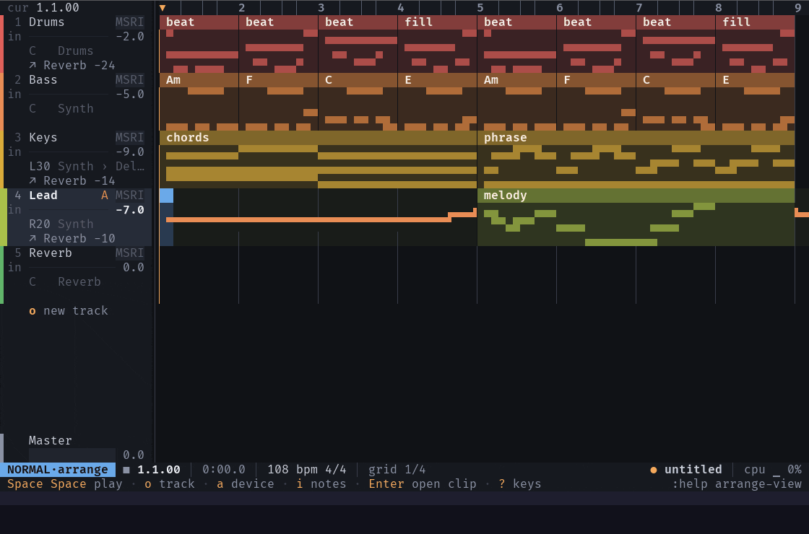

# pattern

A line of text that becomes the notes of a MIDI clip. The text is in the
form of the mini-notation of TidalCycles. You can change it while the song
plays.

```
bd*2 [~ sn] hh(5,8) # vel 1 0.7
```

```lua
paw.ext.load("extensions/pattern")   -- or put the directory in ~/.config/paw/extensions
```



## Try it

1. Type `:ext.load pattern`.
2. In the arrange view, put the cursor on an empty part of a drum track.
3. Press `\tt`. Type `bd*2 [~ sn]` and press Enter. A clip appears, named
   `≈ bd*2 [~ sn]`.
4. Press Space. You hear two kicks and a snare in each bar.
5. Press `\tt` again. Change the text to `bd*2 [~ sn] hh*8` and press
   Enter. The clip now has hats too, and you hear them in the next bar.

## How to

### How to change a beat while the song plays

1. Put the cursor on the pattern clip.
2. Press `\tt`. The prompt shows the text of the clip.
3. Change the text and press Enter. The loop plays the new notes on its
   next pass.

If the text has a mistake, nothing changes. The prompt opens again with
the text and the error.

### How to roll the random choices again

Press `\tr` for the next seed, or `\tR` for the previous seed. A count
moves that many seeds.

### How to make a clip longer or shorter

Change the length of the clip. A longer clip plays more cycles. To make
a new clip of 8 cycles, type `8` before `:pattern.set`.

### How to edit the notes by hand

1. Press `\td`. The clip no longer follows its text. Its notes stay.
2. Edit the notes in the piano roll.

An edit of the notes by other means also detaches the clip, with a
warning.

## Reference

### Keys and commands

In the arrange view, on the clip under the cursor:

| Keys | Command | Effect |
| --- | --- | --- |
| `<localleader>tt` | `pattern.edit` | edits the pattern of the clip on the command line, from its text. With no clip under the cursor, makes a new clip there |
| `<localleader>tn` | | makes a new pattern clip after the clip under the cursor, or at the cursor |
| `<localleader>tr`, `<localleader>tR` | `pattern.seed` | the next or the previous seed: the random choices again. A count moves that many |
| `<localleader>tc` | `pattern.cycle` | asks for the number of beats in a cycle (`bar` for one bar) |
| `<localleader>ti` | `pattern.info` | shows the text, the seed and the length of a cycle |
| `<localleader>td` | `pattern.detach` | the clip no longer follows its pattern. Its notes stay |

| Command | Effect |
| --- | --- |
| `:pattern.set <text>` | gives the clip under the cursor this pattern, or makes a new clip at the cursor with it. The rest of the line is the text, with its spaces: `:pattern.set bd*2 [~ sn]`. A new clip is `pattern_cycles` cycles long (4), or the count |
| `:pattern.edit` | as `<localleader>tt` |
| `:pattern.seed [n]` | sets the seed. With no number, the next seed. `by=-1` the previous seed |
| `:pattern.cycle <beats>` | the beats in a cycle, or `bar` (the default: a cycle is one bar, with any time signature) |
| `:pattern.info`, `:pattern.detach` | as the keys |

| Option | Default | Effect |
| --- | --- | --- |
| `pattern_names` | true | names a clip after its text, as `≈ bd*2 [~ sn]`. So the text shows on the clip in the arrange view, and `/` finds it. A clip that you renamed keeps your name |
| `pattern_cycles` | 4 | the length in cycles of a clip that `pattern.set` makes |

### Errors

When the text has a mistake, nothing changes, and the message gives the
place: `pattern: col 4: missing ] for the bracket at col 4`. Columns count
from 1: `col 4: unknown name zz: not a note, a number or a drum`.
`pattern.caret(err)` gives the text with a `^` under the place.

### How a clip follows its text

- paw calculates the notes again when the text, the length of the clip,
  the seed, the length of a cycle or the time signature changes.
- A clip that you move, mute or split continues to follow its text. The
  left part of a split keeps the pattern, cut at the split.
- **An edit of the notes by other means detaches the clip**: the piano
  roll, insert mode, transpose, snap, join, a script that calls
  `set_notes`. paw keeps the edit and shows a warning. The text goes to
  `meta.pattern_detached`, so `<localleader>tt` offers it again. If you submit
  it, it replaces the edits. Undo removes the edit and the detach together.
- Undo and redo restore the text and the notes together. A saved project
  keeps both.
- While the transport plays, a change goes to the audio engine at the end
  of the key press that made it. A song in a loop plays the new notes on
  the next pass, and does not stop.
- Cycles count from the start of the clip. Alternation starts again at
  each pattern clip.
- Copies made by yank and paste, `&` and `clip.duplicate`, and the right
  part of a split, have the notes but not the pattern. The snapshots of
  clips in the runtime do not keep the `meta` of the clip.

### The language

A pattern is one cycle. A cycle is one bar, unless the clip gives another
length. Steps with spaces between them share the cycle equally. Each
example below gives the events of the first cycle as `start–end` in
cycles.

#### Steps

| Syntax | Example | Events |
| --- | --- | --- |
| sequence | `bd sn hh hh` | `bd 0–¼`, `sn ¼–½`, `hh ½–¾`, `hh ¾–1` |
| `~` rest | `bd ~ sn ~` | `bd 0–¼`, `sn ½–¾` |
| `[ ]` subdivision | `[bd bd] sn` | `bd 0–¼`, `bd ¼–½`, `sn ½–1` |
| `.` group | `a b . c d e` | the same as `[a b] [c d e]` |
| `*n` faster | `hh*4` | four `hh`, a quarter each. `[hh sn]*2` plays the pair two times in its step |
| `/n` slower | `[a b c]/2` | `a 0–⅔`, `b ⅔–1⅓` (starts in cycle 0), `c 1⅓–2`: across two cycles |
| `!n` replicate | `bd!3 sn` | `bd bd bd sn`, four equal steps |
| `!` alone | `bd ! sn` | repeats the step before: `bd bd sn` |
| `@n` elongate | `a@3 b` | `a 0–¾`, `b ¾–1` |
| `_` | `a _ _ b` | the same as `a@3 b` |
| `..` range | `0 .. 3` | `0 1 2 3` (whole numbers) |

- `*` and `/` take a number (`hh*1.5`) or a pattern of numbers: `hh*<2 3>`
  plays two hats in one cycle and three in the next.
- A step repeats at most 256 times. A clip takes at most 20000 notes from
  a pattern. paw refuses a longer result with an error.

#### Cycles

| Syntax | Example | Events |
| --- | --- | --- |
| `< >` alternation | `<c e g>` | `c` in cycle 0, `e` in 1, `g` in 2, `c` in 3… |
| | `<c e> g` | `c g`, then `e g` |
| | `<a <b c>>` | `a b a c` |
| | `<a!2 b>`, `<a@3 b>` | `a a b`. `a` for three cycles, then `b` |
| `{ }` polymeter | `{a b c}%4` | four steps in a cycle, through three: `a b c a`, `b c a b`, … |
| | `{a b c, d e}` | each layer at the steps of the first layer (3): `a+d b+e c+d`, `a+e b+d c+e` |
| `< , >` | `<a b, c d e>` | each layer one step in a cycle: `a+c`, `b+d`, `a+e`, `b+c`… |

#### Together

| Syntax | Example | Events |
| --- | --- | --- |
| `,` stack | `[bd, hh*2]` | `bd 0–1` with `hh 0–½` and `hh ½–1` |
| | `bd*2, ~ sn` | also at the top level |
| `(k,n)` Euclidean | `bd(3,8)` | three hits across eight steps: 0, ⅜, ¾ |
| `(k,n,r)` | `bd(3,8,2)` | the same, rotated left two steps: ⅛, ½, ¾ |
| | `bd(-3,8)` | the five steps that `bd(3,8)` does not use |
| | `[bd sn](2,4)`, `bd(<3 5>,8)` | a group on each hit. Hits that alternate |

The rhythms are the rhythms of Bjorklund, as in TidalCycles: `(5,8)` is
`x.xx.xx.`.

#### Chance

| Syntax | Example | Effect |
| --- | --- | --- |
| `\|` choice | `a \| b \| c` | one of them in each cycle |
| | `[bd \| sn sn] hh` | a choice between sequences, in a step |
| `?` drop | `hh*8?` | drops each hat with probability ½ |
| `?p` | `hh*8?0.2` | drops with probability 0.2 |

- The choices come from the **seed** of the clip (`pattern.seed`, 0 at the
  start). The same text and seed always give the same notes. A saved
  project gives them back.
- Each `|` and `?` in the text decides separately.
- `|` binds more tightly than `,`: `[a | b, c]` is `[[a | b], c]`.

#### Words

| Kind | Examples | Pitch |
| --- | --- | --- |
| Note name | `c4` `eb3` `f#` `Bb2` `cs` `ef5` | `#` or `s` sharp, `b` or `f` flat. Without an octave, the octave is 4. `c4` is 60 |
| MIDI number | `36` `60` | the number. Whole numbers only |
| Scale degree | `1 3 5 # key a3 # scale minor` | numbers, after `key` or `scale`: 1 is the root, 8 the octave above in a scale of seven notes, 0 the step below the root |
| Chord | `c'maj` `e3'min7` `60'm` `1'maj` | the root and the notes of the chord |
| Drum | `bd sn cp hh oh` | General MIDI, see below |

Chords take the names of TidalCycles: `major maj M minor min m aug dim dom7
7 maj7 m7 dim7 six 6 m6 sus2 sus4 7sus4 add9 nine 9 m9 maj9 eleven 11
thirteen 13 five 5 one 1 …`. After another `'`, modifiers apply in order:

| Modifier | Effect |
| --- | --- |
| a number | that many notes, up by octaves: `c'maj'5` is c e g c e |
| `i`, `ii`, `iii` | one, two, three inversions: `c'maj'ii` is g c e |
| `o` | opens the chord: the first and third notes go down an octave |
| `d1`, `d2` | drops the highest note, the second highest note, an octave |

Drums, as `require("pattern").drums`:

| Word | Note | | Word | Note |
| --- | --- | --- | --- | --- |
| `bd` `kick` | 36 | | `hh` `ch` | 42 closed hi-hat |
| `rim` `rs` | 37 | | `ph` `hp` | 44 pedal hi-hat |
| `sn` `sd` `snare` | 38 | | `oh` | 46 open hi-hat |
| `cp` `clap` | 39 | | `lt` `ft` `mt` `lmt` `ht` `hit` | 41 43 45 47 48 50 toms |
| `sn2` | 40 electric snare | | `cr` `crash` `cr2`, `rd` `ride` `rd2`, `rb` | 49 57, 51 59, 53 |
| `cow` | 56 | | `tb` `tamb`, `sp`, `cy`, `vs`, `sh`, `cl` | 54, 55, 52, 58, 70, 75 |

- The built-in `drums` device plays 36, 38, 39, 40, 42, 44 and 46.
- A word in the drum table has priority over a note name. So the cowbell
  is `cow`, not `cb` (C flat).
- Other words are errors.

#### Parameters

After the notes, `# name values` sets a parameter for each event. The
values are a pattern of their own. Each event takes the value that plays
when the event starts (the `#` of Tidal). A `#` is a parameter only at the
start of a word. `f#` is a note.

```
bd*4 # vel 1 0.6 0.8 0.6        velocities 127 76 102 76
c e g c5 # legato 0.5           notes half as long as their steps
1 3 5 <8 7> # key d3 # scale dorian # vel <0.8 1>
c'maj e'min # oct -1 # add <0 5>
```

| Parameter | Values | Effect |
| --- | --- | --- |
| `vel` | 0 to 1, or above 1 | velocity. A value from 0 to 1 is a share of 127 (rounded). Above 1 is a MIDI velocity (at most 127). 0 drops the note. Without it, notes have `paw.opt.velocity` (100) |
| `legato` | number | the note length as a share of the length of the event (1 by default). The end of the clip cuts notes. 0 drops the note |
| `add` | whole number | semitones up (or down). For degrees, steps along the scale |
| `oct` | whole number | octaves up or down |
| `key` | note name or number | the root. Numbers become scale degrees |
| `scale` | name | the scale for degrees: `major minor dorian pentatonic minor_pentatonic blues chromatic ionian aeolian phrygian lydian mixolydian locrian harmonic_minor melodic_minor whole_tone`. A scale without a key has its root on C4 |
| `ch` | number | kept in `meta.channel` of each note, for a device or an extension that reads it. The built-in devices do not read it |

- `add` and `oct` do not move drums.
- A rest in the pattern of a parameter keeps the default.
- paw drops notes outside 0 to 127, and the second of two notes with the same
  pitch that start together.

### The module

```lua
local pattern = require("pattern")

pattern.events("bd [sn sn]", 1)       -- { { start = 0, stop = 0.5, text = "bd", pitches = { 36 }, params = {} }, ... }
pattern.notes("bd sn", 2, { beats = 4, seed = 0 })   -- clip notes for two cycles of four beats
pattern.parse("bd [sn")               -- nil, err: err.pos == 4, tostring(err) == "col 4: ..."
pattern.compile(text, seed)           -- a compiled pattern (or nil, err), for events/notes

pattern.set(clip, "bd*2 sn", { seed = 1, beats = 8 })  -- the clip follows the text. nil, err on an error
pattern.get(clip)                     -- { text, seed, beats, ... } or nil
pattern.detach(clip)                  -- keeps the notes, removes the link
pattern.refresh(clip)                 -- calculates again (paw does it after each change)
pattern.refresh_all()                 -- every pattern clip, for example after a change to the tables below
pattern.clips()                       -- the ids of the clips that follow a pattern

pattern.drums.kick2 = 35              -- tables that you can change
pattern.chords.mu = { 0, 2, 4, 7 }
pattern.scales.hijaz = { 0, 1, 4, 5, 7, 8, 10 }
```

- `opts.beats` is the beats in a cycle (`false` for one bar).
  `opts.length` in `pattern.notes` gives the length in beats, in place of
  the count of cycles.
- The pattern of a clip is `clip.meta.pattern`: `text`, `seed`, `beats`
  (nil for a bar), and `digest` and `name`. The extension uses `digest`
  and `name` to find edits by hand and its own names.
- A script can write `clip.meta = { pattern = { text = "bd*4" } }`. The clip
  follows the text at the end of the turn.
- `pattern.core` has `pure`, `stack`, `timecat`, `fast`, `early`,
  `compress`, `euclid`, `degrade`, `choose` and `bjorklund`, to make
  patterns in Lua.

### What of the notation of Tidal is not here

- Functions and operators outside the mini-notation: `every`, `jux`,
  `off`, `sometimes`, `+` and `|+|` between patterns, `~>` and `<~`,
  continuous patterns such as `sine` and `rand`. Only `#` combines
  parameters.
- Sample indices with `:` (`bd:3`), and sample names: words are notes,
  drums or chords.
- Amounts of `@`, `!` and `?` as patterns. The random values of `?` and `|`
  are not the values of Tidal. They are the same for each seed.
- Tidal counts degrees from 0 and calls middle C `c5`. Here, degrees count
  from 1, as `paw.music.degree` does, and middle C is `c4`.
- Variables (`^name`) and the `-` rest.
- Cycles count from the start of each clip, not from the start of the
  song.

## About

The text of a pattern is in the `meta` of the clip. The notes of the clip
are its result over the length of the clip. Playback, renders, the
piano roll and saved projects see ordinary notes, and know nothing about
patterns. So a project with pattern clips plays without the extension.
See [About MIDI as the truth](../../docs/explanation/about-midi-as-the-truth.md).

Inside, a pattern is a function of time, as in Tidal. Events have a whole
and a part, and only the starts of events become notes.
