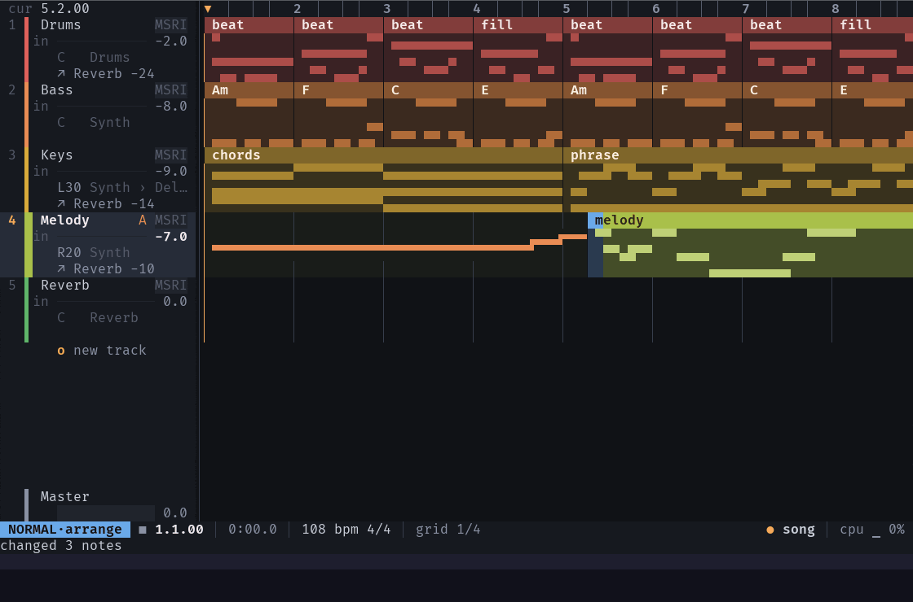

# projdiff

The projdiff extension shows the changes between two versions of a project, and it merges two
versions that changed separately. A project is a folder of files, and
projdiff reads the whole folder as paw opens it. It compares what the project holds (tracks, devices, clips, notes, automation,
the tempo map and markers) and not lines of text.

```lua
paw.ext.load("extensions/projdiff")   -- or put the directory in ~/.config/paw/extensions
```

In the picture, `:Pdiff` lists the changes, `]c` and `za` go through them,
and `Enter` goes to one:



## Try it

1. Type `:ext.load projdiff`. Open a saved project.
2. Rename a track, and change the velocity of a note.
3. Type `:Pdiff`, and a window opens over the project with two changes, by
   track, clip and note:

   ```
   saved → now: 2 changes
   ▾ ~ track 1 "Lead" -> "Lead 2"
       ~ name: "Lead" -> "Lead 2"
   ...
   ```

4. Press `]c`, and the cursor goes to the next change.
5. Press Enter, and the window closes with the cursor on the changed note.

## How to

### How to see what changed since the last save

Type `:Pdiff`, or press `<Space>gd`.

### How to compare with an older version

- With a git revision: `:Pdiff HEAD~2`. projdiff reads the project folder
  as git keeps it at that revision, and the files in the folder don't change.
- With a state of the undo tree: `:Pdiff #7`.
- With another project folder: `:Pdiff ../other`.
- To compare two versions that are not the project now: `:Pdiff a b`.

### How to keep a version to compare with later

1. Type `:Psnapshot name`, or press `<Space>gs` and type the name.
2. Later, type `:Pdiff snap:name`.

### How to go through the changes as a list

Type `:Pdiff.qf`, or press `Q` in the window of `:Pdiff`, and then use
`:copen` and `]q`.

### How to settle the conflicts of a git merge

git merges a project folder file by file. When both branches changed the
same file, for example the same clip or the same track, git stops with
conflicts in those files.

1. Open the project, and type `:Pmerge`, or press `<Space>gm`. If paw can't
   open the project because git marked conflicts in its files, type
   `:Pmerge song` with the name of the project folder, and paw opens the
   merged project.
2. For each conflict, press `co` for ours, `ct` for theirs, or `cb` for the
   value before both.
3. When no conflict is left, save the project with `:w`.
4. In a shell, type `git add song` with the name of the folder, and then
   `git commit`.

## Reference

### Commands and keys

| Command | Keys | What it compares or does |
| --- | --- | --- |
| `:Pdiff` | `<leader>gd` | the saved project folder with the project now |
| `:Pdiff HEAD~2` | | the project folder at that revision of git with the project now |
| `:Pdiff #7` | | undo state 7 (the numbers of the undo tree) with the project now |
| `:Pdiff snap:name` | | a snapshot with the project now |
| `:Pdiff other` | | another project folder with the project now, or a project in one JSON file (`other.json`) |
| `:Pdiff a b` | | the first with the second (any of the above, and `now` is the project now) |
| `:Pdiff.qf …` | | the same, as a quickfix list, one entry for each change |
| `:Psnapshot name` | `<leader>gs` | keeps the project as it is, to compare later |
| `:Pmerge [folder]` | `<leader>gm` | merges the project folder that a git merge stopped on, and shows the conflicts |

A snapshot is a checkpoint (see the undotree extension). When the project
is saved, paw writes the snapshot in the project folder, in
`project.checkpoints/`, and keeps it. Otherwise it keeps the snapshot for the
session only.

To read a git revision, projdiff asks git for the files that paw writes in
the project folder at that revision (`project.toml`, `tracks/`, `nests/` and
the others), and paw puts the project together from them. The media files
come from the folder on the disk.

### The window of `:Pdiff`

| Keys | Effect |
| --- | --- |
| `j` `k` | move, and `Ctrl-d` `Ctrl-u` move by ten, and `gg` `G` go to the ends |
| `za` `zo` `zc` | open and close a fold, and so do `Tab` and a click on its arrow |
| `zR` `zM` | open and close all folds |
| `]c` `[c` | the next and the previous change |
| `Enter` | closes the window and puts the cursor on the change (the track, the clip, the note, the parameter, the lane, the marker or the tempo map), inside its subproject when the change is in one |
| `Q`, `gq` | sends every change to the quickfix list |
| `q` | closes |

A short diff opens with no folds closed, and a long diff closes the folds
below the tracks and clips.

### What a diff names

- tracks added, removed, renamed and moved, and the fader, pan, routing,
  sends and clips off the timeline (the slots of the clip launcher) of a track
- devices added and removed, their parameters, bypass, offline state,
  side-chain, and the saved state of a plugin
- clips added, removed, moved, resized and renamed, and their fades,
  stretch and audio file
- the notes of a clip as a count (`notes +2 -1 ~3`), with a line for each
  (30 lines, then "more")
- controllers, automation lanes and their points
- the tempo and the time signature, and their changes
- markers and regions
- subprojects added, removed and renamed, their length, tempo, meter and
  `meta`, and the changes to their tracks
- the rest of the `meta` of the project

A change inside a subproject shows under the name of the subproject, with
its tracks, clips and notes below that name, as the changes of the song do. A
subproject that another subproject places shows under the name of that
subproject, so a change two levels down shows under both names:

```
~ subproject 12 "Bridge"
  ~ subproject 14 "Verse"
    ~ track 17 "Strings"
      ~ clip 19 "pad"
        ~ notes +1
```

A subproject that the song places shows at the top level, also when another
subproject places it too. The master track of a subproject shows as `master`
under its name.

`Enter` on a change inside a subproject puts the window in that subproject,
as a choice of `:nest.list` does, and then puts the cursor on the change. For
a change two levels down, the window goes into the inner subproject. `zw`
goes up one level, and `zW` goes back to the song.

A field that the model gets later shows as a `field: old -> new` line, and the
extension does not need to know about the field.

### Merges

A merge keeps the changes of both sides when they are to different
things, for example different tracks, different clips, different notes of
one clip, different parameters of one device, or tempo changes at different
beats.

- When both sides added items with the same id (a track, a clip, a note, a
  marker), the merge keeps both and gives the second item a new number. Whatever
  points at that item (outputs, sends, side-chains, automation) changes with it.
- A conflict is the same value changed in two ways, or changed on one side
  and removed on the other. The merged project holds ours there, and it loads
  and plays.
- `meta.merge_conflicts` lists each conflict: its place, the value before,
  ours and theirs. A project saved with conflicts in it keeps them, and paw
  tells you when you open the project.

`:Pmerge` reads the three versions of the project folder from the index of
git: the version before both branches, ours and theirs. A file that git
merged on its own is the same in the three versions. paw puts each version
together from its files, and merges the three. When the project folder is
the open project, the merged project takes its place, and `u` takes the
merge back. When it isn't, paw opens the folder with the merged project in
it, and the project shows as changed until you save it. `:Pmerge` with no
folder, in a project that holds conflicts, shows them again.

The window of `:Pmerge` lists the conflicts of the song first. A conflict
inside a subproject shows under the name of the subproject, as in the
window of `:Pdiff`, also two levels down:

```
song: 2 conflicts
subproject 2 "Bridge"
  track 6 "Keys" › volume
  subproject 4 "Verse"
    track 8 "Strings" › volume
```

| Keys | Effect |
| --- | --- |
| `j` `k` | move between conflicts |
| `co` | take ours |
| `ct` | take theirs |
| `cb` | take the value before both |
| `cO` `cT` | take ours or theirs for all |
| `q` | close |

Each choice changes the open project, inside the subproject when the
conflict is there, and each choice is one undo step. `:w` writes the
project folder over the files that git marked.

### Values

- "The project now" includes every edit, including the edits that a script made
  without an undo step, and `:Pdiff` closes the open undo step first.
- A project folder names media files relative to itself (`media/a.wav`), and projdiff
  compares the full paths that the open project holds, so a project that
  opens again shows no change.
- Numbers show with four decimals.
- paw writes the same files each time it saves a project that has no change (see [Project files](../../docs/reference/project-files.md)), so a project saved again gives an empty
  diff, and one change gives a small diff.
- The name of the project comes from the name of the folder the first time
  you save it, so a copy saved under another name has one different line.
- The views are cells, and the graphical window draws them as the terminal
  does (see "Views in the graphical window" in
  [Extensions](../../docs/reference/extensions.md#views-in-the-graphical-window)).

### Lua

```lua
local pd = require("projdiff")
local from, to = pd.folder("a"), pd.folder("b")      -- project folders, as paw reads them
local old = pd.file("a.json", true)                    -- a project in one file, with full media paths
local tree = pd.diff.diff(from.project, to.project)   -- { children, count }
pd.diff.lines(tree)                                    -- the text of the view
pd.diff.entries(tree)                                  -- { address, text } for paw.qf
local sides = pd.git_merge("song")                      -- { base, ours, theirs } of a git merge
local merged, conflicts = pd.merge.files(sides.base, sides.ours, sides.theirs)
pd.merge.resolve(merged, conflicts[1], "theirs")
paw.api.project_file_text(merged)                      -- the text of the file, as paw writes it
```

- `paw.api.undo_project(id)` (in the core) gives a state of the undo tree
  as the project file holds it.
- `paw.api.project_read(path, files)` (in the core) reads a project folder
  in the same form, without opening it. `files` gives the files of the
  folder from memory, for example from git.
- `paw.api.project_replace(project)` (in the core) puts a whole project in
  the same form in place of the open one, as one undo step.
- `pd.version("#7")` and `pd.version("snap:x")` change the words of
  `:Pdiff` into a version.

## About

A project is a folder of small files, so git shows and merges a change to
one track or one clip on its own. paw writes a `.gitattributes` file that
lets `git diff` show a clip file as notes (see
[Project files](../../docs/reference/project-files.md)). git still can't
tell what two changes to one file mean. projdiff reads the whole folder, as
paw opens it, and compares and merges projects by what they hold.
