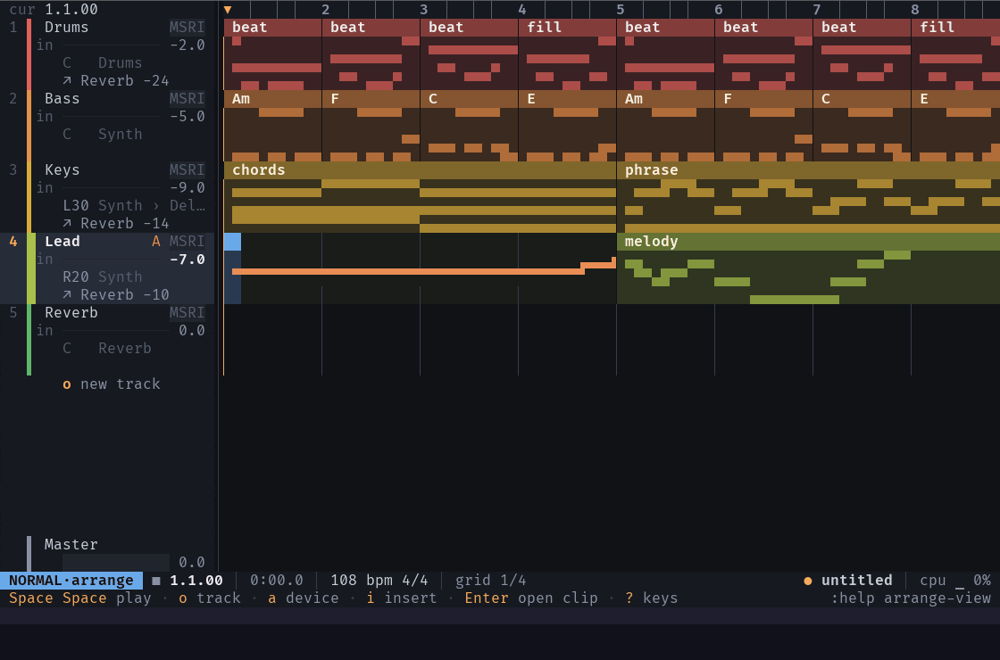

# sampler

The sampler extension is the sample player of paw, and it plays SFZ and Decent Sampler instruments.
Each note can choose its articulation by its MIDI 2.0 attribute, so a
chord can mix sustain and staccato on one channel. The player is a CLAP plugin
(`dev.paw.sampler`) that the extension builds from its own source, in
Rust, and it works in any CLAP host too. It does not contain sfizz or another
player.

```
extensions/sampler/
  init.lua, lua/sampler/   the kind of track, the instrument picker, describe
  native/                  the source of the plugin (its own Cargo workspace)
  nix/                     how the plugin and the extension are packaged
```



## Try it

1. Build the plugin (see [How to build the plugin](#how-to-build-the-plugin)).
   Put an `.sfz` instrument in `~/.local/share/paw/instruments`.
2. Type `:ext.load sampler`, then `:sampler.track`. The instrument picker
   opens.
3. Move the selection to an instrument and wait a moment, and a short phrase
   plays through the instrument.
4. Press Enter, and the new track keeps the instrument.
5. Type `:sampler.info`, and paw shows the range of the instrument and its
   articulations.

## How to

### How to build the plugin

- With Nix, build the plugin and its command alone:

  ```
  nix build .#paw-sampler        # lib/clap/paw-sampler.clap, bin/paw-sampler
  ```

- To get paw with the extension, use `paw.withExtensions (exts: [ exts.sampler ])`,
  or `programs.paw.extensions = [ "sampler" ]` in home-manager.
- From the source tree, in the dev shell, run
  `extensions/sampler/native/build.sh`, which builds into `target/sampler` and
  puts `clap/paw-sampler.clap` and `bin/paw-sampler` beside this file.

The extension adds the folder of the plugin to the plugin scan
(`paw.plugins.add_dir`). The `sampler_plugin_dir` option names another
folder. If your build of paw does not have `add_dir`, put the folder in
`CLAP_PATH`, or link the plugin into `~/.clap`.

### How to add a sampler track

Type `:sampler.track` with a file, or with words to filter the picker. The
graphical window, `:track.add sampler` and `:track.new` do the same.

### How to change the instrument of a track

Put the cursor on the sampler track, and type `:sampler.load`. In the
graphical window, choose "Sampler instrument…" in the menu of the track.

### How to add a folder of instruments

Add the folder to `paw.opt.sampler_libraries`, and separate folders with `:`.

### How to see an instrument from a shell

Run `paw-sampler describe file.sfz`, which prints the description as JSON.

## Reference

### Commands

| Command | Effect |
| --- | --- |
| `:sampler.track [file or words]` | adds a sampler track. With a file, it loads that file, and with words or with nothing it opens the instrument picker |
| `:sampler.load [file or words]` | chooses the instrument of the sampler track at the cursor |
| `:sampler.info` | tells you what the instrument is, including its range, its articulations with their codes and keyswitches, and what in the file does not play |

- The picker lists every `.sfz` and `.dspreset` under the folders in
  `paw.opt.sampler_libraries` and under `~/.local/share/paw/instruments`.
  When the selection stays on one, paw loads it for a trial, and a short
  phrase in its range plays through the track. Enter keeps the instrument (one undo
  step), and Escape restores the instrument that was there.
- `K` and the track header show `Sampler track · Violins · SFZ · 3
  articulations`.
- A load is an edit, as the load of a preset is, and undo removes it. The
  project keeps the state of the plugin, which names the file and the
  parameters.
- When the file is not found, the project keeps its path, and
  `:sampler.info` tells you.

The plugin has these parameters:

- gain, polyphony (1 to 256 voices), tune and transpose
- attack and release scale, velocity sensitivity, and release trigger level
- filter cutoff offset and the interpolation (linear, Hermite, sinc).

### Articulations

The articulations of an instrument come from its keyswitches:

- the `sw_last` keys of SFZ (named by `sw_label`, `label_keyN` or the label
  of the group)
- the `<midi><note>` bindings of Decent Sampler that enable or disable
  groups or tags (named after the groups that they enable)
- the options of a menu of Decent Sampler that does the same

Each articulation gets a code of the MIDI 2.0 orchestral articulation profile (M2-123)
from its name, so `Staccato` is 11.0, `Pizz` is 11.A, and `Legato` is 10.2. If the name
tells nothing, the articulation gets a custom code (classifications 1A to 1F, in order).

- A note whose MIDI 2.0 attribute is an articulation (types 0x10 to 0x1F)
  plays that articulation, for that note only. If the instrument does not
  have it, the player uses another articulation, as the profile says, which is
  another variation, then subclass 0, then 10.0.
- The reset-round-robin bit of the attribute starts the round robins
  again.
- A note with no attribute plays what the keyswitches chose, and a keyswitch
  note at the same time, before the note, counts. The keyswitch stays, as in SFZ.
- The plugin gives names to its keyswitch keys through CLAP `note-name`.

### `describe`

`paw.api.device_call(device, "describe")` returns JSON:

| Field | Value |
| --- | --- |
| `name`, `format`, `path` | the instrument |
| `range` | `[lo, hi]`, without keyswitches |
| `keyswitches` | `{ pitch, name }` |
| `articulations` | `{ name, m2, keyswitch?, default?, custom?, delay_ms }` |
| `delay_ms` | the delay of the attack for the instrument |
| `ccs`, `keys` | labels |
| `regions`, `samples`, `memory` (bytes), `load_ms` | the size and the load time |
| `round_robin`, `release_triggers` | what the instrument uses |
| `warnings`, `error` | what the player does not play, and errors |
| `params` | the parameters |

`delay_ms` is how late the attack comes in the samples. The player measures it once for each sample, at the load, from the start of
the region (after its `offset`) to the first frame at a tenth
(-20 dB) of the peak of the sample. For an articulation, the value is the median
over the attack regions that it plays, and for the instrument it is the
median over all of them (null when there are none).

The articulations
extension writes the value into the `.art.toml` of the instrument as `delay`, so
that paw can play such notes earlier.

### What it reads

**SFZ.** Headers `<control> <global> <master> <group> <region> <curve>`,
with opcodes inherited down the chain. `#define`, `#include`, comments.

| Kind | Opcodes |
| --- | --- |
| Mapping | `sample` (files and `*sine *saw *square *triangle *noise *silence`), `default_path`, `key lokey hikey lovel hivel lochan hichan`, `note_offset octave_offset`, `loccN hiccN`, `lorand hirand`, `seq_length seq_position` |
| Keyswitches | `sw_lokey sw_hikey sw_last sw_lolast sw_hilast sw_default sw_label sw_down sw_up sw_previous` (not `sw_vel`) |
| Triggers | `trigger` (`attack`, `release`, `release_key`, `first`, `legato`), `rt_decay` |
| Pitch | `pitch_keycenter` (a key or `sample`), `pitch_keytrack tune transpose pitch_veltrack bend_up bend_down`, `pitcheg_*` |
| The sample | `offset offset_random end delay loop_mode loop_start loop_end loop_crossfade`, and the loop and key of a WAV (`smpl`) |
| Level | `volume amplitude pan width position amp_veltrack amp_velcurve_N ampeg_*` (with `vel2*`) |
| Filter | `fil_type` (lpf/hpf 1p, 2p, 4p, bpf_2p, brf_2p) `cutoff resonance fil_keytrack fil_keycenter fil_veltrack fileg_*` |
| Crossfades | `xfin_* xfout_*` by key, velocity and controller, `xf_keycurve xf_velcurve xf_cccurve` |
| Controllers | `amplitude volume gain pan pitch tune cutoff resonance` with `_onccN` (or `_ccN`) and `_curveccN`. `set_ccN set_hdccN label_ccN label_keyN` |
| Voices | `group off_by off_mode off_time polyphony note_polyphony` |

paw puts other opcodes into `warnings`, and they are never errors.

**Decent Sampler.**

- `<groups>`, `<group>` and `<sample>`, with their attributes inherited
  down: `path rootNote loNote hiNote loVel hiVel start end tuning
  groupTuning globalTuning pitchKeyTrack volume` (linear or dB) `pan
  ampVelTrack attack decay sustain release ampEnvEnabled trigger
  releaseTriggerDecay seqMode seqLength seqPosition loopStart loopEnd
  loopEnabled loopCrossfade delay loCCN hiCCN previousNotes tags
  silencedByTags silencingMode silencingDecay`
- `<tags>` (`enabled`, `polyphony`)
- keyswitches as `<midi><note>` bindings of `ENABLED` and `TAG_ENABLED`
  (and `swallowNotes`), and `<ui>` menus whose options do the same
- `<effects>`, `<modulators>` and `<buses>` go into the report, and they do not
  play.

**Sound files**: WAV (8, 16, 24 and 32-bit, float), AIFF, FLAC and Ogg
Vorbis (the last two through symphonia). Files with more than two channels
play their first two.

A format is one reader (`native/src/formats/`) that fills the one model in
`native/src/model.rs`, so to add a format you change nothing else.

### How it plays

- The player reads all samples into memory when the instrument loads, on
  up to eight threads, and it keeps 16-bit samples as 16-bit.
- Voices come from a fixed pool of the size of the polyphony parameter (at most 256),
  and 32 more for stolen voices to fade. A stolen voice is a released voice
  first (the quietest), else the oldest, and it fades in 6 ms.
- Nothing on the audio thread allocates, locks or reads a file, and a test
  counts the allocations.
- Events are accurate to the sample.
- Resampling is a windowed sinc (16 taps, Kaiser β 8, 256 phases
  interpolated), with tables for eight speeds up to four times the rate of
  the sample, so the player filters a note pitched up before it folds.
  Hermite and linear cost less.
- Round robins and random choices start the same at every reset, so
  renders repeat exactly.

### Performance

Measured with `paw-sampler bench`, the best of five runs, on a machine
busy with other builds:

- A voice of a stereo sample costs about 20 nanoseconds a frame with sinc, 10 with
  Hermite, and 6 with linear, so 64 voices at 48 kHz take 6 % of a core with sinc,
  and 256 voices take 25 %.
- A library of 1000 stereo 24-bit files (550 MB on disk, 770 MB in
  memory) loads in about 110 ms when the files are in the cache of the
  system.

Through the plugin helper of paw, each instance costs about 8 µs a block
more than in the process of the program. The cost is the same for
each block, so it adds up more with small blocks, and `--plugins-in-process` saves
it.

| Instances, each with a note | Engine load in real time (null backend, 512-frame blocks) | In process | Offline render of 20 s | In process |
| --- | --- | --- | --- | --- |
| 1 | 0.8 % | 0.5 % | 132 ms | 118 ms |
| 16 | 3.1 % | 1.3 % | 525 ms | 211 ms |
| 64 | 8.1 % (at most 13 %) | 3.5 % (at most 5 %) | 1549 ms | 506 ms |

### Events

| Event | Payload | When |
| --- | --- | --- |
| `sampler.loaded` | `{ device, path }` | an instrument file loaded into a sampler device |

### Tests

- `cargo test` in `native/` (in the dev shell):
  - the readers
  - seventeen renders of the fixture instruments, checked by pitch and
    level, which test the order of round robins, keyswitches, attributes
    for each note with the fallback, release triggers and the pedal, and
    also loops without clicks, envelopes, choke groups, velocity
    layers, a FLAC sample and polyphony
  - the plugin through its CLAP entry, with MIDI 2.0 note-ons that carry
    attributes
  - `assert_no_alloc` around all that the audio thread does, which counts each allocation and free
- `native/test.sh` builds the plugin and runs the tests of the extension in
  paw (`tests.lua`) with the plugin on the plugin path, while the suite alone
  runs the tests that need no plugin.
- `paw-sampler fixtures <dir>` writes the fixture instruments (sines of
  known pitches), so that you can try things by hand.
