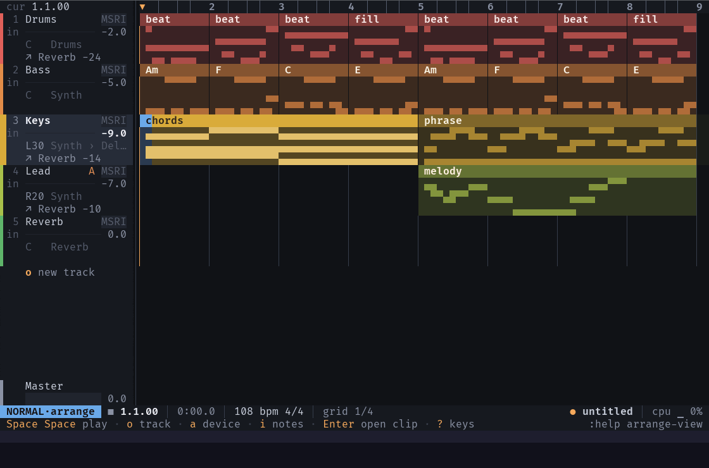

# templates

The templates extension saves a part, a group of parts or a chain of devices under a name, so that you can make it again in any project. For example, you can save a vocal part with its chain and levels, a string section with all its instruments, or a mastering chain.

```lua
paw.ext.load("/path/to/paw/extensions/templates")   -- or link it into ~/.config/paw/extensions
```



## Try it

1. Type `:ext.load templates`.
2. Put the cursor on a part with devices, and press `\Ts`. Type `Keys`
   and press Enter. The message says that the template is saved.
3. Move the cursor to another part, and press `\Tl`.
4. Type `ke` and press Enter, and a copy of the part appears below the
   cursor part.
5. Press `<Space>dd`, and the devices of the new part are the devices of the saved
   part.

## How to

### How to save a part or a group

1. Put the cursor on the part, or on the part of a group.
2. Press `\Ts`, type a name and press Enter.

If a template has the same name, paw asks first. To keep the clips of the
part as well, call `templates.save_part(part, name, { clips = true })`.

### How to save the devices of a part as a chain

1. Put the cursor on the part.
2. Press `\Tf`, type a name and press Enter.

### How to make a template again

1. Put the cursor on a part.
2. Press `\Tl`. Type a part of the name, or choose from the list.

A part or a group appears below the cursor part, and a chain goes at the end
of the devices of the cursor part.

### In the graphical window

- Choose `Part`, then "From a template…".
- In the menu of a part, choose "Save as a template…", "Save its devices
  as a chain…" or "Add devices from a template…".

## Reference

| Keys | Command | Effect |
| --- | --- | --- |
| `\Ts` | `template.save [name]` | saves the cursor part, or the group with all its parts when the cursor is on a group |
| `\Tf` | `template.fx [name]` | saves the devices of the part as a chain |
| `\Tl` | `template.load [name]` | makes a template again: a part or a group below the cursor part, a chain at the end of the devices of the cursor part. Some of the name is enough. Without a name, you choose from a list |
| | `template.delete [name]` | deletes a template |
| | `templates` | lists the templates |

<!-- tags: :templates -->

paw changes a name that a file cannot hold (`Bass/Sub`) into a name that it can
hold (`Bass_Sub`), and the message tells you.

### What a template holds

| Kind | What it holds |
| --- | --- |
| a part | its name, level, pan, color, input, devices with their parameters and plugin state, automation lanes, and what extensions keep with it (a drum map). Its clips only when asked |
| a group | the part of the group and every part in it, groups in it too, each as above. When paw makes the group again, the members play into the new group |
| a chain | the devices of a part, in order, with their parameters and plugin state |

A template does not hold the part that its part played into, or the
parts that it sent to, because both belong to the project that the template came from.

The templates are JSON files in
`~/.local/share/paw/templates/<kind>/<name>.json`, in the shape that
`Part:snapshot()` gives. `paw.opt.templates_dir` puts them in another
directory.

### Lua

```lua
local templates = require("templates")
templates.save_part(part, "Lead vocal")        -- devices with their settings, levels, automation
templates.save_fx(part, "Vocal chain")          -- the devices only
templates.save_group(group, "String section")    -- a group and every part in it
templates.load("Lead vocal")                     -- makes it again below the cursor part
```
