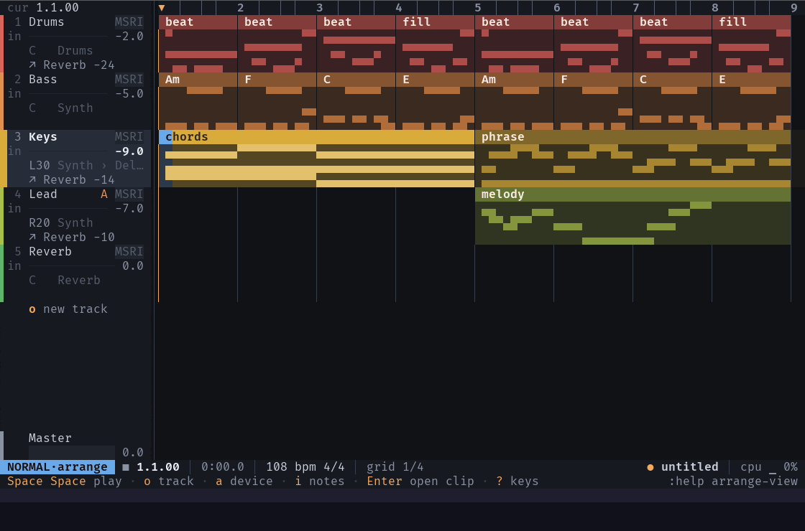

# tutor

A course for new users, inside paw, as `vimtutor` teaches Vim: seventeen
lessons of about ten minutes, each in a practice project of its own. A
panel at the bottom tells you what to do next in a sentence or two, with
the exact keys. It sees when the step is done, tells you, and continues.
Each lesson ends with something that you made or changed and can hear.

The same lessons are text in [the
course](../../docs/tutorials/course/README.md), with a page of keys to keep
beside the keyboard, [Keys, by idea](../../docs/reference/keys.md).

```lua
paw.ext.load("/path/to/paw/extensions/tutor")   -- in ~/.config/paw/init.lua
```



## Try it

1. Type `:ext.load tutor`, then `:tutor`. A page about lesson 1 opens.
2. Press any key. The page closes, and the panel at the bottom tells you
   the first step.
3. Do the step. The panel tells you that it is done, and shows the next
   step.
4. Press `<Space>hh`. The panel shows a hint for the step.
5. Press `<Space>hq`. The tutor closes, and your project opens again.

## How to

### How to continue the course

Type `:tutor`. The course continues where you stopped.

### How to choose a lesson

- Type `:tutor 5` or `:tutor visual`. A lesson that you started continues
  where you were.
- To see all lessons and your progress, press `<Space>hl`.

### How to start a lesson when your project has changes

- Save the project with `:w`, then type `:tutor 3`.
- Or type `:tutor! 3`.

**WARNING:** `:tutor!` discards the changes of your project that are not
saved.

### How to add a lesson

1. Write the lesson as a Lua table (see [Lessons](#lessons)).
2. Call `require("tutor").register(lesson)`. To put it after another
   lesson, call `register(lesson, { after = "visual" })`.
3. Run the suite. `tests.lua` plays every registered lesson.
4. If the lesson is in this extension, write the course again from the top
   of the repository:

   ```sh
   paw --clean --no-plugins -l extensions/tutor/make-docs.lua
   ```

   The tests fail while the files and the lessons are different.

## Reference

### Commands

| Command | Effect |
| --- | --- |
| `:tutor` | the course, where you stopped (lesson 1 the first time) |
| `:tutor 5`, `:tutor visual` | a lesson by number or name. A lesson that you started continues where you were |
| `:tutor list`, `:tutor.list`, `<Space>hl` | the lessons and your progress, to choose one |
| `<Space>hh` (`:tutor hint`, `:tutor.hint`) | a hint for the step |
| `<Space>hn` (`:tutor next`, `:tutor.next`) | skips the step. At the end of a lesson, goes to the next lesson |
| `<Space>hr` (`:tutor restart`, `:tutor.restart`) | starts the lesson again from a new practice project |
| `<Space>hq` (`:tutor quit`, `:tutor.quit`) | closes the tutor and opens your own project again |
| `:tutor reset` | forgets all progress |
| `:tutor.try sections` | loads one of the bundled extensions for this session (lesson 16) |

A lesson starts with a page about it: its subject, the idea of its keys,
and what is different for a user of Vim. Any key closes the page.

### Your project during a lesson

- A lesson opens its own practice project. So your project closes while
  you practice. `<Space>hq` opens it again, as it is on the disk.
- If your project has changes that are not saved, the lesson does not
  start. The tutor tells you. Save first (`:w`), or start with `:tutor! 3`.
- An untitled empty project is replaced.
- The tutor never writes to your project. When you leave, it restores your
  options that lessons change: `grid`, `note_grid`, `octave`, `velocity`,
  `ripple`, `clip_length`.
- If you open another project during a lesson (`:e`), the tutor waits.
  `:tutor` returns to the lesson.

### Files

The tutor keeps your progress in its own directory:
`$XDG_STATE_HOME/paw/tutor` (`~/.local/state/paw/tutor`), or the directory
of the option `tutor_dir`.

| File | Contents |
| --- | --- |
| `progress.lua` | the lesson and the step where you are, and the steps that you did |
| `practice/<lesson>/` | the practice projects, each a project folder with its recordings in `media` |

When you quit paw in a lesson (`:q`, `ZZ`, `ZQ`), the tutor saves the
practice project and your place. `:tutor` continues from there next time.
`:reload` keeps the tutor where it was.

### Lessons

[The course](../../docs/tutorials/course/README.md) lists the lessons. The
built-in lessons are in `lua/tutor/lessons/`, in order in
`lua/tutor/lessons/init.lua`. An extension can add lessons about itself.

```lua
require("tutor").register({
  id = "euclid",                          -- letters, digits, dashes: names the practice file
  title = "Euclidean rhythms",
  intro = [[What the lesson is about, shown when it starts.]],
  idea = [[The idea behind the keys.]],    -- optional
  vim = [[Where this differs from Vim.]],  -- optional
  setup = function(look)                   -- makes the practice project, with the public API
    local t = paw.add_track({ name = "Drums" })
    t:add_device("drums")
  end,
  at = function(look) paw.cursor.set_track(paw.track("Drums")) end,   -- optional: where to start
  steps = {
    {
      say = "Press `o` to add a track.",   -- one or two sentences, with every key in backticks
      keys = { "o" },                     -- exactly what the learner types, for the tests
      start = function(ctx, look) ctx.tracks = #paw.tracks() end,      -- optional
      check = function(ctx, look) return #paw.tracks() == ctx.tracks + 1 end,
      done = "A new track.",              -- said when it is done
      hint = "`o` is a small o.",         -- optional, for `,hh`
    },
  },
  outro = "What the learner did.",
})
```

**Checks.** The tutor calls `check(ctx, look)` after every event and a few
times a second. It returns true when the step is done. `ctx` is the table
of the step: `start` fills it, and the tutor records in it what occurred
after the step started. `look` reads it:

| `look.` | Returns |
| --- | --- |
| `ran(ctx, "undo")` | true when the command ran. Aliases count as their command: `:w` is `write` |
| `saw(ctx, "transport.play")` | true when the event occurred |
| `said(ctx, "text")` | true when a message with the text showed |
| `played(ctx)` | true when the transport played and stopped |
| `became(ctx, "name", condition)` | true when the condition is true after it was false: for an end state that can already be true |
| `names(track)`, `layout(track)`, `clips(track)`, `clip(track, name)`, `melody(clip)` | what a track or a clip holds, as text |
| `cursor_track()`, `focused()`, `mode()`, `float()`, `visible(view)`, `roll()`, `device(track, kind)`, `param(device, key)`, `register(name)` | where the learner is |
| `notes("C4:0:1 E4:1:1")`, `drums(rows, bars)`, `beat`, `pulse(pitch, beats)`, `chord(pitches, beats)` | helpers for `setup` |

A check must not be true before the step is done, also when the learner
skipped the step before. Use `ran`, `became` or a value saved in `start`,
not an end state that the project can already have.

**Keys.** `keys` lists what the learner types, in the notation of Vim.
Each string must also be in backticks in `say` (or `hint`). The tests check
this, so the text and the test stay the same. Other items:

| Item | Effect |
| --- | --- |
| `{ wait = 300 }` | waits, in milliseconds, so that the learner can listen |
| `{ sim = function(lesson) end, instead = { "keys" } }` | what a person does away from the computer keyboard: a test tone on the input, MIDI notes, a quit |
| `{ sim = "quit", instead = { ":q", "<CR>" } }` | quits |

**Other fields.**

- `unchecked = "why"` in place of `check`: a step that the tutor cannot
  see. The panel tells the learner to press `<Space>hn` when done.
- `on_quit = true`: the step is complete when you quit paw.
- `test = { before = fn, after = fn }` on a lesson: prepares the test run
  (an audio engine with a test input) and removes what it made (files
  written beside the program).

**Tests.** `tests.lua` plays every registered lesson from start to end. It
types the keys of each step one at a time, as the kernel gets them. It
checks:

- that the panel shows the step on the screen
- that the tutor does not see the step before its keys, or before the last
  of them, and that it sees it after
- that a skipped step does not complete the next step
- the hints, a restart, a quit, the return after a restart of the program,
  unsaved projects, and the list of lessons

A new lesson is tested when you add it. You write nothing more.

**The text.** `make-docs.lua` writes `docs/tutorials/course/` from the
lessons. A person writes `docs/reference/keys.md` by hand. The tests check that
each key in its first column is a key of paw.

### Steps that the tests cannot do

The tests type the keys of every step. Where a person does something else,
the tests act in place of the person. Two steps are not checked:

| Lesson, step | What the learner does | What the tests do |
| --- | --- | --- |
| 1, 8 | `:q` quits paw | send `:q` (`command.pre`) without a quit. The tutor saves the place on that event |
| 12, 1 to 3 | records from a microphone | the test tone of the silent engine is the input |
| 12, 5 | plays a MIDI keyboard | `paw.midi.note_on` and `note_off`, as if from a port |
| 9, 9 | adds a plugin and opens its window | **unchecked**: the plugins are different on each computer, and a window needs a desktop |
| 15, 4 | copies lines into `~/.config/paw/init.lua` and types `:reload` | **unchecked**: the tutor does not read or write your configuration |

- The tests check a step where you listen by the transport: it played and
  stopped. They do not check what you heard.
- The mixdiag step of lesson 16 checks that a measurement started, not its
  result.
- Lesson 9 teaches plugin windows through what paw reports for a built-in
  device (it has no window).

### What the course does not teach

- the graphical frontend (`paw-gui`) and the pointer
- the control socket (`paw ctl`) and the MCP server
- extensions beyond a mapping and a command (operators, text objects and
  views of your own), and the Lua API beyond `:lua` lines
- plugin parameters through automation (`:lane.add ... device=`), and pan
  automation
- the edits of audio clips (fades, crossfades, `:clip.import`)
- `:engine`, sample rates and latency, `:midi.select`
- `<C-v>` blocks in the piano roll, `o` in visual mode, `ac` `it` `ie`, `=`,
  `S` `J` on clips, `<A-j>` `<A-k>`, zoom and scroll (in the text of the
  lessons and in `keys.md`, but not practiced)
- ripple edits, and tempo and time signature beyond `:tempo`
- controller edits, autosave, stems and other export options, and more
  options of recording

### Limits of the extension interface

- **No event after a key.** No event tells that a key was handled. When a
  float closes (`paw.ui.close`) or the key hints show, there is no event. So
  the tutor also looks on a 200 ms timer. Timers do not run in `paw -l`
  scripts, so the tests call `tutor.poll()` after each key. Wanted: an
  event `key.done` that `paw._kernel.key` sends after each key, with the
  key and the mode, and `ui.float_closed`.
- **The state directory.** The tutor finds `$XDG_STATE_HOME/paw` itself.
  `paw.api.env().state_dir` now gives it, but the tutor does not use it
  yet.
- **No copy of the project.** `paw.project.save(path)` makes `path` the file
  of the project (as `:saveas` of Vim). The tutor can only save the
  practice project in place. So it keeps the state of a step only when it
  saves the practice project (when you leave, quit, or type `:w`). After a
  crash, the lesson continues at the step of the last save. Wanted:
  `paw.project.write_copy(path)` or `save(path, { copy = true })`.
- **No reset of the remembered state of a view.** The tutor sets
  `paw.ui.views.devices.row = 1` and `paw.ui.views.pianoroll:set_step(nil)`
  directly at the start of a lesson.

### Problems found while the lessons were written

paw keeps them as they are, and the lessons teach them as they are. Each
row gives the lesson and a change that would help a new user.

| Lesson | What occurs | What would help |
| --- | --- | --- |
| 12 | After `<Space><Space>` stops a take, record mode stays on (`rec` lit). The next `R` stops record mode, and the next `<Space><Space>` records again. The lesson must teach `R` then `<Space><Space>` | Stop record mode when the transport stops, or make `R` always start a take when stopped |
| 9 | The device panel keeps its row when the track changes. So `<Space>dd` can open on a row of the list of another device | Start at the top for a new track |
| 3, 10 | Prompts have text in them (`grn` with the old name, `A` with the current value), and new text goes at the end. The lesson must teach `<C-u>` first | The first key replaces the text, as in the lyric prompt of the vocal editor |
| 4 | The note length set with a digit in insert mode stays for the session, across clips. It is also the length that `<CR>` gives a new note in normal mode. Nothing shows it outside insert mode | Reset it when insert mode ends, or always show it in the title row of the piano roll |
| 3 | A clip made with `i` `m` has the name `midi` | No name, or the name of the track |
| 3, 4 | `a` adds a device in the arrange view, but appends notes in the piano roll. A user of Vim expects "append" in both | Say so in `?`, or move "add device" to another key |
| 5, 7 | Mute has four keys with two meanings: `M` the track, `~` the clip, `gc` clips and `gcc` the track. `~` on a `V` selection mutes the tracks, but on a `v` selection the clips | One rule: `gc` for clips, `M` for tracks, everywhere |
| 6 | `dw` from a gap deletes nothing (a note belongs to its start). So `.` after a move into a gap does nothing, with no message | A message when the region of an operator is empty |
| 2 | Many terminals and tmux cannot tell `<S-CR>` (play from the playhead) from Enter | A second key, such as `g<Space>` |
| 13 | `:w name` is the `:saveas` of Vim: the project moves to the new file. A user of Vim expects a copy. No command writes a copy | `:w name` for a copy, as in Vim |
| 13 | `:render name.wav` writes relative to the folder where paw started. It does not expand `~`, and the message gives only the name | Expand `~`, and give the full path |
| 14 | Key hints group `grn` and `grc` as `r +2 more` under `g`, and hide the rename keys | List the keys of the group when there are few |
| none | `command.pre` and `command.post` carry the alias typed (`q`, `w`), not the command (`quit`, `write`). An extension that listens for `quit` does not see `:q` | Add the name of the command to the event |
| none | In a script, `paw.project.save` while an undo step is open counts later edits of that step as saved (`modified` is false after a track is added) | Close the open step before the save |

## About

The order of the lessons is the order in which a person needs things.
First you can play and quit (1), then move (2), then make something to
hear (3, 4).

The grammar (5 to 8) comes when there is something to edit, because all
that follows is easier with it. It comes first on clips, where it is
easiest to see. Then it comes on notes, then with the selection first. Then
the lessons show where deleted and yanked things go.

The studio (9 to 13) obeys the order in which a song is made. First come
sounds and balance, then loops to work on a part, then recording, and a
file at the end. The
next three lessons are for work alone: how to find any key, how to change
paw, and what the extensions add. Lesson 17 edits by line, as Ex does.

Each lesson teaches the idea of a family of keys, not a list. The `?` page
and the pickers give the lists. The first page of each lesson tells where
the keys are different from Vim. So a user of Vim can go fast, and a person
who never used Vim still gets the full explanation.
