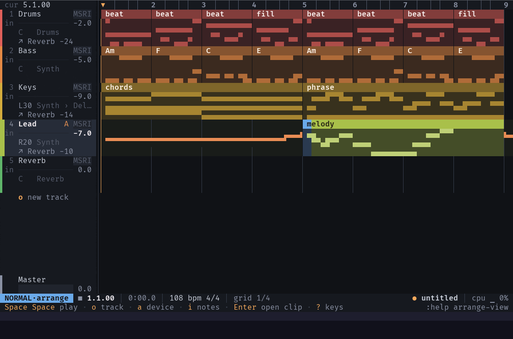

# undotree

The undo tree of Neovim, for paw. An undo followed by a change does not
lose an edit: the change starts a new branch, and the old branch stays.
You can return to any earlier state: walk the tree, step through time
across branches, or give a time (`:earlier 2m`). You can name states,
write named states beside the project as checkpoints, and restore them
after the project opens again. You can compare two states by ear while the
song plays.

```lua
paw.ext.load("extensions/undotree")   -- or put the directory in ~/.config/paw/extensions
```



## Try it

1. Type `:ext.load undotree`, and open a song.
2. Put the cursor on a clip. Type `3>ic`. The clip moves three steps later.
3. Press `u`, then type `2>ic`. The clip moves two steps later. The first
   edit is now on another branch.
4. Press `,uu`. The window of the tree shows two branches.
5. Press `j` to select the state of the first edit, and press Enter. The
   clip is three steps later again.

## How to

### How to return to an earlier state

- To return two minutes, type `:earlier 2m`. To go forward, type
  `:later 2m`.
- To step through states in the order that they were made, press `g-` or
  `g+`.
- To choose a state, press `,uu`, select the state and press Enter.

### How to compare two versions by ear

1. Press `,ua`. This state is A.
2. Continue to work, or go to another state of the tree.
3. Start playback, and press `,ub`. You hear A.
4. Press `,ub` again. You hear where you were, B.
5. To forget A and B, press `,uB`.

### How to keep a version after paw closes

1. Save the project.
2. Type `:checkpoint before the bridge`, or press `,uc` and type the name.
3. Later, to restore it, type `:checkpoints` and choose it.

The restore is a new step. So `u` returns to where you were.

### How to see what a step changed

- For the last step, type `:undo.diff`, or press `,ud`.
- From state 3 to now, type `:undo.diff 3`.

### In the graphical window

- Choose More ▸ Undo tree, or type `:view.window undotree_paint`.
- Click a state to go there. Point at a state to see the step, its time
  and the state that it came from.

## Reference

The tree is in the kernel. So `u` and `Ctrl-r` walk it when the extension
is not loaded. The extension is the interface to the rest of the tree.

### Keys

| Keys | Effect |
| --- | --- |
| `g-` `g+` | the state made before or after this state, on any branch (with a count: `5g-`) |
| `<leader>uu` | the window of the undo tree |
| `<leader>ua` | marks this state as A |
| `<leader>ub` | switches between A and where you were (B) |
| `<leader>uB` | forgets A and B |
| `<leader>uc` | writes a checkpoint. It asks for a name |
| `<leader>ul` | lists checkpoints, to restore one |
| `<leader>un` | names this state, for this session |
| `<leader>ud` | shows what the last step changed |

- `u` and `Ctrl-r` are the built-in undo and redo. Undo goes to the parent
  state. Redo goes to the child that you visited last.
- To switch between A and B with one more key, set the option
  `undotree_ab_key` before the extension loads, for example
  `paw.opt.undotree_ab_key = "<F5>"`. It is `""` by default: no key.

### The window

| Keys | Effect |
| --- | --- |
| `j` `k` | move. `Ctrl-d` `Ctrl-u` by ten, `g` `G` to the ends |
| `Enter` | goes to the selected state. The window stays open |
| `u` `Ctrl-r` | undo and redo |
| `-` `+` | step through time, as `g-` `g+` |
| `a` | marks the selected state as A |
| `b` | switches between A and B |
| `n` | names the selected state |
| `c` | writes a checkpoint of the current state |
| `d` | switches the right side between what the step of the selected state changed, and what is different from it to the current state |
| `Space` | plays and stops |
| `q`, `Esc` | closes |

A click on a row selects it. The wheel moves the selection.

The tree in the terminal shows the newest state at the top.

- `@` is the current state, `*` any other state.
- `│` takes a branch down to the state where it started, and `─┘` joins it
  there.
- Each row shows the number of the state, its time and its name in
  quotes. It shows `[A]` `[B]`, and `(saved)` for the state saved last.
- Then it shows what made the state: the description of the key or the
  command, then the keys typed (`Delete the clip  x`, `Add a track above
  O`, `Set Keys volume`). It shows `a change` for changes by scripts, and
  `opened` for the project as it opened.

In the graphical window, the tree opens in a painted window of its own.
Each state is a node, with the newest at the top, and lines for the
branches. The way back to the first state and the current state are lit.
It takes the same keys as the terminal. You type a name for `n` or `c` on
its last line. `:view.window undotree`, or "Open in a window" on
`<leader>uu`, opens the view of the terminal in cells.

### Commands

| Command | Effect |
| --- | --- |
| `:undotree` | opens or closes the window |
| `:earlier 5`, `:earlier 30s`, `:earlier 2m`, `:earlier 1h`, `:earlier 1d` | back by a count of states or by a time, across branches |
| `:later …` | the same, forward |
| `:undo.goto 12` | goes to state 12 |
| `:undo.name verse` | names the current state, for this session only |
| `:undo.diff`, `:undo.diff 3`, `:undo.diff 3 7` | what the last step changed. From state 3 to now. From 3 to 7 |
| `:checkpoint before the bridge` | names the current state and writes it beside the project |
| `:checkpoints` | lists checkpoints. When you choose one, paw restores it |
| `:checkpoint.restore 2`, `:checkpoint.restore intro` | restores by number in the list or by name |
| `:checkpoint.delete 2` | deletes a checkpoint file |
| `:ab.mark`, `:ab.mark 12` | marks the current state, or state 12, as A |
| `:ab.toggle` | switches between A and B |
| `:ab.clear` | forgets A and B |

Time travel obeys Vim. `:earlier 2m` goes to the newest state made at
least two minutes before the current state, and stops at the oldest state.
`:later` goes to the newest state made by that time after it. A count
steps through states in the order that they were made, as `g-` and `g+`
do.

### A/B

- Each switch first closes the open undo step. So B is what you heard
  last.
- A switch is an ordinary sync from one snapshot to the other, as each edit
  and undo is. So the transport does not stop or move.
- paw sends the engine only what is different between the two versions. A
  volume change is a volume change. A different list of clips replaces the
  clips of that track. A device that is only in one version is added or
  removed. A plugin added in this way starts from its saved state, and you
  can hear this.
- paw does not prune A and B while they are marked.
- When another project opens, paw forgets A and B.

### Checkpoints on disk

- `:checkpoint <name>` names the current state and writes it to a folder
  beside the project file. The project folder `song` keeps its
  checkpoints in `song/project.checkpoints/`.
- The first checkpoint makes the folder. So a project with no checkpoints
  has no folder.
- Each checkpoint is one file, `<milliseconds since 1970>-<name>.json`.
  The name is percent-encoded, with spaces as `+`. The file holds the
  project as it was, with the state of its plugins. The list reads only
  the folder.
- Two checkpoints can have the same name. paw keeps both.
- A project that you did not save has no folder. `:checkpoint` then names
  the state and keeps it in memory. The first save of the project writes
  all these checkpoints, each as its state was.
- A restore does not remove history. It is a new step below the current
  state, with the name of the checkpoint. So `u` returns to where you were.
- Checkpoints are not undo history. When the project opens again, the tree
  starts from the project as it opened. The checkpoints are what is left of
  earlier sessions.

### The limit of the tree

<!-- tags: undotree-pruning -->

- The tree keeps at most 1000 states.
- When an edit goes past that, paw drops the oldest state that is not
  protected. The protected states are the root (the project as opened or
  made), the current state, the state saved last, named states, A and B.
- The children of the dropped state go to its parent. Undo from them goes
  past it.
- States share all unchanged parts through `Arc`. So a state costs about
  what its edit changed.
- When all states are protected, paw keeps more than the limit. It does not
  drop a protected state.

### API

In `paw.api`, plain data only:

| Function | Returns or does |
| --- | --- |
| `undo_tree()` | `{ current, root, saved, limit, pending, states }`. Each state is `{ id, parent, children, redo, time, label, keys, name, keep, current, saved }`, oldest first. `time` is seconds since 1970. `pending` tells that an edit is open. `redo` is the child that redo goes to |
| `undo_current()` | the id of the current state |
| `undo_goto(id)` | goes to a state. false if there is none |
| `undo_step(n)` | `n` states later in the order that they were made (earlier when negative). The id of the new state, or nil |
| `undo_travel(seconds)` | goes to the newest state made that long after (before, when negative) the current state. The id, or nil |
| `undo_name(name, id)` | names a state, the current state by default. nil or `""` removes the name. Returns the id |
| `undo_keep(id, keep)` | protects a state from pruning, or removes the protection |
| `undo_diff(a, b)` | what is different from `a` to `b` (`b` defaults to the current state, `a` to the parent of `b`): `{ from, to, same, project, tracks, devices, clips, notes, lanes, items }`. Each kind is `{ added, removed, changed }`. `project` is a list of fields. `items` are lines such as `~ device synth on track Bass: cutoff` |
| `undo_label(text)`, `undo_keys(text)` | what makes the open step (the first label wins), and the keys typed. The runtime sets them from the description of the key or the command |
| `checkpoint_dir()` | the folder, or nil for a project with no file |
| `checkpoint_write(name, id)` | writes a state (the current state by default) and names it. Returns `{ file, name, time, state }` |
| `checkpoint_list()` | `{ file, name, time }` for each, oldest first |
| `checkpoint_restore(file)` | a path from the list, or a file name in the folder. Returns the id of the new state |
| `checkpoint_delete(file)` | deletes a checkpoint file |

- `paw.undo()` and `paw.redo()` are as before. `undo_checkpoint()` is an
  older function that closes the open undo step. It is not about
  checkpoints on disk.
- `undo_diff` compares notes in clips that are in both states. A note at
  the same start and pitch with a different value is changed. A note that
  moved is removed and added. It counts clips that were added or removed,
  not their notes.

`require("undotree")` has the Lua side: `tree()`, `rows(tree)` (the
drawing), `go(id)`, `travel(dir, amount, count)`, `mark_a(id)`,
`toggle()`, `clear_ab()`, `checkpoint(name)`, `items()`, `restore(item)`,
`choose()`.

### Limits

- paw does not save the tree. When the program closes or another project
  opens, the tree starts again. Checkpoints stay.
- Labels name the key or the command by its description (the `label`
  option of a command, else its description to the first example). Edits
  by scripts, timers or the control socket without a command have the
  label `a change`.
- A note that moves counts as removed and added. Notes in added or removed
  clips do not count.
- The comparison by ear switches the full project. It has no A/B of one
  track, and no crossfade at the switch.
- Vim has `:earlier 1f` (by file writes) and `:undolist`. paw does not. The
  window does both jobs.
